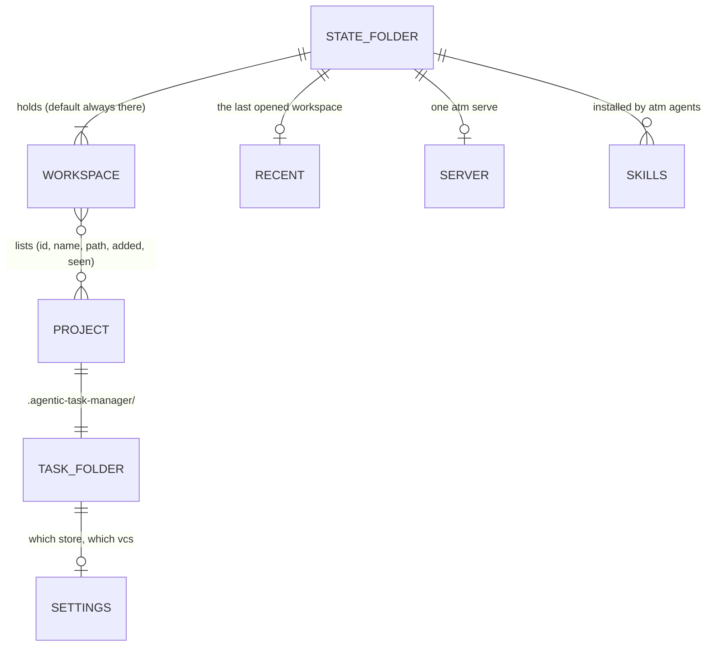
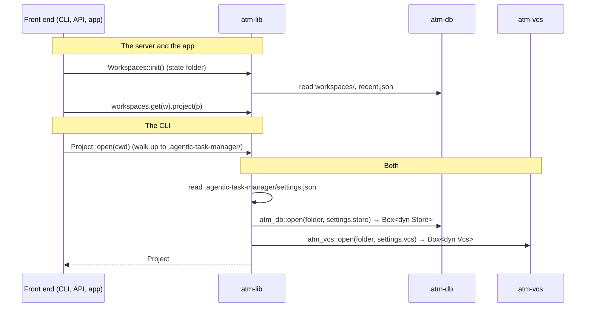
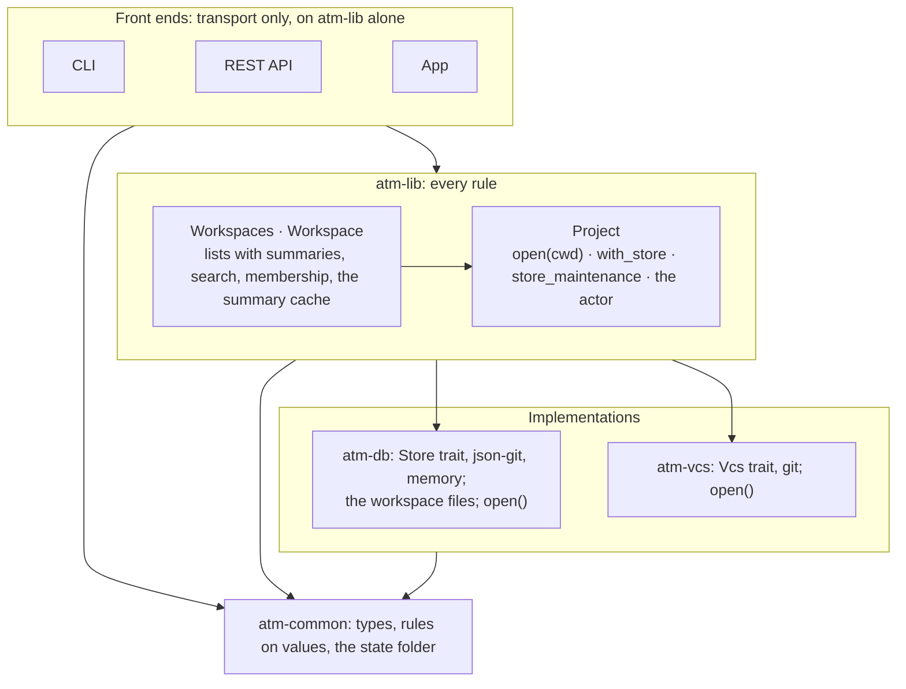
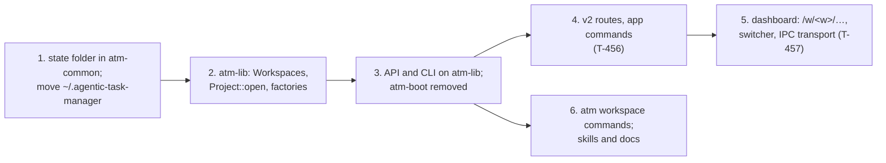

# ADR-003: Workspaces, and opening projects without boot

- **Status:** proposed, 2026-11-08
- **Decided by:** Hakan Serce (in review)
- **Context:** T-489 (blocks T-456, the app's commands); [layered-architecture.md](../layered-architecture.md) §3.2, §5.1,
  §11.2; [multi-project-api.md](../multi-project-api.md); [better-way-to-distribute-atm.md](../better-way-to-distribute-atm.md) §2

## Problem

atm has two units: a **project** (a repository with its task folder) and, implicitly, **every project one user has
seen** (the registry, `$ATM_HOME/projects.json`). What works across projects assumes that one set, and no layer owns
it:

- **atm-lib knows one project at a time.** §5.1's registry functions (`list_projects` "with their summaries", …) and
  §3.2's `Registry` interface (with `open(id)`) were never built: the registry is a concrete `FileRegistry` in atm-db,
  re-exported by boot.
- **So the multi-project logic ended up in the HTTP layer.** atm-api's `Projects` walks the registry, opens each
  project, keeps the summary cache, lists a broken project as missing instead of failing (F18), adds worktrees and
  logos, and searches across projects. That is business logic, and the app (T-456) needs all of it without HTTP.
- **boot is a bag**: opening a project and the vcs, the registry, the JSON-in-git store's own operations (merge driver,
  migrations, paths, registering by folder), identity, process helpers only the CLI uses, a test hook, and
  `hook_project`, which mixes four of these (§11.2). And it always opens JSON-in-git: nothing says which store a
  project uses.
- **One set of projects per user.** Separating work from personal projects, or giving a demo its own set, takes a
  second `ATM_HOME`, with its own server, port and copy of the skills.

## Decision

### 1. Workspaces: named lists of projects, in atm's state folder



- **A workspace is a named, ordered list of projects**, each entry what a registry entry is today (`id`, `name`,
  `path`, `added_at`, `seen_at`). There is no separate index: the workspaces are the indexes. A project can be in
  several; IDs are unique within a workspace (F18's rule, per workspace), so every address that names a project also
  names its workspace.
- **There is always a `default` workspace.** A project atm meets (`atm db init`, `atm db migrate`, `atm serve`) is
  added to it; the user moves it to another later with `atm workspace` (§3). Someone who never creates a workspace
  sees no change.
- **The state folder** holds one file per workspace (`workspaces/<id>.json`), `recent.json` (the last opened
  workspace), the server's record, log and lock, and the installed skills (`skills/`, `agents.json`). Everything in it
  is written under the folder's one lock, as the registry is today: agents add projects concurrently.

### 2. Where the state folder is: the platform's app data folder

One function in atm-common gives it, and the CLI, the server and the app all call that function. The app never asks
Tauri at run time, so the two can't disagree.

| | State folder |
|---|---|
| `ATM_STATE_DIR` set | that folder (tests, the dev server, a second set of everything) |
| macOS | `~/Library/Application Support/com.solo-swe.atm/` |
| Linux | `~/.local/share/com.solo-swe.atm/` (`$XDG_DATA_HOME`) |
| Windows | `%APPDATA%\com.solo-swe.atm\` |

These are Tauri's app data folders for the app's identifier, from the `dirs` crate (approved; already in the tree
through Tauri). The identifier names the folder, so it is fixed from here on. No symbolic links: atm refuses symlinked
task folders and files on purpose (I6, I12), Windows needs privileges to make them, and the server tells its own folder
from another's by the folder's real path.

### 3. Commands: single-project ones never take a workspace

```text
atm workspace list | create <w> | delete <w> | rename <w> <new>
atm workspace projects [<w>]                          the projects, with missing ones marked
atm workspace add-project [<w>] [<folder>] | remove-project [<w>] <project> | prune [<w>]
```

- **Everything else works on the project in the current folder**, as now, with no `--workspace`.
- **The `atm workspace` commands default to `default`**, and to the current folder for `add-project`.
- **`atm project list|add|remove|prune` go**, replaced by these. The `atm-serve` skill and `docs/agent/` change with
  them.
- **`atm serve` serves every workspace.** It opens the only one, or the last opened when there are several (§5).

### 4. Opening a project, with no boot



- **A project's settings file**, `.agentic-task-manager/settings.json`, says which store and which vcs it uses
  (`{"store": "json-git", "vcs": "git"}`). Without one, those are the defaults, so every existing project opens as
  now. It is a file of its own because the store type must be known before the store (`tasks.json`) can be read.
- **Two factories pick the implementations**: `atm_db::open` for the store and `atm_vcs::open` for the vcs. They are
  separate on purpose: atm-lib uses the vcs on its own (commits, the branch, documents).
- **atm-lib does the rest**, through two ways in: `Workspaces` → `Workspace` → `Project` for the server and the app,
  and `Project::open(cwd)` for the CLI. Finding the project from a folder (walking up, a linked worktree's main copy)
  moves behind the store factory, since only the store knows its layout.
  - **For tests:** `Project::with_store(store, vcs)` keeps the in-memory store's seam, and `ATM_STATE_DIR` isolates
    `Workspaces`.
  - **The store's own operations** (merge driver, migrations, file paths) are `project.store_maintenance()`, `None`
    for a store that has none, so the CLI never depends on atm-db.
- **The `atm-boot` crate goes**, and so does what was in it:

  | Was in boot | Goes to |
  |---|---|
  | opening a project, the vcs | atm-lib's `Project::open` and the factories |
  | the registry | atm-lib's `Workspaces` over atm-db's workspace files |
  | JSON-in-git operations | `project.store_maintenance()` |
  | the actor | atm-lib |
  | pids, signals | the CLI, their only user |
  | `hook_project` | deleted, with the plugin's hook it served (T-454) |



### 5. The API, the dashboard and the app

| Route | What | Today |
|---|---|---|
| `GET /api/v2/workspaces` | the workspaces, with which one was last opened | — |
| `GET /api/v2/workspaces/<w>/projects` | its projects, with summaries, worktrees, logos | `/api/projects` |
| `GET /api/v2/workspaces/<w>/search?q=` | search across its projects | `/api/search` |
| `GET /api/v2/workspaces/<w>/projects/<p>/tasks` | a project's tasks (the v1 view) | `/api/v1/projects/<p>/tasks` |
| `…/projects/<p>/documents`, `files`, `claims`, `worktrees`, `logo` | its files | `/api/v1/…`, `/p/<p>/…` |

- **The routes stay read-only.** Opening a workspace in the dashboard records it as the last opened: that's state the
  client writes, a choice of view rather than a change to tasks. It is the one exception, and the security review
  covers it.
- **The v1 routes and `/p/<p>/…` stay, meaning the `default` workspace**, until the dashboard has moved.
- **Addresses:** `/w/<w>/projects/<p>/<tab>`, `/w/<w>/board`, … `/` goes to the last opened workspace. An address
  without `/w/<w>` (every link made so far) means `default`. A workspace switcher sits next to the project switcher
  when there is more than one.
- **The app** opens the last opened workspace, one window per workspace. Its commands mirror the v2 routes, and its
  channels are per workspace or per project (the `notify` watcher, approved for T-456). Deep links carry the
  workspace: `atm://w/<w>/projects/<p>`.
- **"Last opened" is whoever opened one last.** One server serves every browser tab, and the app may have several
  windows, so `recent.json` simply records the latest.
- **One test per read** checks that the REST route and the app's command return the same data.

### 6. Migration



- **The first run of the new atm moves** `~/.agentic-task-manager/` (or `$ATM_HOME`) into the state folder. Its
  `projects.json` becomes `workspaces/default.json`, and the server record, skills and `agents.json` move as they are.
  It leaves a note in the old folder saying where they went.
- **`ATM_HOME` keeps working, as a name for `ATM_STATE_DIR`**, so scripts and tests don't break. The test suite
  switches to `ATM_STATE_DIR`.
- **Steps 1 to 3 are refactors users don't see**, each a task and a commit. T-456 builds on step 3.

## Alternatives considered

- **A project index plus workspaces as lists over it.** It keeps IDs unique across workspaces and stores a project
  once. Discarded: two files to keep consistent for little gain. IDs per workspace are enough when every address
  carries its workspace.
- **A workspace is an `ATM_HOME`** (a folder each, like Obsidian vaults). Discarded as the answer: each comes with its
  own server, port and skills, and a project can't be in two. `ATM_STATE_DIR` remains the tool for full isolation.
- **Membership by containment** (a workspace is a folder, its projects the repositories under it, as in Cargo or
  pnpm). Discarded: users' repositories are scattered, and a project couldn't be in two.
- **Exclusive membership** (Linear, Slack). Discarded: atm doesn't own the projects, and overlapping sets ("work",
  "this client") are normal.
- **A global current workspace** (`kubectl config use-context`). Discarded: several agents and shells run at once.
  Single-project commands need no workspace, and the dashboard and the app carry theirs in the address.
- **Keep boot as the composition root.** Discarded: atm-lib already depends on atm-db and atm-vcs, so factories in
  them, chosen by a settings file, do boot's job. The front ends then depend on atm-lib alone.
- **`~/.config/atm`, or XDG folders on every platform.** Workspaces are state, not hand-edited config, and the
  platform's app data folder is where the app's data belongs and what Tauri uses.
- **Symbolic links** to put the folder elsewhere. Discarded (§2): `ATM_STATE_DIR` does the same without them.
- **Renaming the task folder to `.atm`.** Out of scope: `.agentic-task-manager` stays, and the settings file goes in
  it.

## Risks

- **A space in the macOS path** (`Application Support`). An agent pasting a printed path into a shell command without
  quotes would break it. Mitigation: atm rarely prints state paths, and `atm docs` shows them quoted.
- **The identifier is the folder's name.** Changing `com.solo-swe.atm` would move everyone's data. Mitigation: it is
  fixed by this ADR, and `tauri.conf.json` and atm-common's constant are checked to match.
- **A project in several workspaces is stored in each.** A moved repository is stale in all of them. Mitigation: each
  lists it as missing, and `atm workspace prune` cleans each one.
- **Older atm versions beside the new one** (an old server, a second machine). After the move they find no
  `~/.agentic-task-manager/projects.json` and list nothing. Mitigation: the note left in the old folder, and
  `atm serve` refreshing an older server on the new version, as now.
- **Workspace lists aren't synced.** Users who sync config folders won't carry them over, since they are state.
  Accepted.

## Consequences

- atm-lib owns the rules for many projects as it does for one. atm-api and the app shrink to transport, with a test
  that they agree. The CLI, API and app depend on atm-lib (and atm-common) only.
- A project can say which store and vcs it uses, which a cloud store needs.
- layered-architecture.md (§1, §3, §5.1, §6, §11.2), multi-project-api.md, `docs/agent/`, the `atm-serve` skill and the
  security architecture change with the steps that change them. The skill and API changes follow AGENTS.md's
  checklist.
- T-456 is re-scoped on top of step 3. The steps become tasks in *The atm app* or the next sprint.

## Appendix: how others model it

Checked 2026-11-08.

| Tool | Unit and membership | How one is chosen | Lesson for atm |
|---|---|---|---|
| VS Code | `.code-workspace` lists folders by path; a folder can be in many | the window opens a file | a workspace can be a list that references projects |
| JetBrains | one project per window; extra repositories attached | the window | the project stays the real unit; grouping stays light |
| Cargo, pnpm, Bazel | a root and the members under it (containment, one each) | walk up to the marker | containment needs one tree, and atm's repositories aren't one; walking up is how the CLI finds a project |
| Linear, Slack, Notion | a tenant owning its projects (exclusive) | a switcher; the slug in every URL | the workspace in the address |
| kubectl, gcloud, AWS, Docker, gh | named contexts or profiles | flag > env var > stored current > default | a global switch leaks across shells |
| Obsidian, Logseq, Zotero | vaults or graphs fully apart; Zotero's collections overlap | at launch, per window; the app keeps its list in its app data folder | isolation (the state folder) and overlapping groups (workspaces) are two levels |
