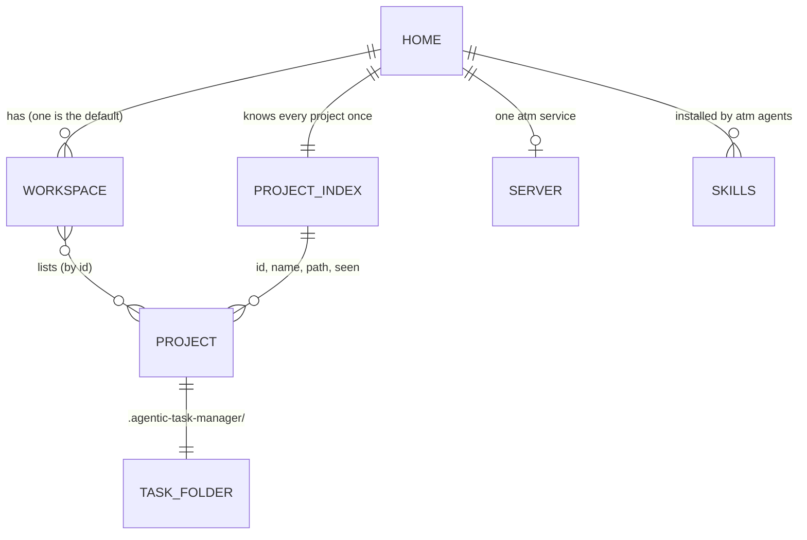
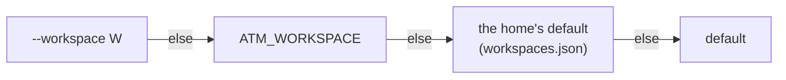
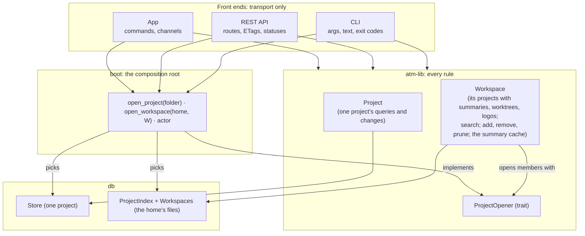
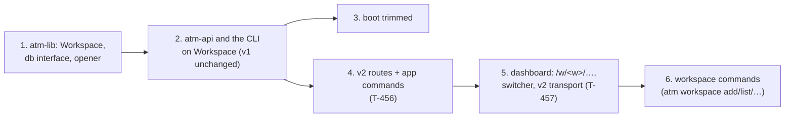

# ADR-003: Workspaces, the sets of projects atm works on

- **Status:** proposed, 2026-11-08
- **Decided by:** Hakan Serce (to review)
- **Context:** T-489 (blocks T-456, the app's commands); [layered-architecture.md](../layered-architecture.md) §3.2, §5.1,
  §11.2; [multi-project-api.md](../multi-project-api.md); [better-way-to-distribute-atm.md](../better-way-to-distribute-atm.md) §2

## Problem

atm has two units: a **project** (a repository with its task folder) and, implicitly, **all the projects one user has
seen** (the registry, `$ATM_HOME/projects.json`). Everything that works across projects assumes that one implicit set,
and nothing in the layers owns it:

- **atm-lib knows one project at a time.** The functions §5.1 planned for the registry (`list_projects` "with their
  summaries", `add_project`, …) were never built there, and §3.2's `Registry` interface (with `open(id)`) never
  existed: the registry is a concrete `FileRegistry` in atm-db, re-exported by boot.
- **So the multi-project logic ended up in the HTTP layer.** atm-api's `Projects` walks the registry, opens each
  project through boot, keeps the summary cache, lists a broken project as missing instead of failing (F18), adds
  worktrees and logos, runs search across projects and caps its results. That is business logic, and the app (T-456)
  needs exactly the same, without HTTP.
- **boot is a bag.** Its public items (about two dozen) mix opening a project or the vcs, the registry, the
  JSON-in-git store's own operations (merge driver, migrations, paths, registering by folder, `default_base`),
  identity, process helpers (pids, signals) used only by the CLI, and a test hook; `hook_project` mixes four of
  these. §11.2 already named the problem.
- **One set per user is the only choice.** Separating work and personal projects, or giving a test or a demo its own
  set, means a second `ATM_HOME`, which also brings a second server, port, record and copy of the skills.

## Concepts

- **Home** (`$ATM_HOME`, `~/.agentic-task-manager` by default): one atm installation's state: the skills it
  installed, its server, and the projects it knows. Unchanged, and still the way to isolate completely (tests, the dev
  server), as a Zotero profile or a separate `KUBECONFIG` is.
- **Project index** (today's registry): every project the home knows, once, with its ID, name, path and when it was
  last seen. It keeps what the registry does now: IDs unique in the home (F18), `missing`, pruning, the lock.
- **Workspace** (new): a named, ordered list of project IDs, with its own settings later (a name, a default view).
  There is always one, `default`. A project may be in several workspaces; removing it from one doesn't forget it.

## Proposal

### 1. A workspace is a named list over the project index

Stored beside the index in the home (`workspaces.json`: `{version, default: "default", workspaces: [{id, name,
projects: [ids]}]}`). Workspaces reference projects and never own them, as VS Code's workspace files reference
folders. atm's projects are repositories scattered over the disk, so membership is by list, never by containment (as
Cargo's or pnpm's is).

Registering a project (`atm db init`, `atm db migrate`, `atm service`, `atm project add`) adds it to the index and to
the **default workspace**, or to the one given (`--workspace`). A user who never creates a workspace sees no change.

### 2. Choosing a workspace: per call, never a global switch

Only what works across projects needs a workspace: registering, the project list, the server's and the app's views.
Everything else works on the project in the current folder, as now. Where one is needed, it is resolved in the order
the common CLIs use:

There is deliberately no `atm workspace use` that changes the default for every shell: several agents run at once,
and kubectl's `use-context` shows how a global switch made in one shell surprises another. `atm workspace default W`
sets the stored default explicitly, as a setting. No per-folder workspace file either: a project can be in several.

### 3. The layers

- **atm-lib gets `Workspace`**, the multi-project twin of `Project`: opened from the db's workspace interface plus a
  `ProjectOpener` (the trait boot implements, §3.2's `open(id)`; atm-lib still never picks a store). Its functions are
  §5.1's, renamed: `list_projects` (each with its summary, worktrees and logo, a broken one as missing), `search`,
  `add_project`, `remove_project`, `prune`, and the summary cache, moved from atm-api.
- **db** gets the interface for the index and the workspaces, with the JSON implementation (today's `FileRegistry`,
  plus `workspaces.json`).
- **boot becomes the composition root only:** `open_project`, `open_project_tolerant`, `open_workspace`, `open_vcs`
  and the actor. The JSON-in-git store's own operations move under `atm_boot::jsongit` (§11.2's split, done); the
  process helpers (pids, signals) move to the CLI, their only user; `hook_project` goes, with the plugin's hook it
  served (T-454).
- **The front ends map, and nothing else:** atm-api keeps routes, ETags, 304s and statuses; the app keeps commands and
  channels (the `notify` watcher, approved for T-456); the CLI keeps arguments and text. One test per read checks the
  REST route and the app's command return the same data.

### 4. The API: `api/v2/workspaces/<w>/…`

| v2 route | What | Today |
|---|---|---|
| `GET /api/v2/workspaces` | the home's workspaces, the default first | — |
| `GET /api/v2/workspaces/<w>/projects` | its projects, with summaries, worktrees, logos | `/api/projects` |
| `GET /api/v2/workspaces/<w>/search?q=` | search across its projects | `/api/search` |
| `GET /api/v2/workspaces/<w>/projects/
/tasks` | a project's tasks (the v1 view) | `/api/v1/projects/
/tasks` |
| `…/projects/
/documents`, `files`, `claims`, `worktrees`, `logo` | the project's files | `/api/v1/…`, `/p/
/…` |

Per-project routes sit under the workspace too, so a page always knows which workspace it is in and the API can
refuse a project that isn't in it. Project IDs stay unique in the home, so a project has the same ID in every
workspace. The v1 routes and `/p/
/…` stay, as the default workspace, until the dashboard has moved; the routes stay
read-only, as now.

The app's commands follow the same shape (`list_workspaces`, `list_projects(w)`, `search(w, q)`,
`project_tasks(w, p, filters)`, …), and its channels are per workspace or per project.

### 5. The dashboard and the app

- **Addresses:** `/w/<w>/projects/
/<tab>`, `/w/<w>/board`, …; without `/w/<w>` they are the default workspace's,
  so every link made so far keeps working. A workspace switcher sits next to the project switcher when there is more
  than one.
- **The app** opens one window per workspace, the default first; deep links carry it (`atm://w/<w>/projects/
`).
- **One server per home** serves every workspace (cheaper than one each); `atm service` opens the default's address,
  or `--workspace`'s.

### 6. Migration

1. `projects.json` gains nothing; `workspaces.json` is created on first use, with `default` listing every project
   already registered, in their order. Older atm versions keep reading `projects.json` as before.
2. Steps 1 to 3 are refactors with no change users see, each its own task and commit; T-456 builds on step 2.
3. `atm project list|add|remove|prune` keep working on the default workspace (or `--workspace`); `atm workspace
   list|add|remove|rename|default` and `atm workspace project add|remove` come in step 6.

## Alternatives considered

- **A workspace is an `ATM_HOME`** (one folder each, as Obsidian vaults are). No new concept: it works today. Discarded
  as the answer: each brings its own server, port, record and skills, a project can't be in two, and switching means
  restarting things. It stays the tool for full isolation (tests, the dev server).
- **Membership by containment** (a workspace is a folder, its projects the repositories under it, as Cargo or Bazel
  find theirs). Nothing to keep in a list. Discarded: users' repositories are scattered, and a project couldn't be in
  two workspaces.
- **Exclusive membership** (a project is in exactly one workspace, as in Linear or Slack). Simpler to scope. Discarded:
  atm doesn't own the projects (they are the user's repositories), and "work" and "this client" overlapping is
  normal; the index already keeps IDs unique, which is what exclusivity would buy.
- **A global current workspace** (`atm workspace use`, as `kubectl config use-context`). Convenient. Discarded:
  several agents and shells run at once, and one switching the others' workspace silently is a bug waiting to happen.
- **No workspace, just move the multi-project code to atm-lib over the registry** (the first idea for T-456). Smaller.
  Discarded: it puts the code in the right layer but keeps "all projects" as the only set, and the API and the app
  would grow the same assumption again.

## Risks

- **Two files to keep consistent** (the index and the workspaces). A workspace can name a project the index dropped
  (pruned, removed). Mitigation: the workspace lists it as missing, as the index does a project without its folder;
  `prune` removes it from the workspaces too; both files are written under the home's one lock.
- **Older atm versions beside newer ones** (a Homebrew upgrade, an old server). Mitigation: `projects.json` keeps its
  format; old versions ignore `workspaces.json` and see everything, as today.
- **More addresses to keep working.** Mitigation: the default workspace needs no prefix; v1 and `/p/` stay until the
  dashboard and any bookmarks have moved, with a redirect after that.
- **Scope creep**: per-workspace settings, sharing a workspace file. Out of scope here; the format leaves room
  (`name`, future keys), and a later ADR decides.

## Consequences

- atm-lib owns the rules for many projects as it does for one; atm-api and the app shrink to transport, with a test
  that they agree.
- boot is the composition root: opening things and the actor; store-specific operations live in one module, process
  helpers in the CLI.
- layered-architecture.md §3.1, §3.2, §5.1, §6 and §11.2, multi-project-api.md and the security architecture (new
  routes, read-only) are updated with the steps that change them.
- T-456 is re-scoped on top of steps 1 and 2; the migration's steps become tasks in *The atm app* or the next sprint.

## Questions for the review

1. Can a project be in several workspaces? (Proposed: yes.)
2. Does registering a project add it to the default workspace? (Proposed: yes, or to `--workspace`'s.)
3. Per-project routes under the workspace (`/api/v2/workspaces/<w>/projects/
/…`), or kept at
   `/api/v2/projects/
/…` since IDs are unique in the home? (Proposed: under the workspace.)
4. Is `ATM_WORKSPACE` worth having, or is `--workspace` plus the stored default enough? (Proposed: keep it, for agents
   and scripts.)

## Appendix: how others model it

Checked 2026-11-08.

| Tool | Unit and membership | How one is chosen | Lesson for atm |
|---|---|---|---|
| VS Code | `.code-workspace` lists folders by path; a folder can be in many | the window opens a file | a workspace can be a list that references projects |
| JetBrains | one project per window; extra repos attached | the window | keep the project the real unit; grouping stays light |
| Cargo, pnpm, Bazel | a root and the members under it (by containment, one each) | walk up to the marker | containment needs one tree; atm's repos aren't |
| Linear, Slack, Notion | a tenant owning its projects (exclusive) | a switcher; the slug in every URL | the workspace in the address; exclusivity fits owned data |
| kubectl, gcloud, AWS, Docker, gh | named contexts or profiles | flag > env var > stored current > default | per-call choice; a global switch leaks across shells |
| Obsidian, Logseq, Zotero | vaults or graphs fully apart; Zotero's collections overlap | chosen at launch, per window | two levels: isolation (a home) and overlapping groups (workspaces) |

On where the files go: single dot-folders that one variable moves (`~/.docker`, `~/.kube`, `CARGO_HOME`) remain common
and easy to explain; `ATM_HOME` already gives atm that. Moving to the XDG or platform folders (`directories`) is a
separate question, and the app has to read the same home as the CLI either way.
