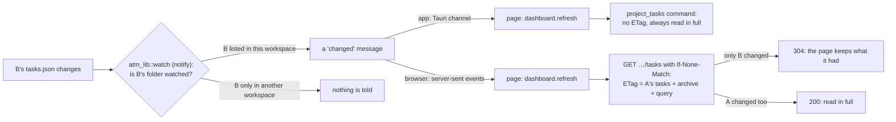

# Other projects' tasks: keeping them fresh in the app, the browser and the CLI

- **Status:** accepted, 2026-11-16 (Hakan, in Crit, three rounds). Round 1 decided:
  - design 1: the browser polls with its refresh settings, as before T-507, and T-507 is reverted;
  - the store owns how it hears of changes (§3);
  - B's expiry is acceptable.

  Round 2 decided another workspace's projects (K4, §4.1: referenced freely, loaded when needed, not watched) and
  worktree branches (V1, §4.2).
- **Context:**
  - [ADR-007](adr/ADR-007-task-keys-uuids-and-dependencies-across-projects.md) §7 decides dependencies across projects,
    but not how they stay up to date;
  - the tasks that built them: T-544 (the rules), T-549 (the views and the overview);
  - the tasks that made the page react to changes: T-506 (the app's subscriptions), T-507 (the browser's change
    stream);
  - [layered-architecture.md](layered-architecture.md): atm-db is the store abstraction (`Store`, implemented by
    `JsonGitStore` and `MemoryStore`).
- **Question:** when a task in project B changes, does project A's page, which shows a task depending on it, show the
  change? Where it doesn't, why not, and how should it?
- **Two constraints from Hakan:**
  1. **Watching for changes belongs behind the store abstraction.** A `JiraDb` would listen to Jira (webhooks, or its
     API), not watch files, or both. What a change is, and how to hear of it, is the store's business.
  2. **The browser may simply poll every few seconds, while the app gets the better experience (pushed changes).** If
     the browser complicates the design, that option is the more appealing.

## 1. Where another project's task shows, and where its data comes from

A task in A may name a task in B in its `dependencies`, `related` or `duplicate_of`, stored as `<B's meta.id>:<UUID>`.
Three pieces of code read B for it, each a different way.

| | What it gives | Used by | How it reads B | Cached? |
|---|---|---|---|---|
| **The display**: `foreign::Lookup` (T-549) | key, name, status, kind, archived, where B is registered (`places`), or why it can't be found | the task views' `derived.foreign`: the details panel's links and badges | every registered project opened once per read, each reference looked up once | **per read** |
| **The rules**: `foreign::status`, the `ForeignStatus` hook (T-544) | done or not, and the status | `waiting_for`, `ready`, unmet dependencies; the views' `derived.ready` and `waiting_for`; the summary's board cards and `next`; `atm project status`; `atm loop next` | finds B by `meta.id` among the registered projects, then the task | **per process**, never cleared (`static SEEN`) |
| **The label**: `foreign::label` | the key, or a short UUID when the key is ambiguous | the CLI's output | as the rules do | no |

The processes that run them:

- **The CLI:** one process per command, so a per-process cache is a per-command cache. Always fresh.
- **`atm serve`:** one process for hours or days, serving every browser tab.
- **The app:** one process for as long as the window is open.

## 2. How a change reaches the page today



- **The watch** (`atm_lib::watch`, shared by the app and `atm serve` since T-507) watches folders, with `notify`. The
  folders come from the store (`Store::watch_folders`) and cover the workspace's own projects and the state folder
  (`workspace_folders`). The lookup, though, searches **every registered project, in every workspace**.
- **On a message** the page reloads the project list and the open project's tasks, claims and worktrees
  (`dashboard.refresh()`, `loadProjectData`).
- **The app** reads through IPC, with no ETags (`lib/api/ipc.ts`), so each reload reads A in full. It also reloads when
  its window regains focus.
- **The browser** sends its validators. The tasks route's ETag (`api_tasks`, `atm-api/src/routes.rs`) is built from
  the store's `stamp()` for A (its `tasks` and `archive`, each a file's size and modification time in nanoseconds)
  and the query. A change in B alone doesn't change it, so the answer is a 304.
- **The project list's** ETag (`api/projects`) changes with every project of the workspace, so the overview's
  summaries are read again. They come from the rules, though, so they can still be stale (§4, case 3).

## 3. The layers: where watching is today, and where it belongs

```text
today                                         proposed
─────                                         ────────
atm-api   SSE route ─┐                        atm-api   (polled, no stream: §5)
app       channels ──┤                        app       channels ─────────────┐
atm-lib   watch.rs: notify on folders ◄───┘   atm-lib   a workspace's changes: ◄┘
            ▲ folders                                     the members' subscriptions merged,
atm-db    Store::watch_folders()                          plus the registry's
          Store::stamp()                      atm-db    Store::subscribe(on_change) → Subscription
                                                        Store::stamp()  (the store's version)
                                                        JsonGitStore: notify on its folders
                                                        MemoryStore:  told by its own writes
                                                        (a JiraStore: webhooks, or polling its API)
```

**Today the store tells atm-lib which folders to watch, and atm-lib watches them.** That assumes every store keeps
files on disk:

- `Store::watch_folders()` is a file-system answer in the store's interface. A store with nothing on disk returns
  none (its default), so it is never told of a change.
- `notify` and its debouncer are atm-lib's dependencies (moved there from the app in T-507), so atm-lib watches files
  for every store.

**`Store::stamp()` is already the right shape:** "a value that changes when the data does", opaque to atm-lib. The
JSON store makes it from file sizes and times; a Jira store could use an issue query's latest `updated` time or a
change counter. The ETags and the cache proposed below (§5.1) key on it, so they work for any store.

**Proposed: changes are the store's.**

- **`Store::subscribe(on_change) -> Subscription`** in atm-db's `Store` trait, replacing `watch_folders`. A store calls
  `on_change` when its data changed, by whatever means it has; dropping the `Subscription` ends it.
  - **`JsonGitStore`:** `notify` on its folders (the task folder, the claims store, the working copies' task files),
    debounced, the code that is now `atm_lib::watch`. `notify` moves to atm-db.
  - **`MemoryStore`:** told by its own writes (useful for tests).
  - **A future `JiraStore`:** Jira's webhooks if atm runs where Jira can reach it, else polling its API, comparing
    its stamp. It may combine both with file watching for anything it keeps locally.
  - **Polling is an implementation's choice, hidden behind the trait** (Hakan, round 1). The trait has no default
    that polls: each store decides how it hears of changes, and what calls `subscribe` can't tell push from polling.
    atm-db offers a helper, `poll_stamp(store, interval, on_change)`, which an implementation may use (a `JiraStore`
    without webhooks would); the interval is that implementation's, so a remote store can poll more slowly than a
    local one.
- **The registry** (`workspaces/<w>.json`, the list of projects) is atm-db's too (`registry.rs`), so it gets the same
  kind of subscription for "the list changed".
- **atm-lib** keeps only what is about workspaces: a workspace's changes are its members' subscriptions merged, plus
  the registry's. The app subscribes through that; nothing above atm-db knows about files.
- **What is "told" stays the same:** "this workspace changed" or "this project changed", never the data. The page reads
  it again through the usual reads.

**Pros:**
- The layer rule holds: a store that isn't files works the same.
- One place decides what "changed" means, the store that knows.
- Push or poll is the store's own business: above atm-db nothing changes when a store switches from one to the other.

**Cons:**
- A trait change in atm-db, with the code moving from atm-lib to atm-db.
- atm-db gains threads: the watcher's, or the poller's.

**Risks:**
- A store's callback runs on its own thread. The trait must say so, and atm-lib must not hold locks across it.
- A store that polls adds load per subscribed project. Its interval is its own, so a remote one can be slower.
- A store that can neither push nor poll (none today) would never call `on_change`: the trait's documentation says
  that every store must do one or the other.

## 4. Use cases, today

A is "Blog" (LFB), B is "atm" (ATM). LFB-1 depends on ATM-1, which is in progress. ATM-1 is then marked done while
LFB's page is open.

| # | Case | App | Browser | CLI |
|---|---|---|---|---|
| 1 | **ATM-1 done, both projects in the open workspace** | The message comes; `derived.foreign` shows ATM-1 **done**. But `derived.waiting_for` and `ready` come from the cached rules, so LFB-1 still reads **waiting on ATM-1**, and the Kanban keeps it in waiting. Right only after the app restarts | The message comes; the tasks route answers **304**, so the page keeps ATM-1 as in progress and LFB-1 waiting. Once LFB changes, the display is right, but `waiting_for` stays wrong until `atm serve` restarts | `atm loop next` in LFB takes LFB-1: right |
| 2 | **B only in another workspace** (registered in "work", the page shows "default") | The lookup finds B, but nothing watches its folder: no message. Shown fresh on the next message about this workspace, focus or Reload; the rules stay cached | No message; even the Reload button gets a 304. As case 1 once LFB changes | right |
| 3 | **The overview and the All projects board** (cards' `waiting_for_labels`, `next`) | The message comes and the summaries are read again, but the rules behind them are the cached ones: LFB-1 still waiting, and not in `next` | The same: the list's ETag changes, so the summaries are rebuilt from the cached rules | `atm project status`: right |
| 4 | **B removed from the workspaces, or its folder deleted** | The display says "its project isn't in your workspaces"; the rules keep the last answer they had | The same as the app, behind a 304 until LFB changes | `atm doctor` warns: right |
| 5 | **B changes in a worktree's branch only** | Not shown: B is read from the folder it is registered at, its main working copy. The same for B's own page | Same | Same |
| 6 | **The user checks after a while** | Focus reloads: the display is fresh, the rules aren't | No focus reload in the browser (T-507 keeps it app-only); the Reload button gets a 304 | — |
| 7 | **Many references** (LFB with 50 dependencies in 5 projects) | Each read opens every registered project once (`Lookup`); the rules open them again for each reference not yet cached (`project_by_id` → `registered`) | Same, on the server | Same, per command |

**What this adds up to:**
- **P1, the rules' cache is never cleared** in the two long-lived processes, so it is wrong in both the app and the
  browser (cases 1, 3, 4, 6). The CLI is right, so the dashboard and agents disagree about what is ready.
- **P2, the browser's ETag ignores the projects A's tasks name.** A change in B alone gets a 304 (cases 1, 2, 4, 6).
  This is independent of how the browser hears of a change: a poll with validators gets the same 304 as a pushed
  reload.
- **P3, what is watched is narrower than what is looked up.** A project in another workspace is found but never
  watched (case 2).
- **P4, the display and the rules disagree within one view**, in the app since T-549: "ATM-1 done", next to "waiting
  on ATM-1".
- **P5, the cost:** every read opens every registered project (case 7). Fine for a handful of projects; not measured
  beyond.
- **P6, the layers:** watching is file-specific and lives above the store (§3).
- Case 5: §4.2.

### 4.1 Where another workspace's project shows (case 2)

The app and the browser show one workspace at a time (ADR-003). A project can be in several workspaces, so "another
workspace's project" only shows **through a reference**: a task of the open project names a task of a project that
the open workspace doesn't list. It never shows as a project of its own there.

**An example.** Hakan has two workspaces:
- **"default"** lists Blog (LFB) and atm (ATM);
- **"work"** lists atm (ATM) and Client (CLI).

LFB-1 "Write the release post" depends on ATM-1 "Release 0.38.0", and CLI-7 "Upgrade the client's atm" depends on
ATM-1 too.

- **In "default"**, LFB's page shows ATM-1: ATM is listed here too. Case 1, not case 2.
- **In "work"**, CLI's page shows ATM-1 the same way: listed in "work" too.
- **Case 2** is LFB depending on a task of CLI, say LFB-2 "Write the case study" depending on CLI-3 "Ship the
  client". CLI is only in "work"; LFB's page in "default" shows CLI-3:
  - in the details panel, its key, status, name and a link that opens it in "work" (T-549's `places`);
  - in the Kanban, LFB-2 waiting on CLI-3 until it is done;
  - on the overview's LFB card, "Waits on CLI-3", and LFB-2 not in "next".

**Where the rules look today.** ADR-007 §7 says a reference written by key is found "among the projects of the
workspaces it is listed in", A's own workspaces. The code (`foreign::registered`) searches every registered project in
every workspace, for writing and for reading. So today case 2 also covers a project that shares no workspace with A at
all.

**What follows for the app** (the browser is solved by E, which covers every registered project):

- **K1. Watch only the open workspace (J, as today).** CLI-3 in the example shows as of the last reload of LFB's
  page: a message about "default", focus, Reload. Simple; stale in the app while nothing in "default" changes.
- **K2. Watch the projects the open workspace's tasks name (H).** In the example, the app also subscribes to CLI.
  Exact; the set changes with references.
- **K3. Narrow the reference to the workspaces A shares (ADR-007 as written).** LFB-2 → CLI-3 is then refused when
  written, unless LFB is added to "work" or CLI to "default". Case 2 can't happen: every reference is to a project in a
  workspace that also lists A, though not necessarily the open one, as above. The rules and the code agree with the
  ADR; the watch can cover "the workspaces that list A" instead of everything.
- **K4. Reference any registered project; watch none of them; load each when it is needed** (Hakan, round 2).
  - **What it means:** another project is read at the moment something needs it: deciding whether a task is ready
    (`atm loop next`, `derived.ready`, the Kanban's waiting column), and showing it (the details panel, the overview
    card). With B (§5.1) that read is cheap: B's stamp is checked, and B is read again only when it changed.
  - **What is watched:** only the open workspace's own projects, for the app's pushed changes (J). In the browser,
    nothing: it polls.
  - **When a change in another project shows:** in the CLI, always fresh, since every command reads. In the app, on
    the next reload of the open project: a change in the open workspace, focus, or Reload. In the browser, on its
    next poll, provided the poll's answer changes when a project A references does. That is D (§5.3), which checks
    exactly the projects A references, no more, so it is "load when needed" for the browser too.
  - **ADR-007 §7 changes** with it: a key is found among every registered project, not only those of A's workspaces,
    as the code already does. AGENTS.md has a decision that changes an ADR written as a new ADR, so the
    implementation adds one that replaces §7's wording.
- **Decided: K4** (K1 to K3 stay above for the record).

### 4.2 Changes in another project's worktree branch (case 5)

A project can have several git worktrees: agents work in their own branches, each worktree with its own copy of
`tasks.json`. atm reads a project's **main working copy** as its truth, and for the project's own page it also reads
the other worktrees' task files (`Store::working_copies`, `copy_tasks`; the `worktrees.json` route), so the board shows
a task's progress elsewhere with its branch.

**Today, for another project's task, only its main copy is read.** An example:

1. Two agents work on atm: one in the main checkout (`dev/0.38.0`), one in a worktree on `fix/updater`.
2. The worktree's agent starts ATM-1, and later marks it done there; it commits on `fix/updater`, not yet merged.
3. **atm's own page** shows ATM-1 as done in the worktree `fix/updater` (the board merges the worktrees), and as in
   progress on the main copy.
4. **LFB's page** (LFB-1 depends on ATM-1) shows ATM-1 **in progress**, and LFB-1 waiting: B is read from its main
   copy only.
5. **`atm loop next`** in LFB doesn't hand out LFB-1: ATM-1 isn't done where it counts, on atm's base.
6. Once `fix/updater` is merged into atm's base and the main checkout pulls it, LFB sees ATM-1 done.

**Is that right?** For the rules, yes: a task done on an unmerged branch isn't done for anyone depending on it, the
same as within one project (a dependency counts when its project's main copy says so). For the display it's less
than atm's own page shows. Options:

- **V1. Leave it** (today): the main copy, for the rules and the display. The display says "in progress" while atm's
  page says "done in `fix/updater`".
- **V2. Show the worktrees in the display only:** the details panel says "in progress (done in `fix/updater`, not
  merged)", read from B's working copies as atm's own page does; the rules keep the main copy. Small with B's cache
  (the copies' stamps join B's).
- **V3. Count a worktree's done as done:** rejected; work that may never be merged would release its dependents.

**Decided** (Hakan, round 2): **V1 now, V2 later** if the difference shows up in practice.

## 5. Options

### 5.1 The rules' cache (P1, P4, P5): the same for the app and the browser

**A. Drop the per-process cache; the rules take B from the same per-read lookup as the display.** Each read (a route,
a command, a CLI command) makes a `Lookup` and the rules use it.
- **Pros:** one source for the display and the rules, so they can't disagree; nothing to clear; the CLI behaves as now.
- **Cons:** the hook is a global function pointer in atm-common (set by `foreign::install`), so it needs a way to know
  the read it is in: a lookup passed down through the rules' callers, or a scope the front end opens per read.
  Passing it down touches many signatures in atm-common and atm-lib.
- **Risks:** a read that forgets to open a scope gets an empty lookup, so every reference counts as unmet. Tests per
  entry point would catch that.

**B. Keep a cache, keyed by B's `stamp()`.** Each entry remembers B's stamp. On use it asks the store for the stamp
(for the JSON store, a file check); if the stamp is unchanged the entry stands, otherwise B is read again. One cache
serves the rules and the display.
- **Pros:**
  - correct in long-lived processes, with no change to the hook or its callers;
  - cheaper than today for repeated reads, which also fixes P5: B is read once until it changes, not once per read;
  - store-agnostic, since it only compares stamps (§3).
- **Cons:** a stamp per reference per use (a file check for the JSON store; for a remote store its stamp must be
  cheap, or cached for a moment by the store); the cache is shared state across the server's threads (it is a `Mutex`
  already).
- **Risks:** a write within the file system's timestamp resolution that keeps the size would look unchanged. With
  nanosecond times on APFS and ext4 this is very unlikely; on FAT or network drives the resolution is coarser. Bound
  the damage: entries also expire after a few seconds.

**C. Clear the cache on each change message** (the subscriptions' callback, in the app and the server).
- **Pros:** a few lines.
- **Cons:** only as good as the subscriptions (P3: B in another workspace never clears it); a browser that polls has
  no messages to clear it with; it ties correctness to the transport.
- **Risks:** a missed event (watchers drop events under load) leaves it stale for good.

### 5.2 How the browser hears of changes: polling, or pushed as the app is

**W1. The browser polls every few seconds; the app keeps its pushed changes.** The page reloads every N seconds (5,
say) with its validators, as it did before T-507. The app keeps its channels.

- **What it removes**, all of it browser-only and built in T-507:
  - the change-stream routes, their 16-stream limit and keep-alive (`atm-api/src/changes.rs`);
  - atm-api's `futures-core` dependency and tokio's `sync` and `time` features;
  - an entry point in the security document (who may open a stream, how many);
  - the page's `EventSource` code: backoff, the catch-up reload, the slow-poll fallback;
  - the e2e suite's fake `EventSource`.
- **With D or E below**, P2 and P3 are solved for the browser **without any watching**: each poll asks whether A, or a
  project A depends on, changed (E: any registered project, in any workspace). Case 2 is then right in the browser
  with no subscription.
- **Pros:**
  - The simplest browser by far: no long-lived connections, nothing to reconnect, nothing for proxies, sleeping
    laptops or the six-connections-per-host limit to break.
  - `atm serve` holds no watchers, so it watches nothing and its cost doesn't grow with open tabs.
  - The browser no longer constrains the store design: a store needs a stamp for the browser and subscriptions only
    for the app.
  - A clear product line: the app is the live, premium experience; the browser is a good view, a few seconds behind.
- **Cons:**
  - Changes show up to N seconds late in the browser.
  - A poll every N seconds per tab: with validators, nearly all are 304s that only check stamps, but the server does
    wake.
  - It undoes part of T-507, which is done but not pushed: the work is thrown away, though the watcher's move out of
    the app stays useful (§3).
- **Risks:**
  - Many tabs on a big workspace: each poll checks the stamps of every project the ETag covers (E: every registered
    project). Cheap file checks, but worth a benchmark (`tests/scripts/bench.mjs`).
  - The refresh settings come back as they were before T-507 (Hakan, round 1): auto-refresh on or off and its interval,
    in Settings and the Refresh menu. Reverting T-507 brings them back as they were tested.

**W2. Keep T-507's change stream (pushed changes in the browser too).**
- **Pros:** the browser as live as the app; already built and tested.
- **Cons:**
  - Everything W1 removes stays: long-lived connections, their limit and lifecycle, the reconnect logic, the fake in
    the tests.
  - The server holds a watcher per stream, so it must have the store's subscriptions (§3) as the app does, for every
    open tab.
  - P2 still needs D or E: the stream only says "reload"; the reload still meets the ETag.
  - P3 needs the subscriptions to cover more projects (H or I below) in the server too.
- **Risks:** stream failures that only show in some networks or browsers; the six-connection limit per host (why
  the browser opens only one stream per tab).

### 5.3 The browser's 304 (P2): needed with either W1 or W2

**D. The tasks ETag also covers the projects A's tasks name.** The server remembers, per stamp of A, which projects
A's tasks reference (worked out on a full read). The ETag is then A's stamp plus those projects' stamps.
- **Pros:** exact: a 304 is still a 304 unless A or a project it names changed; a change in an unrelated project
  costs nothing.
- **Cons:** a small memo in the server; the first request after A changes has to read A to know its references,
  which it does anyway.
- **Risks:** the memo must be keyed by A's stamp, never by time, or a new reference would be missed.

**E. The tasks ETag covers every registered project's stamp.**
- **Pros:** simplest; no memo; covers projects in other workspaces too, so with W1 it also solves P3 for the browser.
- **Cons:** a change in any project busts every open page's 304, so the open project is parsed and re-rendered for
  unrelated changes. With W2 (pushed) that happens on every change anywhere; **with W1 it happens at most once per
  poll interval**, which bounds it.
- **Risks:** a busy machine (many agents, many projects): with W1, one full read per tab per interval while anything
  changes. Measure before choosing.

**F. The page drops its validators when told of a change** (`cache: 'no-store'` on a reload after a message).
- **Pros:** client only.
- **Cons:** with W2, every change in the workspace re-reads and re-renders the open project in full; with W1 it is
  every poll, which loses the 304 altogether.
- **Risks:** as E, worse.

**G. A separate, small route for the other projects' tasks the open project names**, with its own ETag; the task views
stop carrying `derived.foreign`.
- **Pros:** the big tasks answer keeps its 304s; the small one changes only with the projects it names.
- **Cons:** a new route and an IPC command to match (a new entry point), and the page joins two answers; T-549's field
  would move.
- **Risks:** two answers from two moments: for a moment, the task says "waiting" and the link says "done" (P4 again,
  briefly).

### 5.4 What the app is told of (P3): the app's subscriptions

**H. The app subscribes to the projects the workspace's tasks reference too**, wherever they are registered.
- **Pros:** case 2 is told like case 1.
- **Cons:** the set to subscribe to changes when a reference is added, so it is redone on each message; more
  subscriptions.
- **Risks:** watcher limits (Linux's inotify watches, macOS's open files per kqueue): small per project, but it scales
  with references.

**I. The app subscribes to every registered project.**
- **Pros:** simple; independent of references.
- **Cons:** messages for projects the page shows nothing of; each costs a reload of the open project (the app has no
  ETags), unless the app learns from the message which project changed and skips what doesn't concern it.
- **Risks:** as H, scaled by every registered project.

**J. Don't subscribe to more, and say so:** a project in another workspace is shown as of the last reload (focus, a
message about this workspace, Reload).
- **Pros:** nothing to build.
- **Cons:** case 2 stays stale in the app until something else reloads.

### 5.5 The layers (P6)

**L. `Store::subscribe` in atm-db, as in §3.** The JSON store watches its files there; a store that can't push polls,
inside its own implementation.
atm-lib merges a workspace's subscriptions. With W1 only the app subscribes.
- **Pros, cons, risks:** in §3.

**M. Leave watching in atm-lib, give `Store` a richer `watch_folders`.**
- **Pros:** less to move now.
- **Cons:** the file assumption stays in the interface, and a Jira store couldn't push.

### Doing nothing

Document the limits and leave it.
- **Pros:** no work.
- **Cons:** the dashboard says a task waits while `atm loop next` takes it; users and agents act on the wrong one; P4
  shows two answers side by side.

## 6. Comparison

**Two whole designs:**

| | **Design 1: the browser polls** (W1 + D, B, L, K4; chosen) | **Design 2: both pushed** (W2 + D, B, L, H or I) |
|---|---|---|
| App | pushed, through the store's subscriptions | pushed, through the store's subscriptions |
| Browser | a poll every N s, 304s unless something it shows changed | pushed, one stream per tab |
| Case 1 (ATM-1 done) | app: at once; browser: within N s | both: at once |
| Case 2 (another workspace) | browser: within N s, with no watching (D); app: on the next reload (K4) | needs H or I in the server and the app |
| Server-side watching | none | a subscription per open stream |
| Code to keep | B, D, L, the poll; T-507's stream removed (done) | B, D, L, T-507's stream, H or I in the server too |
| Entry points | the tasks route as now | plus the change streams |
| What a new store must give | a stamp (browser), subscriptions (app; pushed or polled, its choice) | a stamp, and subscriptions for both |

**Each option:**

| Option | Fixes | App | Browser | CLI | Size | Main risk |
|---|---|---|---|---|---|---|
| A | P1, P4 | yes | yes | unchanged | large | a read without its scope |
| **B** | P1, P4, P5 | yes | yes | unchanged | small | timestamps on coarse file systems |
| C | P1 partly | partly | no (W1) | no | tiny | missed events |
| **W1** | browser delivery, simpler | — | yes | — | removes code | N seconds late |
| W2 | browser delivery, live | — | yes | — | as built | streams, server watchers |
| D | P2 | not needed | yes | — | small | the memo's key |
| **E** | P2, and P3 with W1 | not needed | yes | — | tiny | re-reads, bounded by W1 |
| F | P2 | not needed | yes | — | tiny | loses the 304 |
| G | P2, P4 briefly | yes | yes | — | large | a new entry point |
| **H** | P3 (app) | yes | — | — | medium | watcher limits |
| I | P3 (app) | yes | — | — | small | noise, reloads |
| J | — | — | — | — | none | case 2 stale in the app |
| **L** | P6 | yes | yes (W2) | — | medium | callbacks on store threads |
| M | — | — | — | — | small | the file assumption stays |

## 7. Recommendation

**Design 1: the browser polls, the app is pushed.** The browser is where the complication is: it needs the stream
(W2) only to be as live as the app, and polling with an ETag that covers what A references (D) solves both of its
freshness problems (P2, P3)
at once, with no watching on the server. The app stays the live experience.

1. **B: one stamp-keyed cache for the rules and the display**, in atm-lib, keyed by the store's `stamp()`. It fixes
   the wrong "waiting" in both hosts and on the overview (P1, P4), and repeated reads (P5). Entries also expire after
   a few seconds, against coarse timestamps.
2. **L: `Store::subscribe` in atm-db** (§3), with the JSON store's file watching moved there; how a store hears of
   changes (push or poll) is its implementation's, hidden behind the trait. atm-lib merges a workspace's
   subscriptions for the app.
3. **W1 and D: the browser polls** with its validators, at the interval its refresh settings say, as before T-507;
   the tasks ETag also covers the projects A's tasks reference (D), so a poll checks exactly what A needs. **T-507 is
   reverted** (Hakan, round 1, done in 1763ae0): its change stream goes, and the refresh settings it removed come
   back. The app's watcher returns to the app with it, until L moves it into atm-db.
   - D over E, after round 2: E would check every registered project on each poll, and re-read A whenever any of them
     changes. D checks only what A references, in line with "load them when we need them". E remains the fallback if
     D's memo proves fiddly.
4. **K4** (§4.1): reference any registered project, watch only the open workspace's own (the app), and load each other
   project when it is needed, through B. A new ADR replaces ADR-007 §7's wording.
5. **V1 for worktree branches** (§4.2), V2 later.

**When to prefer design 2 instead:** if a browser view a few seconds behind isn't good enough (the browser as the main
way some users use atm, or a team view). Even then, B and L come first, and D rather than E.

## 8. Tests

- **atm-db:** the JSON store's subscription tells a change in its task file and its claims, and stops when dropped;
  `poll_stamp` tells a change of the stamp; the memory store tells its own writes.
- **atm-lib:** the cache re-reads B when B's stamp changes, and not otherwise; it expires; the rules and the display
  give the same answer after B changes, in one long-lived process (no restart); a workspace's subscription merges its
  members' and the registry's.
- **The CLI suite (`serve.test.mjs`, the real server):** two registered projects, in different workspaces; a
  conditional GET of A's tasks after B changes is a 200 with the new status and `ready`; with nothing changed, a 304;
  the overview's `next` and `waiting_for_labels` follow.
- **The app (Rust command tests):** `project_tasks` after B changes gives the new `ready`, within one `AppState`; with
  H, a change in a referenced project in another workspace is told.
- **e2e:** the browser polls (`page.clock`, no real waiting) at its refresh setting, and a change in another project
  shows after one interval; the app's pushed change shows at once (`asApp()`).
- **Performance:** `bench.mjs` with many registered projects: a poll that is a 304 stays cheap.

## 9. Decisions and open questions

Decided in round 1 (Hakan):

1. **Design 1:** a browser a few seconds behind is acceptable (W1).
2. **The browser's interval:** the refresh settings come back as before T-507; T-507 is reverted (done: its revert
   commit).
3. **`Store::subscribe` (L):** the store's job; polling, where a store needs it, is its implementation's, hidden by
   the abstraction (§3).
4. **B's few-seconds expiry:** acceptable.
5. **Focus in the browser:** as before T-507 (the app reloads on focus; the browser polls).

Decided in round 2 (Hakan):

6. **Another workspace's projects (§4.1):** K4: any registered project can be referenced; none is watched; each is
   loaded when needed (B). ADR-007 §7 is replaced by a new ADR to say so.
7. **Worktree branches (§4.2):** V1 now, V2 later.

Following from 6: the browser's poll uses D (only the projects A references), not E (§7, item 3).
