# Improving `atm` CLI ergonomics

A redesign of the `atm` command line into a consistent, hierarchical subcommand structure, with a low-risk migration path (wrapper → delegate → delete).

**Status:** proposal — not yet implemented.

---

## 1. The problem

The current `atm` CLI (see `atm-cli/atm/cli/main.py`) is a flat list of ~40 top-level commands. It grew organically, and the result is inconsistent: verbs, naming, option styles, and argument order vary from command to command.

| Symptom | Example | Why it hurts |
|---------|---------|--------------|
| Flat, ungrouped command list | `start`, `review`, `done`, `reject`, `approve`, `request-changes`, `block`, `unblock`, `reopen`, `skip`, `fail`, `release` are all top-level verbs with no grouping | Hard to discover; the help screen is a wall of text |
| Mixed naming conventions | `check` (validate), `paths` (show paths), `migrate` (move file), `merge-driver` (git hook) | No mental model for where a command lives |
| Inconsistent option style | `atm done <id> --note ... --commit ... --resolution ...` vs `atm block <id> --on user --question ... --reason ...` | Hard to remember flags; no common pattern |
| "state" commands scattered | `start`, `review`, `done`, ... are top-level, but `move` (sprint change) is separate | Task lifecycle verbs should be under `task` or `loop`, not floating |
| DB/repo commands mixed with task commands | `migrate`, `archive`, `init`, `merge-driver`, `paths`, `serve` sit next to `start`, `done`, `list` | No separation of "manage the project" vs "manage a task" |
| `show` instead of `details` / `view` | `atm show <id>` | Inconsistent with common CLI vocabulary (`show`/`view`/`details` vary) |
| No `doctor` / health check verb | `atm check` | `check` is ambiguous (is it validating JSON? running CI?); `doctor` is the conventional term |
| `serve` instead of `service` | `atm serve` | `serve` is a noun-as-verb; `service` reads better as a daemon action |
| `merge-driver` is a top-level command | `atm merge-driver base ours theirs` | It's a git hook, not a user command; it should be wired by `init` |

---

## 2. Current command inventory

Extracted from `atm/cli/main.py` (`build_parser`):

| Current command | Purpose | Group |
|-----------------|---------|-------|
| `version` | print plugin version | meta |
| `help` | show usage | meta |
| `paths` | print where task files are | project |
| `migrate` | move tasks.json into `.agentic-task-manager/` | db |
| `serve [start\|stop\|status]` | dashboard server | service |
| `status` | overview counts / next task | query |
| `summary` | project numbers as JSON | query |
| `show <id>…` | tasks in full | task |
| `list` | one line per task | task |
| `deps <id>` | dependencies | task |
| `start <id>` | mark in_progress, claim | state |
| `review <id>` | ask for review | state |
| `done <id>` | mark done | state |
| `fail <id>` | back to todo with failure note | state |
| `release <id>` | back to todo with handoff note | state |
| `reject <id>` | back to todo from review | state |
| `approve <id>` | approve review | state |
| `request-changes <id>` | request changes | state |
| `block <id>` | blocked | state |
| `unblock <id>` | back to todo | state |
| `reopen <id>` | done/skipped → todo | state |
| `skip <id>` | skipped | state |
| `note <id> TEXT` | add a note | task |
| `add` | add a task | task |
| `edit <id>` | change task definition | task |
| `check` | validate tasks.json | db |
| `archive` | move finished to archive | db |
| `unarchive <id>…` | bring archived back | db |
| `workflow [set …]` | print/set workflow | project |
| `commit <id>` | commit files + record | vcs |
| `pr <id>…` | record PR | vcs |
| `merged --pr N` | record PR merged | vcs |
| `heartbeat <id>` | extend claim | claim |
| `run <id> -- cmd` | run long command keeping claim | loop |
| `next` | next task to work on | loop |
| `claims` | list live claims | claim |
| `repository [set URL]` | set repo URL | vcs |
| `logo [set\|unset]` | set logo | project |
| `sprints …` | sprints | sprint |
| `releases …` | releases | release |
| `components …` | components | component |
| `move <id>… --to …` | move tasks between sprints | sprint |
| `backlog` | tasks with no sprint | sprint |
| `projects …` | dashboard projects | project |
| `_lock-test` | test hook (hidden) | internal |

---

## 3. Proposed command structure

New top-level commands (verbs for actions, nouns for domains):

| New command | Replaces | Purpose |
|-------------|----------|---------|
| `help` | `help` | show usage |
| `version` | `version` | print plugin version |
| `doctor` | `check` | validate tasks.json (schema, vocab, deps) |
| `service [start\|stop\|status]` | `serve` | dashboard server |
| `db <subcmd>` | `migrate`, `archive`, `unarchive`, `init`, `merge-driver` (hidden) | database / file maintenance |
| `project <subcmd>` | `paths`, `status`, `workflow`, `logo`, `projects`, `summary` (hidden) | project-level config |
| `sprint <subcmd>` | `sprints`, `backlog`, `move --to <sprint>` | sprint management |
| `release <subcmd>` | `releases` | release management |
| `component <subcmd>` | `components` | component management |
| `vcs <subcmd>` | `commit`, `pr`, `merged`, `repository` | version-control integration |
| `claim <subcmd>` | `claims`, `heartbeat` | claim lifecycle |
| `loop <subcmd>` | `next`, `run` | the work loop |
| `task <subcmd>` | `show`, `list`, `add`, `edit`, `note`, `deps`, `start`, `review`, `done`, `fail`, `release`, `reject`, `approve`, `request-changes`, `block`, `unblock`, `reopen`, `skip` | task lifecycle |

### Command tree (mermaid)

The tree as `atm2` has it (T-424). `atm2 --help` shows three panels: the everyday commands first, then **Maintenance**
(`db`, `doctor`, `service`), then **Meta** (`help`, `version`). What git, hooks and the dashboard's dev server call is
hidden from the help but still runs (dashed below): `db merge-driver` (git, during a merge; `db init` registers it),
`project summary` (the dev server), and `claim heartbeat --auto` (the plugin's PostToolUse hook).

```mermaid
graph TD
    atm[atm]
    atm --> task[task]
    atm --> loop[loop]
    atm --> claim[claim]
    atm --> vcs[vcs]
    atm --> release[release]
    atm --> component[component]
    atm --> project[project]
    atm --> sprint[sprint]
    atm --> maintenance{{Maintenance}}
    maintenance --> db[db]
    maintenance --> doctor[doctor]
    maintenance --> service[service]
    atm --> meta{{Meta}}
    meta --> help[help]
    meta --> version[version]

    task --> task_list[list]
    task --> task_add[add]
    task --> task_edit[edit]
    task --> task_details[details]
    task --> task_note[note]
    task --> task_deps[deps]
    task --> task_state[state]

    loop --> loop_next[next]
    loop --> loop_run[run]

    claim --> claim_list[list]
    claim --> claim_heartbeat["heartbeat (--auto: the hook)"]

    vcs --> vcs_commit[commit]
    vcs --> vcs_pr[pr]
    vcs --> vcs_pushed[pushed]
    vcs --> vcs_repository[repository]

    release --> release_list[list]
    release --> release_add[add]
    release --> release_edit[edit]
    release --> release_archive[archive]
    release --> release_notes[notes]

    component --> component_list[list]
    component --> component_add[add]
    component --> component_edit[edit]

    project --> project_config[config]
    project --> project_status[status]
    project --> project_workflow[workflow]
    project --> project_logo[logo]
    project --> project_list["list | add | remove | prune"]
    project -.-> project_summary["summary (hidden)"]

    sprint --> sprint_list[list]
    sprint --> sprint_add[add]
    sprint --> sprint_edit[edit]
    sprint --> sprint_start[start]
    sprint --> sprint_close[close]
    sprint --> sprint_delete[delete]
    sprint --> sprint_move[move]
    sprint --> sprint_backlog[backlog]

    db --> db_migrate[migrate]
    db --> db_archive[archive]
    db --> db_unarchive[unarchive]
    db --> db_init[init]
    db -.-> db_merge["merge-driver (hidden)"]
```



---

## 4. Detailed subcommand specs

### 4.1 `task` — the task lifecycle (replaces the largest surface)

| Subcommand | Replaces | Arguments | Purpose |
|------------|----------|-----------|---------|
| `task list` | `list` | `--status`, `--sprint`, `--backlog`, `--release`, `--component`, `--type`, `--priority`, `--label`, `--agent`, `--ready`, `--blocked`, `--in-pr`, `--with-user`, `--archived`, `--derived` | list tasks |
| `task add` | `add` | `--name`, `--type`, `--sprint`, `--release`, `--priority`, `--label`, `--description`, `--description-file`, `--dep`, `--file`, `--requirement`, `--component`, `--components auto`, `--review`, `--related`, `--with user`, `--json-file` | add a task |
| `task edit <id>` | `edit` | `--name`, `--description`, `--description-file`, `--sprint\|--backlog`, `--type`, `--priority`, `--release`, `--review`, `--add/--remove` for file,dep,label,component,related,requirement,use-case, `--components auto`, `--with` | edit task definition |
| `task details <id>…` | `show` | ids | show tasks in full |
| `task note list <id>` | — | id | list notes on a task |
| `task note add <id> TEXT` | `note` | id, text | add a note (max 500 chars) |
| `task deps list <id>` | `deps` | id | show dependencies |
| `task state <id> <next-state> [data]` | `start`/`review`/`done`/… | id, next-state (in_progress, in_review, done, todo, blocked, skipped), plus state-specific flags | change task state |

The `task state` command unifies all state transitions:

| next-state | maps to | extra flags |
|------------|---------|-------------|
| `in_progress` | `start` | `--status`, `--agent` |
| `in_review` | `review` | `--note`, `--status`, `--agent` |
| `done` | `done` | `--note`, `--commit`, `--resolution`, `--status`, `--agent` |
| `todo` (from active) | `fail`/`release` | `--reason` (fail), `--note` (release) |
| `todo` (from review) | `reject` | `--reason` |
| `review` (stays) | `approve`/`request-changes` | `--note` (approve), `--reason` (request-changes) |
| `blocked` | `block` | `--on user\|agent`, `--question`, `--reason` |
| `todo` (from blocked) | `unblock` | `--answer` |
| `todo` (from done/skipped) | `reopen` | `--reason` |
| `skipped` | `skip` | `--reason`, `--resolution`, `--duplicate-of` |

### 4.2 `loop` — the work loop (replaces `next`, `run`)

| Subcommand | Replaces | Arguments | Purpose |
|------------|----------|-----------|---------|
| `loop next` | `next` | `--sprint`, `--tasks`, `--all`, `--backlog`, `--type`, `--with-user`, `--claim`, `--json` | next task to work on |
| `loop start` | `next --claim` | id | start and claim next task |
| `loop run <id> -- cmd` | `run` | id, `--every`, command | run long command keeping claim alive |

### 4.3 `claim` — claim lifecycle (replaces `claims`, `heartbeat`)

| Subcommand | Replaces | Arguments | Purpose |
|------------|----------|-----------|---------|
| `claim list` | `claims` | `--json` | list live claims |
| `claim add <id>` | `next --claim` | id | claim a task |
| `claim heartbeat <id>` | `heartbeat` | id, `--auto` | extend claim lease |

### 4.4 `vcs` — version control (replaces `commit`, `pr`, `merged`, `repository`)

| Subcommand | Replaces | Arguments | Purpose |
|------------|----------|-----------|---------|
| `vcs commit <id>` | `commit` | id, `--file`, `--dir`, `--message`, `--record`, `--agent` | commit files + record on task |
| `vcs pr <id>…` | `pr` | ids, `--number`, `--url`, `--agent` | record PR containing tasks |
| `vcs pushed --pr N` | `merged` | pr number, `--at` | record PR merged |
| `vcs repository [set URL]` | `repository` | url, `--from` | print/set repository URL |

### 4.5 `db` — database / file maintenance (replaces `migrate`, `archive`, `unarchive`, `init`, `merge-driver`)

| Subcommand | Replaces | Arguments | Purpose |
|------------|----------|-----------|---------|
| `db migrate` | `migrate` | | move tasks.json into `.agentic-task-manager/`, set up folder |
| `db archive` | `archive` | `--sprint`, `--before`, `--keep-days`, `--dry-run` | move finished tasks to archive |
| `db unarchive <id>…` | `unarchive` | ids | bring archived tasks back |
| `db init` | `init` | `--meta-file` | give tasks.json a meta.id, register the merge driver |
| `db merge-driver BASE OURS THEIRS` (hidden) | `merge-driver` | the three versions git passes | git's merge driver for tasks.json; git runs it during a merge, `db init` registers it |

`merge-driver` can't be absorbed into `init`: git calls a command for every merge of `tasks.json`. It stays a command,
hidden from `atm2 db --help`, since nobody types it.

### 4.6 `project` — project config (replaces `paths`, `workflow`, `logo`, `projects`)

| Subcommand | Replaces | Arguments | Purpose |
|------------|----------|-----------|---------|
| `project config` | `paths` | | print where task files are |
| `project status` | `status` | `--sprint`, `--backlog`, `--release`, `--component` | project overview |
| `project workflow [set …]` | `workflow` | `--base`, `--verify`, `--max-rounds`, `--commit-template`, `--trailers`, `--trailer` | print/set workflow |
| `project logo [set\|unset]` | `logo` | path | print/set/unset logo |
| `project list`, `project add [PATH]`, `project remove ID\|PATH`, `project prune` | `projects` | target | manage dashboard projects |
| `project summary` (hidden) | `summary` | | the project's numbers as JSON, as `atm serve` gives them; the dashboard's dev server reads it |

### 4.7 `sprint`, `release`, `component`

These keep their existing subcommand shapes (`list|add|edit|start|close|delete`, etc.) but move under their domain noun. `move <id>… --to <sprint>` becomes `sprint move <id>… --to <sprint\|next\|active\|backlog>`.

### 4.8 Meta commands

| Command | Replaces | Purpose |
|---------|----------|---------|
| `doctor` | `check` | validate tasks.json: schema, vocabularies, dependencies; `--files` also warns about missing files |
| `service [start\|stop\|status]` | `serve` | run the dashboard server |
| `help` | `help` | show usage (the same list as `--help`) |
| `version` | `version` | print plugin version |

In `atm2 --help`, `doctor` and `service` are listed under **Maintenance** with `db`; `help` and `version` under
**Meta**, after the everyday commands.

---

## 5. Option-name normalization

Current commands use inconsistent option names for the same concept. The redesign normalizes them:

| Concept | Current (inconsistent) | New (normalized) |
|---------|------------------------|------------------|
| who is acting | `--agent` (most), none (some) | `--agent` everywhere |
| pick same-kind status | `--status` | `--status` everywhere |
| output as JSON | `--json` (all) | `--json` everywhere |
| sprint selection | `--sprint` (append) | `--sprint` everywhere |
| release selection | `--release` | `--release` everywhere |
| component selection | `--component` | `--component` everywhere |
| notes / reasons | `--note`, `--reason`, `--answer`, `--question` | keep, but consistent per subcommand |

---

## 6. Risks

| Risk | Likelihood | Impact | Mitigation |
|------|------------|--------|------------|
| Breaking users' muscle memory / scripts | High | High | Keep old commands as deprecated aliases for one release; emit a warning pointing to the new command |
| Wrapper bugs silently swallowing errors | Medium | High | Wrapper must pass through exit codes, stdout, and stderr exactly |
| `state` subcommand overloading too many transitions into one verb | Medium | Medium | Document the `next-state` → old-command mapping clearly; keep old commands available during transition |
| `merge-driver` removal breaking git merges | Low | High | `db init` registers the driver; verify in tests that `.gitattributes` + driver still work |
| Forgetting a command in the migration | Medium | Medium | Maintain an old→new mapping table (below) and check `atm help` covers all old commands as aliases |
| Tests written against old CLI break | High | High | Add new tests for new commands before removing old ones; run full suite at each phase |

---

## 7. Implementation plan: wrapper → delegate → delete

The user-suggested strategy: introduce the new command structure as a **wrapper** that calls existing commands, then migrate one command group at a time, testing fully before proceeding.

### Phase 0 — Scaffold (no behavior change)

1. Add a new top-level parser in `atm/cli/main.py` (or a new module `atm/cli/new_main.py`) that recognizes the new command names.
2. Each new command is initially a thin wrapper: `atm task list` → `atm list`, `atm doctor` → `atm check`, etc.
3. Old commands remain fully functional and unchanged.
4. Add tests for the wrapper (exit codes, stdout/stderr passthrough, `--json`).
5. Run the full existing test suite (`npm run test:scripts`) to confirm no regressions.

### Phase 1 — Meta commands (`help`, `version`, `doctor`, `service`)

1. `doctor` delegates to `check` (with `--files` passthrough).
2. `service start|stop|status` delegates to `serve start|stop|status`.
3. `help` and `version` documented for new structure; old `help` still works.
4. Test: `atm doctor` == `atm check` output; `atm service status` == `atm serve status`.
5. Run full test suite.

### Phase 2 — `db` group (`migrate`, `archive`, `unarchive`, `init`)

1. `db migrate`, `db archive`, `db unarchive`, `db init` delegate to existing commands.
2. `db init` also registers the merge driver (absorbing `merge-driver`).
3. `merge-driver` top-level command removed (or hidden/deprecated).
4. Test each `db *` command against its old equivalent.
5. Run full test suite.

### Phase 3 — `project`, `sprint`, `release`, `component`, `vcs`, `claim` groups

1. Each new subcommand delegates to its old flat equivalent.
2. Example: `project config` → `atm paths`; `project workflow` → `atm workflow`; `project logo` → `atm logo`; `project list` → `atm projects list`.
3. `vcs commit` → `atm commit`; `vcs pr` → `atm pr`; `vcs pushed --pr N` → `atm merged --pr N`; `vcs repository` → `atm repository`.
4. `claim list` → `atm claims`; `claim heartbeat` → `atm heartbeat`; `claim add` → `atm next --claim` (or `task state in_progress`).
5. Test each group. Run full test suite.

### Phase 4 — `task` group (the big one)

1. `task list`, `task add`, `task edit <id>`, `task details <id>…`, `task note list|add`, `task deps list`.
2. `task state <id> <next-state> [...]` — the unified state transition verb.
3. `loop next`, `loop run`, `loop start` under `loop`.
4. Test all task subcommands. Run full test suite.

### Phase 5 — Remove old flat commands

1. Once every new subcommand is tested and delegates correctly, remove the old flat commands one at a time (or all at once after a deprecation release).
2. Keep deprecated aliases that print: `atm: '<old>' is deprecated, use 'atm <new>'` and exit with the same code as the new command.
3. Update `atm/cli/main.py` `USAGE` string, `NO_REFRESH`, `build_parser`.
4. Update `plugin/CLAUDE.md` and skills that reference `atm` commands.
5. Update `task-states.md` and any other docs referencing old command names.
6. Run full test suite + `atm check` (`doctor`).

### Phase 6 — Native implementation (optional, post-migration)

1. Replace wrappers with direct calls to `atm-lib` functions (e.g. `task state done` calls `done_task` directly instead of shelling out to `atm done`).
2. Remove the wrapper layer entirely.
3. Run full test suite.

---

## 8. Old → new command mapping (reference)

| Old command | New command | Notes |
|-------------|-------------|-------|
| `atm help` | `atm help` | unchanged |
| `atm version` | `atm version` | unchanged |
| `atm check` | `atm doctor` | `--files` passthrough |
| `atm serve` | `atm service` | `start\|stop\|status` |
| `atm migrate` | `atm db migrate` | |
| `atm archive` | `atm db archive` | |
| `atm unarchive` | `atm db unarchive` | |
| `atm init` | `atm db init` | also registers merge-driver |
| `atm merge-driver` | `atm db merge-driver` | hidden; git runs it, `db init` registers it |
| `atm paths` | `atm project config` | |
| `atm status` | `atm project status` | |
| `atm summary` | `atm project summary` | hidden; the dashboard's dev server reads it |
| `atm workflow` | `atm project workflow` | |
| `atm logo` | `atm project logo` | |
| `atm projects` | `atm project list\|add\|remove\|prune` | |
| `atm sprints` | `atm sprint list\|add\|edit\|start\|close\|delete` | |
| `atm backlog` | `atm sprint backlog` | or `atm task list --backlog` |
| `atm move` | `atm sprint move` | `--to <sprint\|next\|active\|backlog>` |
| `atm releases` | `atm release list\|add\|edit\|archive\|notes` | |
| `atm components` | `atm component list\|add\|edit` | |
| `atm commit` | `atm vcs commit` | |
| `atm pr` | `atm vcs pr` | |
| `atm merged` | `atm vcs pushed` | `--pr N` |
| `atm repository` | `atm vcs repository` | |
| `atm claims` | `atm claim list` | |
| `atm heartbeat` | `atm claim heartbeat` | `--auto`: the plugin's PostToolUse hook |
| `atm next` | `atm loop next` | `--claim` → `atm loop start` or `atm task state <id> in_progress` |
| `atm run` | `atm loop run` | |
| `atm show` | `atm task details` | |
| `atm list` | `atm task list` | |
| `atm add` | `atm task add` | |
| `atm edit` | `atm task edit` | |
| `atm note` | `atm task note add` | |
| `atm deps` | `atm task deps` | |
| `atm start` | `atm task state <id> in_progress` | |
| `atm review` | `atm task state <id> in_review` | |
| `atm done` | `atm task state <id> done` | |
| `atm fail` | `atm task state <id> todo --reason` | |
| `atm release` | `atm task state <id> todo --note` | |
| `atm reject` | `atm task state <id> todo --reason` | (from review) |
| `atm approve` | `atm task state <id> review --note` | |
| `atm request-changes` | `atm task state <id> review --reason` | |
| `atm block` | `atm task state <id> blocked` | `--on user\|agent` |
| `atm unblock` | `atm task state <id> todo` | `--answer` (from blocked) |
| `atm reopen` | `atm task state <id> todo` | `--reason` (from done/skipped) |
| `atm skip` | `atm task state <id> skipped` | `--reason`, `--resolution`, `--duplicate-of` |

---

## 9. Wrapper code sketch

```python
# atm/cli/main.py (sketch of the new dispatch)

NEW_COMMANDS = {
    "help": cmd_help,
    "version": cmd_version,
    "doctor": lambda args: cmd_check(args),   # check -> doctor
    "service": lambda args: cmd_serve(args),  # serve -> service
    "db": cmd_db,          # migrate, archive, unarchive, init
    "project": cmd_project,# config, status, workflow, logo, list/add/delete/edit
    "sprint": cmd_sprint,
    "release": cmd_release,
    "component": cmd_component,
    "vcs": cmd_vcs,        # commit, pr, pushed, repository
    "claim": cmd_claim,    # list, add, heartbeat
    "loop": cmd_loop,      # next, start, run
    "task": cmd_task,      # list, add, edit, details, note, deps, state
}

def main(argv):
    target, argv = leading_dir(argv)
    ...
    if argv[0] in NEW_COMMANDS:
        return NEW_COMMANDS[argv[0]](argv[1:])
    # fall through to old flat commands (still work during transition)
    ...
```

Each group command (e.g. `cmd_task`) parses its subcommand and delegates:

```python
def cmd_task(args):
    if not args:
        error("atm task <subcommand> ...")
    sub = args[0]
    rest = args[1:]
    if sub == "list":
        return cmd_list(rest)          # existing atm list
    if sub == "add":
        return cmd_add(rest)           # existing atm add
    if sub == "edit":
        return cmd_edit(rest)          # existing atm edit
    if sub == "details":
        return cmd_show(rest)          # existing atm show
    if sub == "note":
        return cmd_note_task(rest)     # wrapper around atm note
    if sub == "deps":
        return cmd_deps(rest)          # existing atm deps
    if sub == "state":
        return cmd_task_state(rest)    # new unified state verb
    error(f"unknown task subcommand '{sub}'")
```

---

## 10. Testing strategy (per the "test fully before next state" rule)

At each phase:

1. **Wrapper parity test:** `atm <new> …` produces identical exit code, stdout, and stderr to `atm <old> …` for a set of representative inputs (happy path, error path, `--json`).
2. **Existing suite:** `npm run test:scripts` (atm-cli tests) must be green.
3. **Dashboard/dev API:** `tests/scripts/dev-api.test.mjs` still passes (the serve/service command is exercised there).
4. **Sandbox:** if any skill or agent-facing command changed, run the agent sandbox (`tests/sandbox/run.mjs`) per `AGENTS.md` security checklist.
5. **Documentation:** update `plugin/CLAUDE.md`, skills, and `task-states.md` to reference new command names before the phase is considered done.

Only after all of the above pass for a phase do we proceed to the next phase.

---

## 11. Open questions

- Should `atm task state <id> in_progress` require `--agent`, or infer from `ATM_AGENT`/session like today?
- Should `task state` accept the old command names as aliases (e.g. `atm task state <id> start`) during transition?
- Does `loop start` merge with `task state <id> in_progress`, or stay separate?
- Should deprecated old commands print a warning to stderr, or silently delegate for one release then remove?

---

*Next step: pick Phase 0 scope, scaffold the wrapper, and run `npm run test:scripts` to confirm the baseline is green before adding any new command.*
