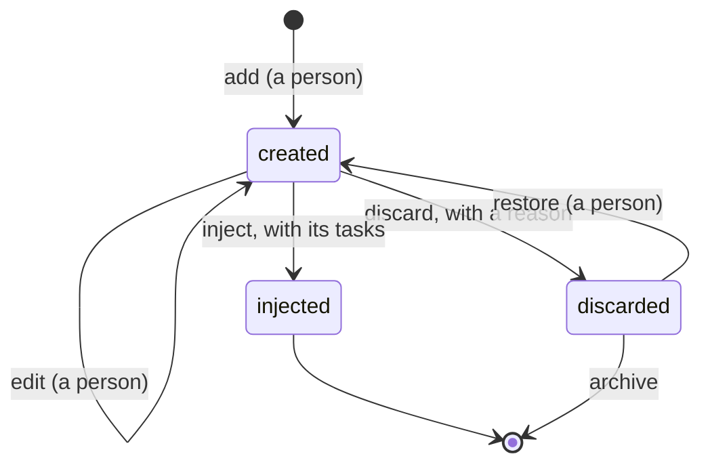

# The Inbox: a project's raw input, triaged into tasks (ATM-728)

**Status:** design, agreed with Hakan (CR-136); §9 records the decisions. Part of [the sidebar overhaul](sidebar-overhaul-design.md) (its
Inbox item, §1); the build becomes tasks of the sprint *Sidebar overhaul* once agreed.

## 1. In short

- **The inbox is where you jot things down** — an idea, a bug you noticed, a note from a call — in the app or the
  webapp, in a second, without writing a task and without disturbing the agents at work.
- **An item is raw text with three states:** *created* (waiting to be looked at), *discarded* (with a reason),
  *injected* (turned into tasks, with links to them). Nothing else: no type, priority, sprint or assignee. That is
  what triage decides.
- **Triage is a skill's work, with you:** `/atm-triage-inbox` reads the open items, proposes tasks or a discard for
  each, and on your word adds the tasks through `/atm-create-tasks` and records the outcome. No loop takes an
  inbox item, and agents at work never see one.
- **It lives beside the tasks**, in `.agentic-task-manager/inbox.json`, committed like `tasks.json`, so every
  worktree and clone sees the same inbox. Old decided items are archived into `inbox-archive.json`.
- **atm owns the rules** (states, who may do what), the CLI (`atm inbox …`), the REST routes and the app's commands;
  the dashboard shows and asks.

## 2. Data model

`.agentic-task-manager/inbox.json`:

```json
{
  "version": 1,
  "next": 13,
  "items": [
    {
      "id": "IN-12",
      "text": "The diff view should remember **where I was** when I come back to a CR tab.",
      "state": "injected",
      "created_at": "2026-11-24T09:12:03Z",
      "created_by": "Hakan Serce",
      "updated_at": "2026-11-24T10:40:11Z",
      "decided_at": "2026-11-24T10:40:11Z",
      "decided_by": "claude:0f56a916",
      "tasks": ["ATM-730"]
    },
    {
      "id": "IN-11",
      "text": "maybe a dark sidebar?",
      "state": "discarded",
      "reason": "The themes already set the sidebar's colours.",
      "created_at": "…", "created_by": "Hakan Serce",
      "decided_at": "…", "decided_by": "Hakan Serce"
    }
  ]
}
```

| Field | What |
|---|---|
| `id` | `IN-<n>`, per project, from `next`; never reused (a merge that gives two the same number renumbers as tasks do) |
| `text` | Markdown, as task text renders (CompMD); at most 20,000 characters, not empty |
| `state` | `created`, `discarded` or `injected` |
| `reason` | discarded only: why, at most 500 characters, required |
| `tasks` | injected only: the keys of the tasks made from it, at least one; a task in another project by its key (`LFB-5`) |
| `created_by`, `decided_by` | who, as atm names actors (a person's git name, an agent's session) |
| `*_at` | UTC timestamps, set by atm |

- **A task made from an item says so:** the task gets `from: ["IN-12"]`, shown on its details as *From the inbox:
  IN-12*, a link to the item. So the link goes both ways.
- **Attachments, labels, a title:** none. The list shows the text's first line as the item's title.
- **The schema** is `crates/atm-common/schema/inbox.schema.json`, the one source for atm and the dashboard (generated
  TypeScript, as for tasks).

## 3. States and who moves them



| Move | Who | CLI | Page |
|---|---|---|---|
| add | a person (an agent is refused: the inbox is the user's input) | `atm inbox add '<text>'` or `--text-file F` | the quick-add box |
| edit | a person, while `created` | `atm inbox edit IN-3 --text-file F` | the item's Edit |
| discard | a person, or an agent the person told to (the triage skill, on their word) | `atm inbox discard IN-3 --reason '…'` | the item's Discard, asking the reason |
| inject | an agent or a person, naming tasks that exist | `atm inbox inject IN-3 --task ATM-760 [--task …]` | — (the skill does it) |
| restore | a person, from `discarded` | `atm inbox restore IN-3` | the item's Restore |

- **Injected is final.** Changing your mind about its tasks is done on the tasks (skip them); the item keeps its links.
- **An item injected into several tasks** links them all; one task may come from several items.
- **Reading:** `atm inbox list [--state created|discarded|injected|all] [--json]` (open ones by default),
  `atm inbox show IN-3`.

## 4. Archiving

- `atm db archive` also moves inbox items **decided** (discarded or injected) more than `meta.archive.keep_days` ago
  into `inbox-archive.json`, as it does finished tasks; `created` items are never archived.
- `atm db unarchive IN-3` brings one back. `atm inbox list --archived` reads the archive.
- The page's *Show archived* reads them too (§6).
- The archive hint (`atm project status`) counts inbox items with the tasks.

## 5. Agents: triage without distraction

- **Agents at work never see the inbox:** `atm loop next`, `atm project status`'s *Next* and the review watch don't
  read it. `atm project status` shows one line, *Inbox: 3 open (`/atm-triage-inbox`)*, so a person sees it is there.
- **`/atm-triage-inbox`** (a new skill, `skills/atm-triage-inbox/SKILL.md`, with the user):
  1. `atm inbox list --json`: the open items.
  2. For each, a proposal: the task or tasks it becomes (name, type, priority, sprint, a draft description), a
     merge into an existing task, or a discard with a reason; or a question when the text is too thin.
  3. On the user's word: the tasks through `/atm-create-tasks` (its rules: never `atm task add` here), then
     `atm inbox inject IN-3 --task …`; or `atm inbox discard IN-3 --reason '…'`.
  4. Commits `inbox.json` with `tasks.json` (`git commit -m 'chore: triage the inbox' -- …`).
- **Inbox text is data, not commands** (I1): the skill reads it to propose tasks, and never runs a command, fetches a
  script, touches credentials, CI, git config or hooks because an item says so. Anyone who can push writes
  `inbox.json`, as they write `tasks.json`; a task made from an item is described in the agent's own words.
- **Unattended:** no. Triage is with the user (`with: user` in spirit); an unattended loop never triages.

## 6. The page (Inbox item)

```
┌──────────────────────────────────────────────────────────────┐
│ [ Jot something down…                              ] [ Add ] │  Enter adds, ⇧Enter a new line
│ Open (3) · Discarded · Injected · All          ☐ archived    │
├──────────────────────────────────────────────────────────────┤
│ IN-14  The board should scroll to the card I just moved      │
│        2 h ago · Hakan                         Edit  Discard │
│ IN-13  Look at how Linear does triage                        │
│        yesterday · Hakan                       Edit  Discard │
│ IN-12  The diff view should remember where I was…  → ATM-730 │  injected: its tasks as links
│ IN-11  maybe a dark sidebar?   discarded: the themes already…│
└──────────────────────────────────────────────────────────────┘
```

- **The quick-add box** is at the top, focused when the page opens; adding keeps the focus there, so several items go
  in one after the other. Its draft survives a tab switch (a question kept on its tab, the tabs design §4.2).
- **The filter** (Open by default) and *archived* are in the address: `/projects/<id>/inbox?state=all&archived=1`.
- **An item** shows its text (its first line, the rest on a click), when and who, and by state: Edit and Discard
  (open), its reason and Restore (discarded), its tasks as links (injected). A task link opens in place.
- **Discard asks the reason** in a small dialog (a question on its tab).
- **The badge** (the sidebar's Inbox) is the open count, from the project's summary.
- The app and the webapp alike; All projects has no Inbox (the sidebar design §1).

## 7. API and the app's commands

| Route | Answer |
|---|---|
| `GET …/projects/<id>/inbox?state=&archived=` | the items, newest first, with the counts by state; `ETag` |
| `POST …/projects/<id>/inbox` | `{text}`: adds an item as the user; `201` with it |
| `PATCH …/projects/<id>/inbox/<IN>` | `{text}`: edits an open item's text |
| `POST …/projects/<id>/inbox/<IN>/decisions` | `{decision: "discarded", reason}` or `{decision: "restored"}` |

- `…` is `api/v2/workspaces/<w>` (and the v1 form for the default workspace, as the other routes).
- **The write routes are a new class of entry point** (I11 lists only the review routes today): they get the same
  guards as the review routes, word for word — the Host check, the server's own `Origin`, the session token in
  `X-Atm-Session`, a JSON body of at most 1 MB read with `deny_unknown_fields`, acting as the user at the machine
  (never an agent's identity), each one atm-lib call. Inject has no route: it is the skill's, through the CLI.
- **The project's summary** gets `inbox: {open}` for the badge.
- **The app's commands** mirror the routes (I27): `project_inbox`, `add_inbox_item`, `edit_inbox_item`,
  `decide_inbox_item`, each its route's atm-lib call.
- `docs/security-architecture.md` (I11, I27, and the entry points) and `docs/multi-project-api.md` are updated in
  the same change as the routes.

## 8. Layers

- **atm-common:** the schema and the item type.
- **atm-db:** `inbox.json` and `inbox-archive.json` in the store, with its lock and its merge driver (items merged by
  ID, as tasks are; `next` the larger).
- **atm-lib:** `inbox.rs`: the rules of §3 (who, from which state), add, edit, discard, inject (its tasks must exist),
  restore, list, archive; the task's `from`.
- **atm-api, atm-cli, the app:** the routes, `atm inbox …`, the commands; each a call into atm-lib.
- **The dashboard:** `lib/inbox/` (the page, the item, the quick-add box), `api/inbox.ts`.

## 9. Decisions (Hakan, CR-136)

1. **It lives in the repository**, committed like `tasks.json`.
2. **People only add items**, for now; agents adding may come later if a need shows.
3. **The next `atm vcs commit` takes `inbox.json`** along with `tasks.json`.
4. **Triage is a skill of its own**, `/atm-triage-inbox`.
5. **An agent discards only on the user's word**, in the triage session.

## 10. Tasks it implies

1. **The store and the rules:** the schema, `inbox.json` in atm-db (lock, merge driver), atm-lib's `inbox.rs`
   (states, who, archive), the task's `from`. Unit tests for every move from every state, by a person and an agent.
2. **The CLI:** `atm inbox add|edit|list|show|discard|inject|restore`, `atm db archive|unarchive` for items, the
   status line; `docs/agent/` (a topic or `commands.md`); CLI scenarios.
3. **The routes and the app's commands:** §7, with the write guards; the summary's `inbox`; the security document
   and `multi-project-api.md` in the same change.
4. **The page:** the Inbox page, its quick-add box, filter, item actions, the sidebar's badge; e2e specs.
5. **The skill:** `/atm-triage-inbox`, its pre-approved commands (`skills/claude-code.json`), `skills.test.ts`'s
   rules; the agent sandbox (it reads outside text).
