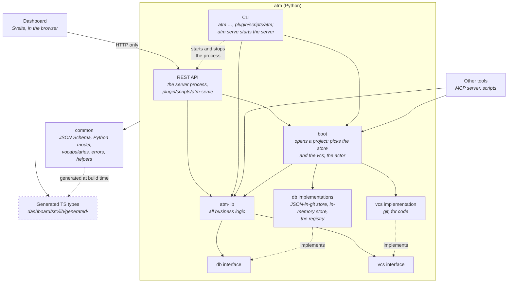
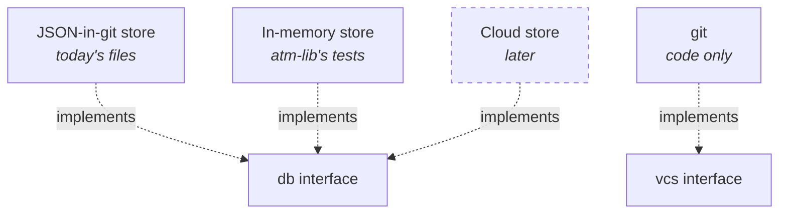

# Layered architecture for atm

**Status:** done: approved (T-360, reviewed with Hakan in Crit), and carried out in the 16 steps of §9 (T-361 to
T-376, with T-377) · **Date:** 2026-11-02 · **Sprint:** *Layered Architecture*

Where the code ended up differs from this design, and what is still open, is in §11 (*Current state and gaps from
the design*), with the decision taken on each in the end-of-sprint review and the task that carries it out.

atm grew command by command: each `cmd_*` function parses its arguments, locks and reads `tasks.json`, applies the
rules, writes the file back and prints the result. That was the fastest way to build it, and it works. It also means
the business rules, the storage and the output are woven together in every module. Three things we want next need
them apart:

- **another storage model**, such as a cloud database with its own sync, instead of JSON files shared through git;
- **other users of atm's logic** (an MCP server, scripts, other tools) without going through the command line;
- **a dashboard without its own copy of the rules**, so a rule changes in one place.

This document defines the layers, what each one may depend on, the interfaces between them, where today's code
goes, and the steps to get there. It moves no code: the steps at the end become tasks once it is approved.

## 1. The layers

**The layers and what they depend on:**



The layers as built (T-361 to T-376, and the follow-ups of §11). Every layer inside *atm (Python)* may use common;
the Dashboard uses only the types generated from it. The solid arrows are the build's layer rule (`ALLOWED` in
`atm-cli/build.py`): nothing else may import across layers. The dashed arrow between the CLI and the REST API is
between processes, not an import: the CLI starts, stops and refreshes the server process (`plugin/scripts/atm-serve`),
and the built `atm.py` enters as one or the other (§11.1). The reach of **boot** is the code's, not the first
design's; §11 says where the code differs from the design and what follows.

**What implements the interfaces:**



| Layer | Does | Never |
|---|---|---|
| **Dashboard** | Shows projects; fetches from the REST API; computes what is presentation (charts, forecasts, velocity, burndown, groupings, layout) | Reads files; holds business rules (what is ready, archivable, waiting on whom) |
| **Generated TS types** | The types of the API's responses, generated from common's schema; the Dashboard imports them | Is edited by hand |
| **REST API** | Maps HTTP requests to atm-lib calls and results to JSON; the HTTP concerns (Host check, ETags, sizes, caching) | Holds logic; touches storage |
| **CLI** | Maps arguments to atm-lib calls and results to text or `--json`; exit codes | Holds logic; touches storage |
| **boot** | Opens a project: picks the store and the vcs; works out the actor; reaches what only the JSON-in-git store has (paths, migrations, the merge driver, the registry by folder) | Holds business rules |
| **atm-lib** | Every business action and query (§5) | Knows how or where data is kept; prints; reads `argparse` objects |
| **db** | One interface for data access (§3); its implementations know how and where data is kept, and keep concurrent writers apart | Business rules |
| **vcs** | One interface to the code's version control (§2) | Business rules; storing tasks |
| **common** | The JSON Schema and the Python model generated from it, vocabularies and their defaults, status kinds, typed errors, pure helpers (time, IDs, names) | Depends on any other layer; does I/O |

**The dependency rule.** Dependencies run one way:

- the Dashboard depends on the REST API, over HTTP only, and on the generated TS types;
- the REST API, the CLI and other tools depend on atm-lib;
- atm-lib depends on the db and vcs **interfaces**, never on an implementation; the implementation is chosen once,
  when a project is opened, in **boot** (`open_project`), a small layer the CLI and the REST API call and the only
  one that knows the implementations;
- the db and vcs implementations depend on their interfaces;
- every Python layer may use common.

Nothing depends upward, and the CLI and REST API never call each other. They are two processes: the CLI
(`plugin/scripts/atm`) starts, stops and refreshes the server (`plugin/scripts/atm-serve`, the REST API) as a process,
through its record and pid; what both know about the server (its record, the dashboard file's tags) is common's
(`common/dashboard.py`). The one built `atm.py` ends in a single entry the build writes: `--server` runs the server,
anything else the CLI (T-379, §11.1).

What a store alone has (the JSON-in-git store's paths, lock, merge driver and migrations; the user's registry of
projects) is reached through boot, by the commands about it (`atm paths`, `migrate`, `merge-driver`, `init`'s merge
driver, the hook's registering).

## 2. Git's two roles

atm runs `git` today for two different reasons, and the design keeps them apart.

**Git as the store for tasks** (a db implementation detail):

- tasks reach other people by commit, push and merge; atm's merge driver for `tasks.json` (`merge.py`) lets branches
  that changed different tasks merge cleanly;
- `migrate` and `init` stage atm's files (`git add`, `git mv`, `git rm --cached`);
- claims and the registry are shared by all worktrees of a clone through `git rev-parse --git-common-dir`
  (`claims.py:79`, `registry.py:60`);
- the project card's branch comes from `.git/HEAD` (`query.py:351`), and the worktrees' own copies of `tasks.json`
  show on the board (`worktrees.json`).

**Git as the code's version control** (the vcs interface):

- `atm commit`: commits exactly a task's files with `tasks.json`, and records the SHA on the task (`lib/code.py` `commit_task`, through `vcs/git.py`; before step 13, `git_ops.py`);
- `atm commit --record`: checks a commit is in the history (`merge-base --is-ancestor`);
- `atm workflow`'s default base branch (`origin/HEAD`), `atm repository`'s remote address.

```python
class Vcs(Protocol):
    def commit(self, files: list[str], message: str) -> str: ...     # exactly these files; returns the SHA
    def resolve(self, rev: str) -> str | None: ...                    # a revision's SHA, None if unknown
    def in_history(self, sha: str) -> bool: ...                       # reachable from the current commit
    def message(self, sha: str) -> str: ...                           # a commit's message
    def default_base(self) -> str | None: ...                         # the remote's default branch
    def remote_url(self) -> str | None: ...                           # the remote's address
    def branch(self) -> str | None: ...                               # the checked-out branch
```

**The code host is already outside atm.** `atm pr` and `atm merged` only record what they are given; the skills call
`gh`. The dashboard already builds commit and PR links for GitHub, GitLab, Bitbucket and Gitea (`repo.ts:26`).
Supporting GitLab needs no change to these layers: it is a change in the skills.

**What the split buys:**

- **Another store for tasks.** Merge driver, commit-to-share and worktree-shared claims all move into the JSON-in-git
  store. A cloud store replaces them with its own sync and locking, and atm-lib doesn't change. This is the main gain,
  and it needs those three to leave `core.py`, `merge.py`, `claims.py` and `registry.py`.
- **Code in git, tasks elsewhere.** With a cloud store, `atm commit` still commits the code through vcs and records
  the SHA in the store, but no longer commits `tasks.json`: atm-lib asks the store for the files that travel with
  code commits (`Store.files_for_commit()`, `[".agentic-task-manager/tasks.json"]` for JSON-in-git, none for a cloud
  store) instead of assuming them.
- **Other version control** (Mercurial, Jujutsu, Sapling). The vcs interface is small (above). We define it and ship
  only git; another implementation is possible later, not planned.

Both git implementations (the store's and vcs's) run git the same way; they share a small git runner kept beside
them, not in common, since common does no I/O.

## 3. The db interface

### 3.1 What atm stores today

Every read or write loads and saves whole files, but what atm *does* is a short list of operations on a few
entities. The interface models those, as they are used today, and nothing more.

| Entity | Kept today in | Create | Read | Update | Delete |
|---|---|---|---|---|---|
| **Settings**: `project`, `description`, `id`, `repository`, `logo`, `workflow`, `review`, `sprint_names`, `archive` settings | `tasks.json` `meta` | `init` | every command | `init --meta-file`, `workflow set`, `repository set`, `logo set/unset` | — |
| **Vocabularies**: statuses, types, priorities, `default_priority`, label descriptions | `tasks.json` `meta` | `init --meta-file` | every command | `init --meta-file` (a list is replaced whole) | — |
| **Task** | `tasks.json` `tasks` | `add` (one or many; the ID is allocated then) | `show`, `list`, `status`, `deps`, `next`, … | `edit`, the status changes, `note`, `commit`, `pr`, `merged`, `move`, `components --assign/--from-label` | none: finished tasks are archived, unwanted ones skipped |
| **Archived task** | `tasks-archive.json` | `archive` (moved from tasks) | `list --archived`, `show`, dependencies | `components --from-label` | `unarchive` (moved back) |
| **Sprint** | `tasks.json` `meta.sprints`, in order | `sprints add [--after]`, `close --carry-to new` | `sprints`, `status` | `sprints edit`, `start`, `close` (with its report) | `sprints delete` |
| **Release** | `tasks.json` `meta.releases`, in order | `releases add` | `releases`, `status` | `releases edit`, `archive` (a state), `merged` (released) | — |
| **Component** | `tasks.json` `meta.components` | `components add` | `components`, `add`, `edit`, `check` | `components edit` | — |
| **Claim** (a task's holder and lease) | the claims store, shared by a clone's worktrees | `start`, `next --claim` | `claims`, `status`, `next`, the dashboard | `heartbeat` (the lease) | `done`, `review`, `block`, `release`, `fail`; expiry |
| **Resolution** (a review or block decided in another worktree) | the claims store | the decision | `status`, the worktrees' boards | — | when that worktree's copy catches up |
| **Registered project** | `~/.agentic-task-manager/projects.json` | `projects add`, every atm run (registers) | `projects`, `atm serve` | `seen_at`, id and name follow `meta` | `projects remove`, `prune` |

Two counters live with them: `meta.next_id` (the next task ID, so new IDs never need the archive) and
`meta.archived` (the archive's size, for the dashboard). Both are the store's job, not atm-lib's.

### 3.2 The interface

```python
class Store(Protocol):
    # Settings and vocabularies
    def get_settings(self) -> Settings: ...
    def update_settings(self, changes: SettingsChanges) -> Settings: ...
    def get_vocabularies(self) -> Vocabularies: ...                    # with the defaults filled in
    def set_vocabularies(self, lists: VocabularyLists) -> None: ...     # init --meta-file

    # Tasks
    def create_tasks(self, drafts: list[TaskDraft]) -> list[Task]: ...  # allocates the IDs (next_id)
    def get_task(self, id: str) -> Task | None: ...                     # a working task
    def get_archived_task(self, id: str) -> Task | None: ...            # an archived task
    def list_tasks(self, where: TaskFilter | None = None) -> list[Task]: ...
    def update_task(self, id: str, changes: TaskChanges, expect: Version) -> Task: ...

    # The archive
    def list_archived(self, where: TaskFilter | None = None) -> list[Task]: ...
    def archive_tasks(self, ids: list[str]) -> int: ...                 # moves them; returns the archive's size
    def restore_tasks(self, ids: list[str]) -> list[Task]: ...          # unarchive

    # Sprints, releases, components (meta lists, in order)
    def list_sprints(self) -> list[Sprint]: ...
    def create_sprint(self, sprint: Sprint, after: str | None = None) -> Sprint: ...
    def update_sprint(self, name: str, changes: SprintChanges) -> Sprint: ...
    def delete_sprint(self, name: str) -> None: ...
    def list_releases(self) -> list[Release]: ...
    def create_release(self, release: Release) -> Release: ...
    def update_release(self, id: str, changes: ReleaseChanges) -> Release: ...
    def list_components(self) -> list[Component]: ...
    def create_component(self, component: Component) -> Component: ...
    def update_component(self, id: str, changes: ComponentChanges) -> Component: ...

    # Claims
    def list_claims(self) -> list[Claim]: ...                          # live and expired: atm-lib decides
    def create_claim(self, claim: Claim) -> Claim: ...                  # Conflict if the task is claimed
    def renew_claim(self, task_id: str, holder: str, until: Time) -> Claim: ...
    def delete_claim(self, task_id: str, holder: str | None = None) -> None: ...
    def list_resolutions(self) -> list[Resolution]: ...

    # Several writes that must happen together (3.3)
    def apply(self, writes: list[Write]) -> None: ...                   # all or nothing; Conflict on a stale expect

    # What the store needs from the code's version control
    def files_for_commit(self) -> list[str]: ...                        # files atm commit adds; [] for a cloud store


class Registry(Protocol):                                               # the user's list of projects
    def list_projects(self) -> list[ProjectEntry]: ...
    def add_project(self, path: str) -> ProjectEntry: ...
    def update_project(self, id: str, changes: ProjectEntryChanges) -> ProjectEntry: ...
    def remove_project(self, id: str) -> None: ...
    def open(self, id: str) -> Store: ...
```

`TaskFilter` names only stored fields (IDs, status, sprint or backlog, type, priority, label, component, release,
`with`); what is derived (ready, waiting, effective review) is atm-lib's. The JSON-in-git store filters in memory.

**Tolerant reads** (T-377, decided with Hakan): a store opened `tolerant` reads malformed data as far as it can, for
showing it (the REST API's reads for the dashboard), and says what is wrong (`problems()`: the file's, and each
task's); every task it hands out fits the task schema. Writes are always strict, as are atm's commands.

Things only one store has stay out of the interface and are reached through that store directly by the code that
needs them: the JSON-in-git store's merge driver (`atm merge-driver`, which git runs), its migrations of old layouts
(`atm migrate`), its file locations (`atm paths`) and its worktrees' copies (`worktrees.json`). A cloud store has no
such things; atm-lib never calls them.

### 3.3 Do we need transactions?

Not a generic one, but atm does need some writes to happen together. Today every write is, in effect, a
transaction: lock, read the whole file, change it, write it back, unlock. That is what keeps two agents from taking
the same task. Most of today's writes touch one entity and need nothing more. A few touch several, and must happen
all together or not at all:

| Operation | Why it must be atomic |
|---|---|
| `start`, `next --claim` | read "to do, dependencies done, unclaimed", then set the status and create the claim: two agents racing must not both win |
| `done`, `review`, `block`, `release`, `fail` | the status change and the claim's removal go together |
| `add` (many) | all the tasks or none; the IDs allocated once |
| `sprints close` | the sprint's state and report, every carried task's sprint, and a new sprint |
| `sprints delete --move-to` | the sprint and its tasks' moves |
| `archive`, `unarchive` | a move between two places; today a crash leaves a task in both, never in neither (DM-5.2) |
| `merged` | the tasks' `merged_at` and the release becoming released |

So instead of a transaction that callers open and hold, the interface has:

- **conditional writes:** every entity has an opaque `version` (the JSON-in-git store hashes the entity's content);
  `update_task(…, expect=version)` fails with `Conflict` if the task changed since it was read;
- **`apply(writes)`:** a list of conditional writes, done all together or not at all (the archive moves are their
  own store operations, since a store may move them differently);
- **retry in atm-lib:** on `Conflict`, atm-lib reads again, checks its rules again, and writes again (for `start`,
  a second check finds the task claimed and says so).

This fits the JSON-in-git store (`apply` is today's lock-read-write) and a cloud database (conditional and batched
writes are what they offer).

**How it starts (decided with Hakan, T-368): `change(fn)`, then `apply`.** The status changes and their rules still
work on the whole document in place, so the first form is a store operation that runs a change under the store's own
isolation: `store.change(fn)` calls `fn(work)` with a working copy (`db/working.py`: `tasks()`, `claims()`, `here()`,
`size()`, `defer(error)` for an error raised after writing) and writes what changed, nothing if `fn` raises. The
JSON-in-git store runs it under its lock; a database with read-modify-write transactions (Firestore, Spanner) runs it
as one, retried on contention. `work.changes()` records each task and claim the change touched, before and after:
that list is the `apply(writes)` of a store with conditional writes only, so moving there changes the stores, not
atm-lib's rules. The first draft's `Tx` handed atm-lib the whole document to change in place, which is
today's code moved behind a name: it would have tied every future store to whole-document writes.

## 4. common and the generated types

Today the model is written twice, by hand: in Python (`model.py`, `core.py`) and in TypeScript (`types.ts`,
`vocab.ts`). common makes one source: **JSON Schemas**, in `atm-cli/atm/common/schema/`.

### 4.1 The schemas

| Schema | Describes | Used by |
|---|---|---|
| `tasks.schema.json` | `tasks.json`: `meta` and `tasks` | the JSON-in-git store, `atm check`, the tests |
| `archive.schema.json` | `tasks-archive.json` (`meta.archived_at`, `tasks`) | the JSON-in-git store |
| `task.schema.json` | one task, every field of `docs/v4/data-model.md` §4 | all of the above, the API |
| `meta.schema.json` | settings, vocabularies, sprints, releases, components, workflow, archive settings | as above |
| `claims.schema.json` | the claims store: claims, resolutions, hint dates | the JSON-in-git store, the API |
| `registry.schema.json` | `projects.json` | the registry |
| `api.schema.json` | every REST API response (§6) and the error shape | the REST API, the Dashboard |

### 4.2 The types

Generated for both languages from the schemas (Python `TypedDict`s and `Literal`s; TypeScript `interface`s and
unions):

| Group | Types |
|---|---|
| Vocabularies | `Kind` (the six), `Status`, `TaskType`, `Priority`, `LabelInfo`, `Vocabularies`, `ReviewMode`, `SprintNames` |
| Task | `Task`, `TaskDraft`, `TaskChanges`, `Note`, `NoteKind`, `Block`, `ReviewRound`, `SprintHistoryEntry`, `PullRequest`, `ReviewState`, `Resolution` (how it ended), `WithUser` |
| Project | `Settings`, `Workflow`, `ArchiveSettings`, `Sprint`, `SprintState`, `SprintReport`, `Release`, `ReleaseState`, `Component` |
| Documents | `TasksDocument`, `ArchiveDocument`, `ClaimsStore`, `RegistryDocument`, `ProjectEntry` |
| Claims | `Claim`, `ClaimResolution`, `Actor` |
| atm-lib results | `TaskView` (a task with its derived values: `kind`, `ready`, `waiting_for`, `waiting_on`, `effective_review`, `effective_release`, `stage`, `archived`), `StatusReport`, `NextResult`, `DepsResult`, `CheckReport`, `ArchiveReport`, `SprintCloseReport`, `ReleaseNotes` |
| API | `ProjectList`, `ProjectInfo`, `ProjectSummary`, `SprintSummary`, `Board`, `BoardColumn`, `Card`, `Worktree`, `WorktreeList`, `ClaimList`, `SearchResult`, `WhoAmI`, `ApiError` |
| Errors | `ErrorCode`: `not_found`, `invalid`, `conflict`, `claimed`, `lease_expired`, `not_allowed`, `nothing_to_do` |

### 4.3 How they are made and checked

- **one generator for both languages**, in `atm-cli/build.py` (standard library, no npm dependency): the schemas use
  a small subset of JSON Schema (scalar types, arrays, string enums, `$ref`s to `$defs`), and every object type is
  defined in `$defs` or is a file's own type;
- **TypeScript** for the Dashboard (`dashboard/src/lib/generated/types.ts`, formatted as Prettier wants it), which
  `src/lib/types.ts` builds on;
- **Python** `TypedDict`s (`atm-cli/atm/common/types.py`, the functional form, since keys such as `from` are
  keywords), so `atm.py` stays standard-library only;
- **the kinds and the default vocabularies** (statuses, types, priorities, the default priority) as data,
  `atm-cli/atm/common/schema/vocabularies.json`, generated into `common/vocabularies.py` and
  `dashboard/src/lib/generated/vocabularies.ts`: atm-cli's `model.py` and the dashboard's `vocab.ts` keep no copy;
- **checks:** the Python validators (`check_*` in `model.py`) stay hand-written (the standard library has no schema
  validator); the test suite validates every fixture, every scenario's output and every API response against the
  schemas, so code and schemas can't drift;
- CI fails when a generated file is stale: `build.py --check`, which CI already runs for `atm.py`, checks them too.

The alternative, Python `TypedDict`s as the source with a small generator for TypeScript, has fewer files but puts
the contract in one of the two languages. We prefer the schemas: they are also the contract for other users of
atm-lib and for a future store.

## 5. atm-lib

atm-lib is usable by others, so it is an API with a version:

- functions take plain values and return results of common's types; they never take an `argparse.Namespace`, print
  or exit;
- failures are typed errors (`ErrorCode`, §4.2), which the CLI maps to its exit codes (today 1, 2, 3 and 4) and the
  REST API to HTTP statuses;
- no module-level state (the `archived_task` cache became a lookup the store sets, the one hook left, §8);
  everything goes through a `Project`, which holds the store, the vcs and the actor:

```python
from atm.boot import open_project                       # boot: picks the store (JSON-in-git) and the vcs (git)
from atm.lib import change_task_status

project = open_project(path, actor="claude:b7be7288")
change_task_status(project, "start", "T-360")
```

- **names unique across atm:** the build puts every module into one namespace (`plugin/scripts/atm.py`), so a
  function is `show_tasks`, not `tasks.show`. The tables below group the functions by area; the names in code follow
  this rule;

- **delivery:** the plugin keeps the one-file `atm.py`, built from the same modules. Other tools import atm-lib from
  the repository's `atm-cli/` for now; a published package can come later. Its public surface is `atm.lib` (what
  `atm/lib/__init__.py` exports in `__all__`, with how to use it) and `atm.boot`'s `open_project` and
  `open_registry`, which open the stores atm-lib may not know (T-376); versioned with the plugin, a change to it in
  `plugin/CHANGELOG.md`. Everything else is internal. `tests/lib/test_public.py` uses only that surface.

### 5.1 The functions

Every function takes the `project` first; those that write record `project.actor`. `status` (where a function takes
one) picks a status when the project has several of the target kind. The CLI command each one serves is in the last
column.

**Tasks: status changes**

| Function | Parameters | Returns | Does | CLI |
|---|---|---|---|---|
| `tasks.start` | `id`, `status?` | `TaskView` | to do → in progress, claimed; its dependencies must be done | `start` |
| `tasks.review` | `id`, `note?`, `status?` | `TaskView` | asks for a review; the claim is released | `review` |
| `tasks.done` | `id`, `note?`, `commit?`, `resolution?`, `status?` | `TaskView`, now ready | done (or waits for the sprint review, by its review mode); the claim dropped | `done` |
| `tasks.reject` | `id`, `reason` | `TaskView` | a task in review back to to do | `reject` |
| `tasks.approve` | `id`, `note?` | `TaskView` | approves a review; it stays in review until its agent takes it back | `approve` |
| `tasks.request_changes` | `id`, `reason` | `TaskView` | asks for changes; its agent gets it back first | `request-changes` |
| `tasks.block` | `id`, `on` (`user`/`agent`), `questions[]`, `reason?` | `TaskView` | blocked on a decision; the claim released | `block` |
| `tasks.unblock` | `id`, `answers[]` | `TaskView` | back to to do with the answers as a note | `unblock` |
| `tasks.reopen` | `id`, `reason` | `TaskView` | a done or skipped task back to to do | `reopen` |
| `tasks.skip` | `id`, `reason`, `resolution?`, `duplicate_of?` | `TaskView` | not needed: skipped | `skip` |
| `tasks.fail` | `id`, `reason?` | `TaskView` | in progress back to to do, with a failure note | `fail` |
| `tasks.release` | `id`, `note?` | `TaskView` | in progress back to to do, with a handoff note | `release` |
| `tasks.note` | `id`, `text` | `TaskView` | adds a note (at most 500 characters) | `note` |

**Tasks: definitions and queries**

| Function | Parameters | Returns | Does | CLI |
|---|---|---|---|---|
| `tasks.add` | `drafts[]` (name, type, sprint, release, priority, labels, description, dependencies, files, requirements, components or `auto`, review, related, with; placeholder IDs) | `TaskView[]`, component hints | adds tasks with the next IDs, all or none | `add` |
| `tasks.edit` | `id`, `changes` (name, description, sprint or backlog, type, priority, release, review, with; add/remove files, dependencies, labels, components, related; components `auto`) | `TaskView`, hints | changes a definition, never the status | `edit` |
| `tasks.show` | `ids[]` | `TaskView[]` | tasks in full, archived ones too | `show` |
| `tasks.list` | `filter` (statuses, type, priority, labels, agent, sprints or backlog, release, component, ready, blocked, in_pr, with_user, archived) | `TaskView[]` | the tasks that match | `list` |
| `tasks.deps` | `id` | `DepsResult` | what it waits for, and what waits for it (archived ones too) | `deps` |
| `tasks.search` | `query` | IDs | the tasks matching every word | (API: search) |
| `tasks.check` | `files?` | `CheckReport` | the schema, vocabularies, dependencies; with `files`, missing files of finished tasks | `check` |

**Claims and the loop**

| Function | Parameters | Returns | Does | CLI |
|---|---|---|---|---|
| `claims.next` | `selection` (sprints, tasks, all or backlog), `type?`, `with_user?`, `claim?`, `status?` | `NextResult` (the task, or why there is none) | the task the loop takes next; with `claim`, starts and claims it atomically | `next` |
| `claims.heartbeat` | `id` | `Claim` | renews the actor's lease | `heartbeat` |
| `claims.heartbeat_due` | — | `Claim[]` | renews the actor's claims whose last renewal is ten minutes old | `heartbeat --auto` |
| `claims.list` | — | `Claim[]` | the live claims, from every working copy | `claims` |

**Overview**

| Function | Parameters | Returns | Does | CLI |
|---|---|---|---|---|
| `project.status` | `scope?` (sprints, backlog, release, component) | `StatusReport` | counts, in progress, in review, blocked, next, hints | `status` |
| `project.summary` | — | `ProjectSummary` | the numbers the dashboard's cards show | `summary` |
| `project.backlog` | `all?` | `TaskView[]` | the tasks in no sprint | `backlog` |

**Sprints, releases, components**

| Function | Parameters | Returns | Does | CLI |
|---|---|---|---|---|
| `sprints.list` | `all?` | `Sprint[]` with counts | the sprints in order | `sprints` |
| `sprints.add` | `name?`, `goal?`, `release?`, `due?`, `after?` | `Sprint` | a planned sprint (a name generated without one) | `sprints add` |
| `sprints.edit` | `name`, `goal?`, `release?`, `due?` (empty removes) | `Sprint` | changes a sprint | `sprints edit` |
| `sprints.start` | `name` | `Sprint` | makes it the active one | `sprints start` |
| `sprints.close` | `name`, `carry_to?` (a sprint, `new` or `backlog`), `new_name?`, `reviewed?` | `SprintCloseReport` | closes it; unfinished tasks carried | `sprints close` |
| `sprints.delete` | `name`, `move_to?`, `force?` | — | deletes it; its tasks moved | `sprints delete` |
| `sprints.move` | `ids[]`, `to` (a sprint, `next`, `active`, `backlog`) | `TaskView[]` | moves tasks between sprints | `move` |
| `releases.list` | `all?` | `Release[]` with tasks by kind and stage | the releases in order | `releases` |
| `releases.add` | `id`, `name?`, `target?`, `prs[]?`, `released_at?` | `Release` | a release (with the tasks of those PRs) | `releases add` |
| `releases.edit` | `id`, `name?`, `target?` | `Release` | changes one | `releases edit` |
| `releases.archive` | `id` | `Release` | archives it | `releases archive` |
| `releases.notes` | `id` | `ReleaseNotes` (Markdown) | a draft of its changes | `releases notes` |
| `components.list` | — | `Component[]` with counts | the components | `components` |
| `components.add` | `id`, `label?`, `paths[]`, `review?`, `from_label?`, `assign?` | `Component` | a component; with `from_label` or `assign`, given to tasks | `components add` |
| `components.edit` | `id`, `label?`, `add_paths[]?`, `review?`, `from_label?`, `assign?` | `Component` | changes one | `components edit` |

**The archive**

| Function | Parameters | Returns | Does | CLI |
|---|---|---|---|---|
| `archive.archive` | `sprints[]?`, `before?`, `keep_days?`, `dry_run?` | `ArchiveReport` (moved, kept and why) | moves finished tasks to the archive | `archive` |
| `archive.unarchive` | `ids[]` | `TaskView[]`, those the next archive moves back | brings tasks back | `unarchive` |
| `archive.hint` | — | the hint, or none | whether archiving would help now | (in `status`, `done`) |

**Code, PRs and the project's settings**

| Function | Parameters | Returns | Does | CLI |
|---|---|---|---|---|
| `code.commit` | `id`, `files[]`, `message?` | the SHA | commits exactly those files (plus the store's `files_for_commit`) and records it on the task | `commit` |
| `code.record_commit` | `id`, `rev` | the SHA | records an existing commit in the history | `commit --record` |
| `code.pr` | `ids[]`, `number`, `url` | `TaskView[]` | records the PR containing the tasks | `pr` |
| `code.merged` | `pr`, `at?` | the tasks, the release released (or what keeps it planned) | records a merge | `merged` |
| `settings.init` | `meta?` | `Settings` | gives the project an ID; sets settings and vocabularies | `init` |
| `settings.workflow` / `set_workflow` | `type`, `base?`, `verify?`, `max_rounds?`, `commit_template?`, `trailers?`, `trailer[]?` | `Workflow` | reads or sets the workflow | `workflow` |
| `settings.repository` / `set_repository` | `url`, `from?` | the address | reads or sets it (moving recorded PR links) | `repository` |
| `settings.logo` / `set_logo` / `unset_logo` | `path` | the logo's path | reads, sets or removes the logo | `logo` |

**Projects (the registry)**

| Function | Parameters | Returns | Does | CLI |
|---|---|---|---|---|
| `projects.list` | — | `ProjectInfo[]` | the registered projects, with their summaries | `projects`, (API: projects) |
| `projects.add` | `path` | `ProjectEntry` | registers a project | `projects add` |
| `projects.remove` | `id` or `path` | — | unregisters one | `projects remove` |
| `projects.prune` | — | the removed ones | drops projects whose folder is gone | `projects prune` |

**Not in atm-lib** (they are about processes or one store, not business logic): `version` and `help` (CLI);
`serve` (the CLI starts, stops and refreshes the server process, `plugin/scripts/atm-serve`, which is the REST API); `run` (the CLI keeps a claim alive around a child process with
`claims.heartbeat`); `merge-driver`, `migrate` and `paths` (the JSON-in-git store, §3.2); `_lock-test` (a test hook
of that store).

## 6. The REST API

**Today it is a file server.** `atm serve` sends `tasks.json`, `tasks-archive.json` and `claims.json` as they are on
disk (`server.py:600`), plus a few computed answers. The Dashboard then applies the rules itself: which tasks are
ready or waiting (`waiting.ts`, `work.ts`), status kinds and defaults (`vocab.ts`), effective review modes and
releases (`review.ts`, `releases.ts`), the archive's threshold notice. Those are atm-lib's rules computed a second
time, and they are what moves.

**The rules for every request stay** (`docs/multi-project-api.md` §1): `127.0.0.1` only, the Host check, `GET` and
`HEAD` only, `Cache-Control: no-store`, no CORS, JSON errors, ETags with `If-None-Match`. The API stays **read-only**:
a route that writes is a new entry point, out of scope here (§8).

### 6.1 Today's routes

| Route | Answer | atm-lib behind it (target) |
|---|---|---|
| `GET /` | the dashboard | — (the launcher holds it) |
| `GET /__atm/whoami` | the server's pid, port, version, build | — |
| `GET /api/projects` | the projects with their summaries | `projects.list` |
| `GET /api/search?q=` | matching task IDs per project | `tasks.search` per project |
| `GET /p/<id>/tasks.json` | the file, as stored | gone (step 14): the v1 route |
| `GET /p/<id>/tasks-archive.json` | the file, as stored | gone (step 14): the v1 route, `?archived=true` |
| `GET /p/<id>/claims.json` | the live claims | `claims.list` (`lib/query.py` `list_claims`) |
| `GET /p/<id>/worktrees.json` | the worktrees and their changed tasks | `lib/worktrees.py` `worktree_copies`, on the store's working copies |
| `GET /p/<id>/logo` | the logo image | `settings.logo` (`lib/settings.py` `get_logo`) |

### 6.2 The v1 routes

Beside today's, under `/api/v1/`; today's raw file routes went once the Dashboard no longer read them (§9, step 14).
Every answer is a type of `api.schema.json`; list routes take the same filters as `tasks.list` as query parameters.

| Route | Parameters | Answer | atm-lib |
|---|---|---|---|
| `GET /api/v1/projects` | — | `ProjectList`: every project with its summary | `projects.list` |
| `GET /api/v1/projects/<p>` | — | `ProjectInfo`: settings, vocabularies, summary | `project.summary` + settings |
| `GET /api/v1/projects/<p>/status` | scope: `sprint`, `backlog`, `release`, `component` | `StatusReport` | `project.status` |
| `GET /api/v1/projects/<p>/tasks` | `status`, `type`, `priority`, `label`, `agent`, `sprint`, `backlog`, `release`, `component`, `ready`, `blocked`, `in_pr`, `with_user`, `archived` | `TaskView[]`, with the derived values | `tasks.list` |
| `GET /api/v1/projects/<p>/tasks/<t>` | — | `TaskView` | `tasks.show` |
| `GET /api/v1/projects/<p>/tasks/<t>/deps` | — | `DepsResult` | `tasks.deps` |
| `GET /api/v1/projects/<p>/next` | `sprint`, `backlog`, `all`, `type`, `with_user` | `NextResult` (never claims) | `claims.next` |
| `GET /api/v1/projects/<p>/sprints` | `all` | `Sprint[]` with counts and reports | `sprints.list` |
| `GET /api/v1/projects/<p>/releases` | `all` | `Release[]` with tasks by kind and stage | `releases.list` |
| `GET /api/v1/projects/<p>/releases/<r>/notes` | — | `ReleaseNotes` | `releases.notes` |
| `GET /api/v1/projects/<p>/components` | — | `Component[]` with counts | `components.list` |
| `GET /api/v1/projects/<p>/claims` | — | `ClaimList` | `claims.list` |
| `GET /api/v1/projects/<p>/worktrees` | — | `WorktreeList` (empty for a store without worktrees) | the store |
| `GET /api/v1/projects/<p>/archive/hint` | — | the archive hint, or none | `archive.hint` |
| `GET /api/v1/projects/<p>/logo` | — | the image | `settings.logo` |
| `GET /api/v1/search` | `q` | `SearchResult` | `tasks.search` |

Errors map from `ErrorCode`: `not_found` → 404, `invalid` → 400, anything else → 500; a body over the size limit
→ 413, as today.

## 7. Today's code, by layer

atm-cli (7,670 lines in 21 modules). Every module with a `cmd_*` function is CLI and atm-lib at once (it parses,
loads, decides, saves and prints), and most also do storage. `cli.py` imports a `cmd_*` from 17 modules.

| Module | Lines | Goes to | Mixed today |
|---|---|---|---|
| `core.py` | 176 | common (time, JSON text, errors); git runner; CLI (`out`) | output, git and pure helpers together |
| `paths.py` | 73 | db (JSON-in-git) | `cmd_paths` |
| `lock.py` | 122 | db (JSON-in-git) | `cmd_lock_test` |
| `registry.py` | 347 | db (registry) | `cmd_projects`; git for the common dir |
| `model.py` | 799 | common (vocabularies, kinds, checks); atm-lib (`change_status`, notes, archivable) | `load_tasks`, `load_archive` read files; the `archived_task` cache |
| `components.py` | 240 | atm-lib | `cmd_components` |
| `sprint_names.py` | 99 | common | — |
| `repository.py` | 111 | common (URL parsing); vcs (remote address) | `cmd_repository` |
| `logo.py` | 96 | atm-lib (project info); db (reading the file) | `cmd_logo` |
| `claims.py` | 630 | atm-lib (claims, leases, next); db (the claims store) | `cmd_next`, `cmd_run`, `cmd_heartbeat`, `cmd_claims` |
| `query.py` | 813 | atm-lib (status, list, show, deps, summary) | five `cmd_*`; reads `.git/HEAD` |
| `tasks.py` | 191 | atm-lib (status changes, notes) | locks and writes the store itself |
| `edit.py` | 494 | atm-lib (add, edit, check) | three `cmd_*` |
| `sprints.py` | 478 | atm-lib | three `cmd_*` |
| `releases.py` | 280 | atm-lib | `cmd_releases` |
| `merge.py` | 428 | db (merge driver, merge config); atm-lib (`init`) | `cmd_init`, `cmd_merge_driver` |
| `archive.py` | 183 | atm-lib; db (the archive file) | two `cmd_*` |
| `git_ops.py` | 330 | vcs; atm-lib (commit, pr, merged, workflow) | four `cmd_*` |
| `migrate.py` | 443 | db (old layouts); REST API (the dashboard template) | `cmd_migrate` |
| `server.py` | 710 | REST API | serves the task files themselves, not atm-lib results |
| `cli.py` | 622 | CLI | — (already only parsing and dispatch) |

**The Dashboard's requests** are spread over `load.ts`, `state.svelte.ts`, `claims.ts`, `worktrees.ts` and
`overview-data.ts`: they become one client module (`dashboard/src/lib/api/`), the only one that calls `fetch`.

**The dev server plays the API a second time** (`dashboard/build/dev-data.ts`, 152 lines), already calling
`atm summary` for part of it. In the target it runs the real REST API, so there is one implementation.

## 8. Layout, the rule's check, and what stays

```
atm-cli/atm/
  common/        model (generated types + rules), vocabularies, errors, helpers; schema/
  db/            interface.py; jsongit/ (files, lock, merge driver, migrations, claims store); memory/
  vcs/           interface.py; git/
  lib/           atm-lib: tasks, claims, project, sprints, releases, components, archive, code, settings, projects
  boot/          opening a project: picks the store and the vcs; the actor; what is the JSON-in-git store's alone
  cli/           argparse, renderers (text, --json), exit codes
  api/           the REST API: routes, HTTP handling, the launcher
```

- `atm-cli/build.py` already refuses an import from a module later in `MODULES`. It gets layers: each module's layer
  is its folder, and an import the rule doesn't allow fails the build (`api` → `lib` yes, `lib` → `db/jsongit` no,
  `lib` → `cli` no). The output is still one file, `plugin/scripts/atm.py`, and top-level names stay unique.
- **The ratchet** was `atm-cli/layers.json`: the flat modules from before the layers (`legacy`, which could import
  anything until they moved) and, per layered module, the imports that still broke the rule (`exceptions`). The build
  refused a flat module or a forbidden import that wasn't listed, and an entry that was no longer needed, so fixing a
  violation removed its entry in the same change. Step 14 emptied it and removed it: the build now refuses every
  module outside a layer's folder and every import the rule forbids.
- **No global state:** the rules that need an archived task (a dependency only in the archive is done; the "it is
  archived" hint) take the project's lookup as a parameter: atm-lib passes `store.get_archived_task`, or
  `archived_in(work)` inside a change, and each store keeps its own archive cache (T-378, §11.4).
- The Dashboard gets the same as an ESLint rule: only `src/lib/api/` may call `fetch`; generated types are imported,
  never edited.

**Constraints that stay:**

- atm-cli is standard-library Python 3.9 and ships as one file; the plugin needs nothing installed but Python.
- The Dashboard is one self-contained HTML file, served by `atm serve`.
- The security invariants in `docs/security-architecture.md` hold at every step. The REST API stays read-only and
  localhost-only, with its Host check. A route that writes is a new entry point and needs its own design (CSRF
  protection, a token, the security document updated in the same PR).
- Users see no change: same commands, output, exit codes and files. `tests/scripts/` (530 tests through the built
  launcher) and the e2e suite pass at every step and are the safety net for the moves.

## 9. Migration plan

**Slices, not layers.** Building the layers one at a time (all of the store, then all of atm-lib, then the API)
would leave the new layers unused until the last step. Instead, a thin skeleton comes first, and then each step
takes **one slice of atm's functionality through every layer**: its common types, store operations, atm-lib
functions, CLI renderer, API route and, where it has one, the Dashboard's use of it. The slice's old code path is
removed in the same step.

**Every step:**

- leaves every test green: the 530 atm-cli tests and the e2e suite prove users see no change (same commands,
  output, exit codes and files);
- adds atm-lib unit tests on the in-memory store (`tests/lib/`, standard `unittest`) and contract tests for the store
  operations it adds, run against both stores;
- **shrinks the ratchet.** Step 1 makes `build.py` enforce the layer rule (§8) and records today's violations as an
  allowed list. A test fails if the list grows, and every step removes its slice's entries. The list's length is the
  migration's progress; when it is empty, the migration is done.

The JSON-in-git store starts as a wrapper around today's loading, locking and saving code (step 1), so no step
switches storage in one go: the code moves into the store as its slices do.

| # | Step | Afterwards, end to end |
|---|---|---|
| 1 | **The skeleton.** The layer folders, the rule and the ratchet in `build.py`, `Project`, the `Store` and `Vcs` interfaces; the JSON-in-git store wrapping today's code; the in-memory store and the contract test harness. First slice: `atm show` | `show`: CLI → atm-lib → store |
| 2 | **The schema's seed.** `task.schema.json`, the TypeScript and Python generators, CI's staleness check; the Dashboard uses the generated `Task` type instead of its hand-written one | one type, generated for both sides |
| 3 | **The reads.** `list`, `deps`, `status`, `backlog`, `summary` and `projects` through atm-lib; typed errors and the CLI's mapping to exit codes; their result types in the schema | every read command on the new path |
| 4 | **The REST API on atm-lib.** Today's routes answered through atm-lib; `GET /api/v1/projects/<p>/tasks` with the tasks' derived values (`TaskView`); `docs/multi-project-api.md` | the server holds no logic |
| 5 | **The Dashboard's client.** All requests in `src/lib/api/`, the ESLint rule, tasks loaded from v1; the views unchanged | Dashboard → API → atm-lib |
| 6 | **Dashboard rule: readiness and waiting**, from `TaskView` (`waiting.ts`, `work.ts`) | the first duplicated rule gone |
| 7 | **The vocabularies.** Kinds and defaults generated from common; the Dashboard's `vocab.ts` uses them | the second rule gone |
| 8 | **The status changes.** Conditional writes and `apply` in both stores; start, review, done, reject, approve, request-changes, block, unblock, reopen, skip, fail, release, note; claims created and dropped with the status | the first writes on the new path |
| 9 | **Claims and next.** `next` (with `--claim`), `heartbeat`, `claims`; `run` on `claims.heartbeat` | the loop's core |
| 10 | **Definitions.** `add`, `edit`, `check`, `components` | tasks and components defined on the new path |
| 11 | **Sprints and releases.** `sprints`, `move`, `releases`; the Dashboard's effective review and release from `TaskView` (`review.ts`, `releases.ts`) | the third rule gone |
| 12 | **The archive.** `archive`, `unarchive`, the hint; the v1 archive route; the Dashboard stops reading `tasks-archive.json` itself | the fourth rule gone |
| 13 | **Code, PRs and settings.** The vcs interface in full: `commit` (and `--record`), `pr`, `merged`, `workflow`, `repository`, `logo`, `init` | git's two roles apart |
| 14 | **The store's own parts.** The merge driver, migrations, paths and worktrees inside the JSON-in-git store; the raw file routes dropped; the ratchet's list empty and its exception mechanism removed | the layer rule with no exceptions |
| 15 | **One API in development.** The dev server runs the real REST API; `dev-data.ts` goes | one API implementation |
| 16 | **atm-lib for others, and the docs.** The public module (`atm.lib`) and its documentation, used from the repository (no published package yet); `docs/v4/atm-cli.md`, `CLAUDE.md`'s layout, `docs/security-architecture.md` | done |

Each step depends on the one before it. Steps 9–13 could run in parallel after 8, but they all touch the store, so
they go in order.

## 10. Decisions

1. **The store's grain:** the entities and operations atm uses today (§3), with conditional writes and `apply` for
   the few writes that go together; no generic transaction.
2. **API versioning:** `/api/v1/` beside today's routes; the old ones go once the Dashboard has moved.
3. **The package for others:** not published yet; used from the repository.
4. **The Dashboard's computations:** forecasts, velocity and burndown stay in the Dashboard; the rules that decide
   what atm does (ready, waiting, archivable, effective modes) move behind the API.

## 11. Current state and gaps from the design

Where the code stands after the migration (T-361 to T-376, with T-377), and each place it differs from §1–§10 or
leaves one of their goals unmet. Every item was gone through with Hakan in the end-of-sprint review (2026-11-02) and
has a decision and a task; a task that settles an item updates its entry here (and the section it changes) in the
same change.

**What holds today:** every module is in a layer's folder, and the build refuses an import the rule forbids, with no
exceptions (§8). The Dashboard reads only the REST API; the server reads no task file itself; readiness, waiting,
the vocabularies' kinds, effective review and release, and the archive hint come from atm-lib; the types of tasks
and their views are generated from common's schema for both languages; the CLI's commands, output and exit codes
are unchanged (the atm-cli suite, at every step).

### 11.1 The `app` layer (T-379)

- **Design:** the CLI and the REST API never call each other (§1); there was no layer above them.
- **Built (T-374):** `atm serve`, the server process (`_serve-child`) and the refresh every command runs first
  (`refresh_server`) are the API's, but the `atm` command must reach them. `app/main.py` imports both and hands the
  API's server commands to the CLI's parser (`cli/main.py` `Serving`); `app` may import only `cli` and `api`, and
  nothing imports it.
- **Problem:** it keeps the separation at the import level only: the CLI and the API still run in one process, and
  a layer exists only to join them.
- **Decision:** two launchers. `plugin/scripts/atm` runs the CLI; an internal `atm-serve` runs the API's server (one
  dispatch in the one built file). The CLI manages the server as a process (spawn, signal, read its record); the
  cheap refresh check stays in-process, with the server record's format and the dashboard's version tags in common.
  `atm serve` and every skill, hook and permission stay as they are. The `app` layer goes.
- **Settled (T-379):** `cli/serve.py` has `atm serve` (start, stop, status, refresh) and the refresh every command
  runs first; it starts the server with `common/dashboard.py`'s `server_command` (this Python, the built `atm.py`
  with `--server`). `api/server.py` is the server process only, entered with `serve_main`. `common/dashboard.py`
  holds the dashboard file's tags and the server record's names. The build appends the one entry (`ENTRY` in
  `atm-cli/build.py`) and checks the layer rule on each import before the module order, so an import between the CLI
  and the API is refused as such either way. `plugin/scripts/atm-serve` is the server's launcher (the dev API uses
  it); the hidden `_serve-child` command, `app/` and `Serving` are gone. Users, skills and hooks see no change.

### 11.2 What only one store has, through boot (T-380)

- **Design:** what only the JSON-in-git store has (the merge driver, migrations, file locations, worktrees' copies)
  stays out of the Store interface and is "reached through that store directly by the code that needs them" (§3.2).
- **Built (T-374):** the code that needs them is the CLI and the API, which may import only common, atm-lib and boot;
  so boot reaches them: `task_paths`, `migrate_folder`, `merge_versions`, `set_up_store`, `register_project`,
  `dashboard_id`, `hook_project`, `hold_lock_for_test` (`boot/open.py`), and the actor (`boot/identity.py`). The
  worktrees went *into* the interface instead (`working_copies`, `copy_tasks`; the rule in `lib/worktrees.py`). The
  registry (`db/registry.py`) lists, adds, removes and prunes, without §3.2's `open(id)`; `lib/projects.py` only
  passes calls through.
- **Problem:** boot reads as one bag of functions, some for any store and some for this one only; a second store has
  no way to say a command doesn't apply to it; registering reaches `project.store.paths`.
- **Decision:** split boot: `boot/open.py` keeps what every store has (opening a project or the registry, the actor);
  `boot/jsongit.py` takes what only the JSON-in-git store has, and the commands about it (`cli/store.py`) import
  only that. `lib/projects.py` stays, for the rules about projects a second registry will need.

### 11.3 The Store interface is the transitional one (T-381)

- **Design:** operations per entity, with conditional writes and `apply` for writes that go together (§3.2, §3.3).
- **Built:** decision B of T-368, `store.change(fn)` with a `Working` copy and its change list, became the write path
  for every later step, and atm-lib reads the whole document (`store.document()`, `work.document`) in about 55
  places: its rules take the task file's shape (`meta.sprints`, `meta.releases`, `meta.components` inside it).
  `document()` was to go in step 14 and didn't (its docstring was changed instead). Added operations: `sizes`,
  `problems`, `raw`, `files_for_commit`, `working_copy`, `exists`, `create`, `stamp`, `logo`, `check_logo`,
  `working_copies`, `copy_tasks`.
- **Problem:** another store would have to load a whole project into a `Working`; atm-lib's rules are bound to the
  file's shape. And the REST API and the CLI reach the store through `project.store` (`document()["meta"]` in the v1
  route, `stamp()` and `working_copies()` in the server, `working_copy()` in `atm logo`), which the build's import
  rule can't see.
- **Decision:** `change(fn)` with its change list is the write path, by design: §3.2 and §3.3 say so. atm-lib's reads
  move off `document()` to per-entity reads (`list_sprints`, `list_releases`, `list_components`, `get_settings`),
  area by area; `document()` remains only as `work.document` inside a change. `Project`'s store is private
  (`project._store`), and a build check refuses `.store.` outside `lib/` and `boot/`.

### 11.4 The global archive lookup in common (T-378, before the merge)

- **Design:** no module-level state in atm-lib; the `archived_task` cache goes (§5).
- **Built (T-374):** it became a hook in `common/model.py` (`use_archive(lookup)`, `archived_task(id)`) that the
  JSON-in-git store's loaders set; `unfinished_dependencies`, `find_task`, `change_status`, the `edit` and `status`
  checks and the renderer use it without knowing which project they mean.
- **Problem:** a bug. `atm serve` is threaded and serves many projects in one process: a request for one project can
  be judged against another's archive, so a dependency that is only in its own archive counts as missing and a ready
  task shows as waiting (since T-364). On the in-memory store the hook is never set, so archived dependencies count
  as missing there, and a stale lookup from an earlier store in the same process can answer.
- **Decision:** before the branch is merged, the rules take the lookup as a parameter (atm-lib passes
  `store.get_archived_task`, or `archived_in(work)` in a change), each store keeps its own archive cache, and the hook
  goes. Tests: an archive-only dependency counts as done on both stores; two projects in one process never see each
  other's archives.
- **Settled (T-378):** `unfinished_dependencies`, `change_status` and the loop's functions (`ready_in_order`,
  `loop_order`, `next_task`, `apply_resolutions`) require the lookup (a call without it fails, rather than counting
  archived dependencies as missing); `find_task` takes it for its hint; the JSON-in-git store's `get_archived_task`
  reads its own archive once per store; `archived_in` moved to `lib/loop.py`; `use_archive` and the global
  `archived_task` are gone. The tests are in `tests/lib/test_store_contract.py`.

### 11.5 The raw file routes, and symlinks refusing the whole project (T-388)

- **Design:** the raw routes go once the Dashboard no longer reads them (§6.2, step 14): done.
- **Built (T-374):** `p/<id>/tasks.json` and `p/<id>/tasks-archive.json` are gone. With them: a task folder with a
  symlinked file is refused whole (v1, claims, worktrees, logo all 404; atm itself refuses such a folder, F7), its
  symlink checks run on every request (before, the server found a project's paths once, and from T-372 to T-374 the
  v1 archive route could read through an archive linked after the server started); `claims.json` before the first
  claim is an empty list; ETags hash the store's stamps.
- **Problem:** a dashboard page from 0.26.0 left open across the update still asks for the removed routes. It should
  get the reload offer (the server's build changed); what it shows until then hasn't been checked.
- **Decision:** the routes stay removed. The release task checks a 0.26.0 page left open across the update; if it
  shows an error rather than the reload offer, a small fix makes its 404s lead to the reload.

### 11.6 The public surface is two modules (T-384)

- **Design:** one public module, `atm.lib`, versioned with the plugin (§5).
- **Built (T-376):** `atm.lib` (`atm/lib/__init__.py`, its `__all__`) and `atm.boot` (`open_project`,
  `open_registry`): atm-lib may not import boot, which picks the stores. Tests use `atm.db.memory`, which is internal;
  only the names' presence is tested; the surface exists only in the repository, not in the shipped `atm.py`.
- **Decision:** `atm.lib` and `atm.boot` are the surface, by design (§5 says so). `atm.boot` gets
  `open_memory_project(...)`, so tools and their tests never import `atm.db`; a contract test freezes `__all__` and
  every exported function's signature, so a change to the surface is made on purpose and noted in the changelog;
  the docstring says it is for imports from the repository. After §11.7.

### 11.7 atm-lib's functions don't match §5.1 (T-383)

- **Design:** §5.1's tables: a function per action, with its parameters and a result of common's types
  (`TaskView`, …).
- **Built:** the steps moved each CLI command's code into atm-lib as it was. So: one `change_task_status(project,
  command, id, **options)` for every status change (what a command needs is checked at run time); results are dicts
  of varying shape; sprints, releases, components and task edits take `Changes`, an object named after the CLI's
  options; `commit_task` takes file names relative to the current folder; names are uneven (`live_claims`, which
  writes, beside `list_claims`; `list_matching` beside `task_views`; `get_repository` beside `workflow_settings`).
- **Decision:** a clean public layer over it: a function per status change with its own parameters
  (`start_task`, `done_task`, `reject_task`, …; `change_task_status` becomes internal), keyword parameters instead of
  `Changes`, repository-relative paths in `commit_task` (the CLI resolves the current folder), one naming scheme, and
  results typed in the schema (§11.10). The CLI moves onto them, unchanged for users. §5.1 then matches the code.
  Before §11.6's frozen signatures.

### 11.8 Git run in two places; "the branch" three ways (T-385)

- **Design:** git's two roles apart: carrying the task files is the store's, versioning the code the vcs's (§2).
- **Built:** the store runs git through `db/jsongit/gitrun.py`, the vcs through its own runners in `vcs/git.py` (the
  same ten lines, renamed: db and vcs may import only common, which does no I/O). The branch is read from
  `.git/HEAD` by `GitVcs.branch()` (the card, `atm status`) and by a copy in `db/jsongit/worktrees.py` (the worktree
  list), but with `git rev-parse --abbrev-ref HEAD` by the store's `here()` (the branch in a claim): on a detached
  HEAD a claim says `HEAD` while the card shows the short SHA. "Is this a git repository" is asked two ways too.
- **Decision:** a small layer below db and vcs, **host** (`host/`), allowed I/O: the subprocess runner and the HEAD
  reader, imported by both; one meaning of "the branch" (a claim, the card and the worktree list agree, tested on a
  detached HEAD). The layer rule and §1's diagram get it.

### 11.9 The dev server runs the real API on a temporary ATM_HOME (T-386)

- **Design:** step 15: the dev server runs the real REST API; `dev-data.ts` goes. Done.
- **Built (T-375):** `dashboard/build/dev-api.ts` lists the `ATM_DEV_DATA` projects in a temporary `ATM_HOME`, starts
  this checkout's server (`atm _serve-child`; since T-379 `plugin/scripts/atm-serve`) on the first free port from 8865, and forwards `api/`, `p/` and `__atm/` to it
  (rewriting `Host`, so the DNS-rebinding check is Vite's own host check); it stops with Vite.
- **Problems:** an atm-cli change needs a Vite restart; a folder without a task file isn't listed (before: listed as
  missing); the dev page's CSP isn't checked against the server's; nothing tests it; a hard kill of Vite leaves the
  server and the folder behind.
- **Decision:** the dev API restarts when `plugin/scripts/atm.py` changes; folders without a task file are listed as
  missing; the dev page's CSP is checked against the server's; a test starts `vite dev` and reads `api/projects`
  through it.

### 11.10 Still open: worktree copies' derived values; two answers outside the schema

- **A. Worktree copies (T-387).** `worktrees.json` gives the linked worktrees' differing tasks without atm's derived values,
  so the Dashboard keeps its own rules for them (readiness in `kanban.ts`, together-now in `waiting.ts`, the
  effective review in `review.ts`): the duplication §1 set out to remove. **Decision:** each copy's derived values
  are computed on its own worktree's data, which is what `atm next` does there (a dependency done in another worktree
  counts once the branches merge), by `lib/worktrees.py` opening each worktree's store; the Dashboard's fallbacks go.
- **B. `ProjectSummary` and `StatusReport` (T-382).** `api/projects`' summaries and `atm status --json` aren't in
  `api.schema.json`; the Dashboard's `ProjectSummary` is written by hand. The generator can't express a field that
  may be `null`. **Decision:** the generator learns nullable types (`Optional[...]`, `T | null`); both schemas are
  written and the hand-written type replaced; a test validates a real summary and the e2e fixture against them.
