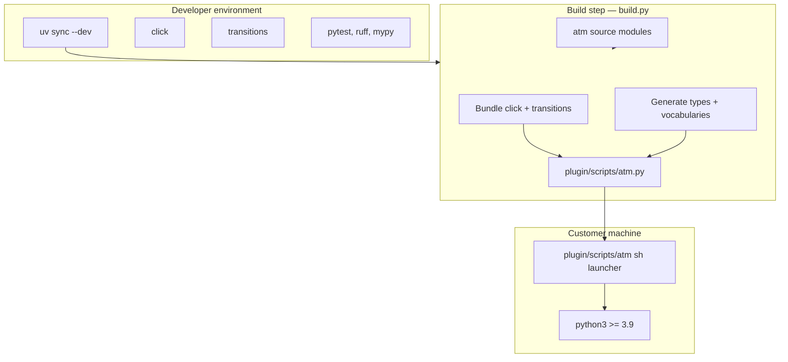

# Modernizing the `atm` build approach

**Status:** proposal — not yet implemented.

This document describes how the `atm` CLI build approach should evolve now that we distinguish **customer prerequisites** (minimal: single file, Python 3.9+ only) from **developer tooling** (unconstrained: `uv`, `click`, state machine libraries, etc.).

---

## 1. The problem

The original design forced the developer toolchain to match the customer constraint: zero third-party dependencies, handwritten `argparse`, hand-rolled state transitions, and a custom bundler (`atm-cli/build.py`) that concatenates stdlib-only modules into `plugin/scripts/atm.py`.

That worked for shipping, but it made development needlessly difficult:

| Area | Current (stdlib-only) | Limitation |
|------|----------------------|------------|
| CLI parsing | `argparse` with flat subparsers | Verbose, no nested groups, inconsistent help |
| Task states | Hand-rolled `STATUS_CHANGES` + `change_status` in `common/model.py` | No explicit state graph, guards mixed with side effects |
| Build | `build.py` concatenates ~99 modules | Can't bundle third-party packages; also enforces architecture |
| Dev tooling | None | No `uv`, no lockfile, no third-party packages |

The customer-facing rule stays: **users get one `plugin/scripts/atm.py` that runs with nothing but `python3 >= 3.9`.** Developers, however, should be free to use `uv`, `click`, a state machine library, and other modern Python tooling.

---

## 2. Design principles

1. **Customer artifact unchanged:** `plugin/scripts/atm.py` remains a single, self-contained, stdlib-runtime file. Customers need only Python 3.9+.
2. **Developer tooling unconstrained:** Developers use `uv sync --dev` to install `click`, `transitions`, pytest, ruff, mypy, etc.
3. **Build step collapses dependencies:** The build bundles third-party code into the customer file so customers never `pip install`.
4. **Architecture enforcement moves out of the bundler:** Layer rules, import-order checks, and duplicate-name detection become CI tests, not build-time failures in `build.py`.

---

## 3. Proposed developer stack

| Tool | Purpose | Customer impact |
|------|---------|-----------------|
| `uv` | Dev dependency management (`uv sync --dev`) | None — dev only |
| `click` | CLI parsing (replaces `argparse`) | Bundled into `atm.py` by build |
| `transitions` (or similar) | Task state machine (replaces hand-rolled transitions) | Bundled into `atm.py` by build |
| pytest | Unit tests | Dev only |
| ruff / mypy | Linting and type checking | Dev only |

---

## 4. CLI with `click` (example)

The current flat `argparse` parser in `atm/cli/main.py` becomes nested `click` groups:

```python
import click


@click.group()
@click.option("--dir", help="run as if started in PATH")
@click.option("--json", is_flag=True, help="print result as JSON")
@click.pass_context
def atm(ctx, dir, json):
    """atm: the Agentic Task Manager helper."""
    ctx.obj = {"dir": dir, "json": json}


@atm.group()
def task():
    """Task lifecycle commands."""


@task.command()
@click.argument("task_id")
@click.option("--state", type=click.Choice([
    "todo", "in_progress", "in_review", "done", "blocked", "skipped"
]))
@click.option("--note")
@click.option("--reason")
@click.option("--commit")
@click.pass_obj
def state(obj, task_id, state, note, reason, commit):
    """Change a task's state."""
    ...
```

**What `click` buys us:**

| Capability | `argparse` today | `click` proposed |
|------------|------------------|------------------|
| Nested commands | Hand-rolled subparser dispatch | Native `Group` → `Command` hierarchy |
| Option validation | Manual `choices=` checks | Declarative `click.Choice`, `INT`, `FLOAT`, etc. |
| Consistent help | Handwritten `USAGE` string | Auto-generated, uniform across commands |
| Context passing | Manual `args` threading | `click.Context.obj` for `--agent`, `--dir`, `--json` |
| `--help` per command | Handwritten text | Auto-generated from docstrings and options |

---

## 5. Task state machine (example)

The hand-rolled status transitions in `atm/common/model.py` (`STATUS_CHANGES`, `change_status`) become a declared state machine:

```python
from transitions import Machine


class TaskState:
    states = ["todo", "active", "review", "blocked", "done", "skipped"]

    transitions = [
        {"trigger": "start", "source": ["todo", "review"], "dest": "active",
         "conditions": "dependencies_done", "before": "create_claim"},
        {"trigger": "review", "source": "active", "dest": "review",
         "before": "release_claim"},
        {"trigger": "done", "source": ["active", "review"], "dest": "done",
         "before": "record_completion"},
        {"trigger": "fail", "source": "active", "dest": "todo",
         "before": "wipe_attempt", "after": "add_failure_note"},
        {"trigger": "release", "source": "active", "dest": "todo",
         "before": "wipe_attempt", "after": "add_handoff_note"},
        {"trigger": "reject", "source": "review", "dest": "todo",
         "before": "wipe_attempt", "after": "add_rejection_note"},
        {"trigger": "block", "source": ["todo", "active"], "dest": "blocked",
         "before": "release_claim"},
        {"trigger": "unblock", "source": "blocked", "dest": "todo"},
        {"trigger": "reopen", "source": ["done", "skipped"], "dest": "todo"},
        {"trigger": "skip", "source": ["todo", "blocked"], "dest": "skipped"},
    ]

    def __init__(self, task, agent):
        self.task = task
        self.agent = agent
        self.machine = Machine(model=self, states=TaskState.states,
                               transitions=TaskState.transitions,
                               initial=task["status"])
```

**Benefits over the current hand-rolled approach:**

| Aspect | Hand-rolled (`change_status`) | State machine library |
|--------|------------------------------|----------------------|
| State graph | Implicit in `STATUS_CHANGES` dict | Explicit, declarative data |
| Guards | Inline `if` checks | `conditions=` callbacks |
| Side effects | Mixed into one 150-line function | `before`/`after` hooks per transition |
| Invalid transitions | Ad-hoc `AtmError` strings | Library-generated, consistent errors |
| Visualization | Must maintain Mermaid by hand | Can render graph from machine definition |

---

## 6. Click vs Typer

**Typer is built on Click.** It is not a competing CLI framework; it is a thin, type-hint-based wrapper around Click. Choosing Typer does not remove Click from your dependency tree — it adds Typer on top of Click.

| Dimension | Click | Typer |
|-----------|-------|-------|
| Relationship to Click | The foundation itself | Built on Click; requires Click at runtime |
| Declaration style | Decorators with explicit parameters (`@click.option`, `@click.argument`) | Python function parameters with type hints (`name: str`, `verbose: bool = False`) |
| Boilerplate | More explicit, more code | Less code; types double as CLI parameters |
| Help text | Auto-generated from docstrings and `help=` args | Auto-generated from docstrings and type hints |
| Subcommands | `click.group()` + `@group.command()` | Functions on a `typer.Typer()` app; feels natural |
| IDE / autocomplete | Good; parameter names are strings | Excellent; types and defaults are first-class Python objects |
| Maturity / ecosystem | Mature, battle-tested, large plugin ecosystem | Newer, smaller ecosystem, but growing |
| Python version | 3.7+ (comfortable on 3.9) | 3.7+; newer versions use `typing.Annotated` (3.9+) but some features may want newer Python |
| Vendor / bundle size | One library | Two libraries (Typer + Click) to vendor into `atm.py` |

### Example comparison

**Click:**
```python
@click.command()
@click.argument("task_id")
@click.option("--state", type=click.Choice(["todo", "in_progress", "done"]))
@click.option("--note", default=None)
def state(task_id, state, note):
    """Change a task's state."""
```

**Typer:**
```python
def state(
    task_id: str,
    state: str = typer.Argument(help="New state"),
    note: str | None = typer.Option(None, help="Optional note"),
):
    """Change a task's state."""
```

Typer reads closer to plain Python function signatures, which many developers prefer. But under the hood it is still Click.

### Recommendation for ATM

**Use Click** if you want minimum risk and maximum maturity for a tool that ships to customers, a smaller bundle (one library to vendor), and proven patterns for nested subcommands (`atm task state`, `atm project config`, etc.).

**Use Typer** if you want less boilerplate and better IDE ergonomics for developers, and you accept vendoring both Click and Typer into `plugin/scripts/atm.py`.

**Practical consideration for bundling:** With Click you vendor one package. With Typer you vendor two (Typer + its Click dependency) — more third-party code in the customer artifact and more to keep pinned in `uv.lock`.

**Suggested approach:** Prototype one command group (e.g. `atm task`) in both Click and Typer, see which reads better for the team, and pick one. Do not mix them — that would mean bundling both frameworks.

The Click vs Typer decision is an **open question** (see §10).

---

## 7. Build approach evolution

### Current `build.py` responsibilities

`atm-cli/build.py` currently does three jobs:

1. **Bundling:** Concatenates ~99 atm modules into `plugin/scripts/atm.py` in dependency order.
2. **Code generation:** Generates Python TypedDicts and TypeScript interfaces from JSON Schemas; generates vocabulary constants for both languages.
3. **Architecture enforcement:** Enforces layer rules (cli/api can't touch stores directly), import order, no duplicate top-level names.

### Proposed split

```
┌─────────────────────────────────────────────────────────────┐
│                     Developer environment (uv)              │
│  click, transitions, pytest, ruff, mypy, ... (dev deps)     │
└─────────────────────────────────────────────────────────────┘
                              │
                              ▼
┌─────────────────────────────────────────────────────────────┐
│                     Build step (build.py)                   │
│  • Concatenate atm source modules                            │
│  • Bundle vendored click + transitions into one namespace    │
│  • Generate Python TypedDicts + TypeScript interfaces        │
│  • Emit plugin/scripts/atm.py (single file)                  │
└─────────────────────────────────────────────────────────────┘
                              │
                              ▼
┌─────────────────────────────────────────────────────────────┐
│                     Customer artifact                       │
│  plugin/scripts/atm.py — runs with python3 >= 3.9 only       │
└─────────────────────────────────────────────────────────────┘
```

### Mermaid: build flow



### Architecture enforcement moves to CI

Instead of `build.py` refusing to build on layer violations, enforce via tests:

```python
# tests/test_architecture.py
def test_cli_modules_do_not_touch_store():
    for module in cli_modules:
        assert ".store" not in module.source
        assert "_store" not in module.source


def test_no_duplicate_top_level_names():
    names = collect_top_level_names(all_modules)
    assert len(names) == len(set(names))
```

---

## 8. Customer-facing artifact options

The build must produce a single file customers run with only Python 3.9. Options for bundling third-party code:

| Approach | Mechanism | Pros | Cons |
|----------|-----------|------|------|
| **Evolved `build.py` bundler** | Concatenate atm modules + vendored `click`/`transitions` source into one `.py` | No new dev tools; one readable `.py` file | Must vendor and update dependencies |
| **`zipapp`** | `python -m zipapp` produces `.pyz`, shim launcher runs it | Standard library | `.pyz` less familiar; customers still need `python3` |
| **`shiv`** | Self-extracting zip with shebang, deps included | One executable file | Third-party dev tool |
| **PyInstaller / Nuitka** | Compiled binary | No Python needed on customer | Large binaries; breaks "readable script" ethos |

**Recommended:** Keep `build.py` as the bundler, vendoring `click` and `transitions` source into `plugin/scripts/atm.py`. This preserves the current customer experience (one `.py` file, `python3 >= 3.9`) while letting developers use rich dependencies.

---

## 9. Risks

| Risk | Likelihood | Impact | Mitigation |
|------|------------|--------|------------|
| Vendored dependencies drift from upstream | Medium | Medium | Pin versions in `uv.lock`; rebuild on dependency changes |
| Build becomes slower (bundling + vendoring) | Low | Low | Build runs at dev time only, not per customer |
| `click`/`typer`/`transitions` APIs change | Low | Medium | Pin versions; test against pinned versions |
| Architecture rules no longer enforced at build time | Medium | High | Add CI tests for layer rules before removing from build |
| Customer confusion about single file containing vendored code | Low | Low | Clear header comment in generated `atm.py` |

---

## 10. Migration plan

| Phase | Action |
|-------|--------|
| **0** | Add `uv` to developer workflow. `uv sync --dev` installs `click`, `transitions`, pytest, ruff, mypy. Existing `atm.py` unchanged. |
| **1** | Rewrite one command group (e.g. `task`) using `click`, keeping old `argparse` commands intact. Test side-by-side. |
| **2** | Replace handrolled status machine in `common/model.py` with declared state machine. Run existing task-state tests. |
| **3** | Update `build.py` to bundle vendored `click`/`transitions` into `plugin/scripts/atm.py`. Verify `atm doctor` (`check`) passes. |
| **4** | Remove old `argparse` flat commands one group at a time, testing after each removal. |
| **5** | Move layer-enforcement out of `build.py` into CI tests (`tests/test_architecture.py`). |

---

## 11. Open questions

- Which state machine library: `transitions`, `python-statemap`, or a custom minimal implementation?
- **Click vs Typer:** use Click directly (one library to vendor, mature) or Typer (type-hint ergonomics, but vendors both Click + Typer)? Prototype one command group in both before deciding.
- Should `click`/`typer` replace all `argparse` at once, or one command group at a time?
- Should vendored dependencies be committed to the repo, or generated by the build from `uv.lock`?
- Does the `sh` launcher (`plugin/scripts/atm`) need changes to support a bundled `.py` with vendored code?

---

## 12. Related documents

- `docs/task-states.md` — current task state model and transitions (to be replaced by state machine)
- `docs/improving-atm-cli-ergonomics.md` — proposed `atm` command structure (task, project, sprint, etc.)
- `docs/helper-runtime-proposal.md` — original Python-only runtime decision (B)
- `docs/layered-architecture.md` — layer rules currently enforced by `build.py`
- `atm-cli/build.py` — current bundler to be evolved
