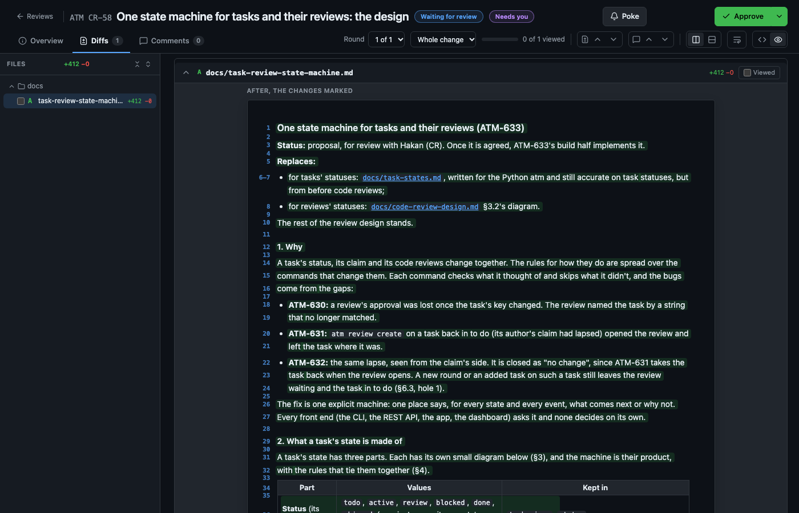
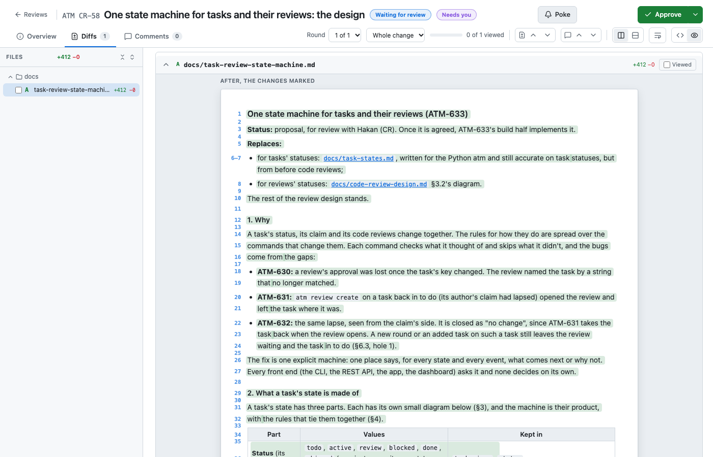
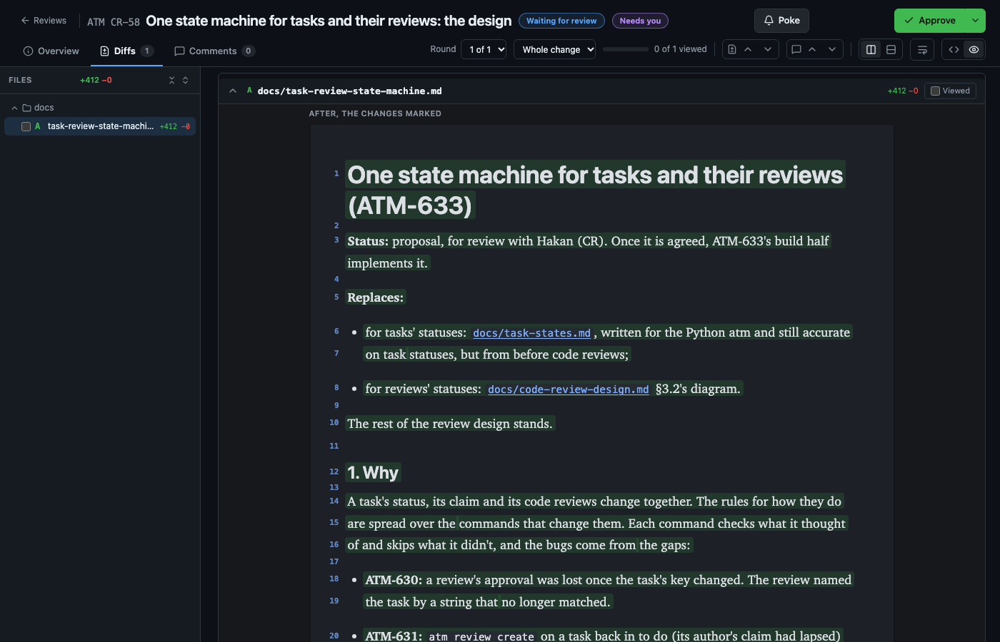

# Rendered Markdown as a document editor shows it (ATM-649)

**Status:** research, for review with Hakan (CR). The changes it recommends become tasks of their own (§6).

Hakan (2026-11-19): a review's rendered Markdown looks very dark. It should look as a top-level document editor shows a
document (Microsoft Word, Google Docs, Apple Pages, Notion): a page you read and comment on, not a dark panel.

This document looks at how those editors show a document (§2), what atm shows now and why (§3), the gap between the
two (§4), and recommends what to build (§5–§6). The page in question is one component, `DocumentPage.svelte`
(ATM-645): the document viewer shows it, and so does a review's rendered side (`RenderedSide.svelte`). Fixing it fixes
both.

## 1. In short

- **Editors show a document as paper:** a light page on a canvas, the type at reading size, the marks (changes,
  comments) in the margins. A dark app keeps the page light by default (Word on the Mac, Pages, Google Docs' apps) or
  lets the reader switch it back with one click (Word's *Switch Modes*). The reason they give: a document should be read
  as the people it is sent to will see it.
- **atm shows a dark panel:** in dark mode the review's page is painted in the theme's background, which is darker
  than the desk around it, so the page reads as a hole, not a sheet. Its default type is the task panel's (14 px text,
  16 px titles). Each changed line is painted green or red box by box, so a new file is a patchwork.
- **All of it is atm's own CSS** (the boundary: page styles for rendered CompMD are the host's). Nothing here needs a
  change in CompMD; one thing is to check (§4, G2).
- **Recommended:** a *Document* page style that is the default: light paper in both modes, with a page toggle as Word
  has; reading type; changes as bars in the margin and a light tint per block; comments in the right margin (ATM-651).

## 2. How editors show a document

| | The page | Dark mode | Type, width | Changes and comments |
|---|---|---|---|---|
| **Microsoft Word** (Print Layout) | A white sheet with a shadow on a grey canvas, at its paper size (Letter or A4), 1 in margins | The canvas and the ribbon go dark. The page goes dark too, and **Switch Modes** (View tab) turns it back to white; Word remembers the choice. On the Mac, *Dark Mode has a white page color* keeps it white for good, and Windows has the same setting. Microsoft's advice: switch the page to light to preview the document as it will print and be shared [^word-dark] | Body text at 11–12 pt (about 15–16 px), a measure of about 6.5 in | Tracked changes: inserted text underlined in the author's colour, deleted text struck through, and a **change bar** in the left margin beside each changed line. Comments are balloons in a **right margin**, tied to their text by a line |
| **Google Docs** (web) | A white page on a light grey canvas, Letter or A4 with 1 in margins; or *Pageless*, one long sheet | The web app has none: the page is always light [^docs-web] | 11 pt Arial by default, 1.15 line spacing | Suggestions: insertions in colour, deletions struck through. Comments are cards in the right margin, level with the highlighted text they are about |
| **Google Docs** (Android, iOS) | The same document, as a page | A dark theme inverts the page. The document's **More** menu has *View in light theme*, so the reader can check it as collaborators see it: Google says it isn't a good idea to send an important document seen only in the inverted theme [^docs-dark] | | |
| **Apple Pages** | A white sheet on a canvas | The app's chrome follows macOS's Dark Mode; the page stays white. There is no dark page setting; users who want one paint a dark shape behind their text, which then prints and exports [^pages] | | Comments in the margin; tracked changes as Word's |
| **Notion** | No paper: the text lies on the app's own canvas | The whole canvas goes dark with the app | About 700 px of text, or **Full width**; **Default**, **Serif** or **Mono** type per page; **Small text** [^notion] | Comments in the right margin or under a block |

The dark-mode column is sourced (the footnotes); the page, type and marks columns describe the apps as they are used,
and their defaults change between versions (Word's default font has changed twice in recent years).

**What they share:**

1. **A document is paper.** A page that stands out from the canvas: lighter than it, with a border or a shadow. The page
   is never darker than what it lies on.
2. **Light by default.** The tools for writing documents others will read (Word, Docs, Pages) keep the page light, or
   bring it back with one click, even when the app is dark. Notion, a tool for notes kept in the app, is the exception:
   its page is the app.
3. **Reading type.** 15–16 px of text, a line height of 1.15–1.6, about 65–75 characters a line, headings in a clear
   scale (the title about twice the text).
4. **The marks live in the margins.** A changed line gets a bar in the left margin and its words a colour or a strike;
   a comment sits in the right margin, its text highlighted. The text itself stays readable.

## 3. What atm shows now

The same document (CR-58's `docs/task-review-state-machine.md`, a new file) on a review's rendered side, at 1400 × 900,
with the Default theme.

**Dark mode, the default page style (Auto):**

**Light mode, Auto:**

**Dark mode, the Docs style** (Settings → Document style):

**Why it looks as it does:**

| What | Where | Effect |
|---|---|---|
| **The page is darker than its desk** | `RenderedSide.svelte`: without a style, `--doc-desk: var(--surface2)` and `--doc-page: var(--bg)`. Its comment says "a white page (the theme's background) on a grey desk", which is true only in light mode | In dark mode the page is `#0d1117` on `#21262d`: a dark hole in a grey panel, the reverse of paper. Each of the 14 themes does the same with its own colours |
| **The page follows the app's mode** | `app.css` (`:is(.doc-viewer, .doc-sheet)`: `--doc-page: var(--surface)`) and every theme's dark block; the document styles (`themes/doc-styles.css`) each have a dark page too | A dark app always means a dark page; there is no way to keep the page light as Word and Pages do |
| **The default type is the task panel's** | `app.css` `.compmd` and `.compmd-page h1…h6`: text at `--text-lg` (14 px), `h1` 16 px, `h2` 14 px, `h3` and below 13 px and muted | Sized for a task's description in a side panel. On a page, headings hardly stand out from the text and the page reads as dense. The GitHub, Docs and Magazine styles have proper type, but Auto is the default |
| **Each changed line is painted, box by box** | `RenderedSide.svelte`: a 16 % green or red box over every line box CompMD drew for a changed line | A new file is entirely boxes; in dark mode the green on near-black is heavy. Word and Docs mark a change in the margin and in the words, not as a fill behind every line |
| **The line numbers sit in the page's text margin** | `DocumentPage.svelte` (`.doc-gutter-lines`, T-406) | Useful for a review, but on a page they crowd the left edge; their alignment is ATM-652 |
| **No comments on the page** | `RenderedSide.svelte` | ATM-650 (commenting) and ATM-651 (showing them) |

The document viewer is better in dark mode (its page is `--surface` on a `--bg` desk, so lighter than its desk) but has
the same dark page and the same panel type.

**What is CompMD's here, and what is atm's.** CompMD turns the Markdown into HTML and draws its components; it reads
the colour scheme for a frame or a component (`view.scheme()`). The page, its colours, its type and the marks over it
are atm's CSS and components: the boundary says page styles for rendered CompMD are the host's, and the document styles
are already written that way.

## 4. The gap

| # | Change | Where |
|---|---|---|
| G1 | **A light page in both modes:** paper colours of its own (`--doc-page`, `--doc-desk`), and the colours the text uses on it (`--text`, `--text-muted`, `--border`, `--surface2`, `--accent`, and `--red`, `--green`, `--yellow` for the marks) set on `.doc-page`, so none of the dark theme leaks in. The desk stays the app's; the page is lighter than it | `themes/doc-styles.css` (a style of its own), `app.css` |
| G2 | **The page's colour scheme:** `color-scheme: light` on a light page, so the browser's own parts (scrollbars, form controls) and CompMD's components and highlighted code take the light variant inside a dark app. CompMD reads the scheme of the element it renders into (`scheme()`, `@compmd/render`'s `page.d.ts`): to confirm when built. If code blocks stay dark, that is CompMD's to change, and is asked of CompMD, not built here | `app.css`; check with CompMD |
| G3 | **A page toggle, as Word's Switch Modes:** one button on the page (and in Settings) that turns this page dark or light, remembered | `DocumentViewer.svelte`, the diff viewer's toolbar (`DiffView.svelte`), `state.svelte.ts` (a preference) |
| G4 | **Reading type for the default:** text at 16 px, line height 1.6, a measure of about 70 characters (the page about 760 px wide), headings in a scale (2, 1.5, 1.25 em), not muted, margins of 56–64 px | `themes/doc-styles.css` |
| G5 | **Changes as an editor marks them:** a bar in the left margin beside each changed block (green, red, or both for a change), and one light tint per block instead of a box per line. A new file is marked once, as new (the file header says so), not line by line | `RenderedSide.svelte` |
| G6 | **The line numbers in the margin, outside the text:** fainter, and hidden in the document viewer unless asked for (the viewer is for reading; a review needs them) | `DocumentPage.svelte`, `app.css`; alignment is ATM-652 |
| G7 | **Comments in the right margin**, level with their block, the block's text highlighted | ATM-651 (and ATM-650 to make them) |
| G8 | **Auto, kept as a choice:** the theme's own page for those who want the app's colours, without its inverted desk (the page `--surface` on a `--bg` desk, as the viewer has) | `RenderedSide.svelte` |

The diff's marks and the comments must still read on the light page: G1 sets `--red`, `--green` and `--yellow` for the
light page, and the screenshot tests cover each of them, in each mode.

## 5. Recommendation

**A *Document* page style, the default for every reader**, in place of Auto as the default:

- **Paper:** a white page (`#ffffff`) with a soft shadow on the app's desk; in dark mode the desk is dark, the page
  still white (Word's *Dark Mode has a white page color*, and Pages). One toggle on the page turns it dark for those
  who prefer it (Word's *Switch Modes*), remembered across sessions; the dark page is lighter than its desk.
- **Type:** the system's sans-serif at 16 px, line height 1.6, about 70 characters a line, headings in a clear scale.
  The GitHub, Docs and Magazine styles stay, as alternatives; Auto stays as *Theme*, with its desk fixed (G8).
- **Marks:** changes as bars in the left margin and a light tint per block; comments in the right margin (ATM-651);
  line numbers faint in the left margin, on in a review, off in the viewer.

Why light by default and not a better dark page: a document in a review is read as its readers will read it, mostly on
GitHub and in editors, in light. Word and Google say the same about previewing a document. A reviewer who prefers dark
has the toggle.

## 6. Follow-up tasks

1. **The Document page style (G1, G2, G4, G8):** the new default style, a light page in both modes with its own
   colours and `color-scheme`, reading type; Auto renamed Theme, its desk fixed; Settings lists it first. Screenshot
   tests of the viewer and the review's rendered side, in each mode. Check CompMD's components and highlighted code
   on the light page in a dark app; anything wrong there goes to CompMD.
2. **A page toggle (G3):** the page dark or light, from the viewer and the diff viewer, remembered.
3. **Changes marked as an editor marks them (G5):** bars in the margin and one tint per block; a new file marked once.
   The e2e tests on the marks updated.
4. **The line numbers (G6):** faint, off in the viewer by default; together with ATM-652 (their alignment).
5. **Comments on the page:** ATM-650 and ATM-651, as planned; ATM-651 takes the right margin (G7).

## 7. Questions for Hakan

1. **A light page in dark mode by default,** with a toggle to make it dark (recommended), or a dark page by default
   with a toggle to make it light?
2. **Line numbers in the document viewer:** off by default (recommended), or on as now?

[^word-dark]: Microsoft Support, [Dark Mode in Word](https://support.microsoft.com/en-us/word/dark-mode-in-word); Microsoft 365 Insider blog, [Try Dark Mode in Word](https://techcommunity.microsoft.com/blog/microsoft365insiderblog/try-dark-mode-in-word/4211941).
[^docs-web]: How-To Geek, [How to turn on dark mode in Google Docs](https://www.howtogeek.com/721117/how-to-turn-on-dark-mode-in-google-docs/) (the dark theme is the mobile apps'; the web app has none).
[^docs-dark]: Google Docs Editors Help, [Use Dark theme in Google Docs, Sheets & Slides](https://support.google.com/docs/answer/9955476); Google Workspace Updates, [Dark theme now available for Docs, Sheets, and Slides on Android](https://workspaceupdates.googleblog.com/2020/07/dark-theme-google-docs-sheets-slides-.html).
[^pages]: Apple Community, [Why pages do not have dark mode?](https://discussions.apple.com/thread/253044463) and [Pages - A "dark mode" kludge](https://discussions.apple.com/thread/255116751) (community answers, not Apple's documentation).
[^notion]: Notion Help Center, [Style & customize your page](https://www.notion.com/help/customize-and-style-your-content).
