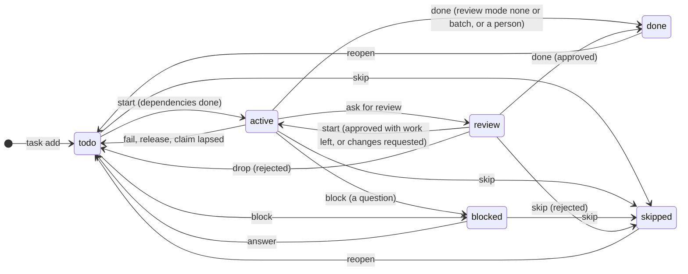
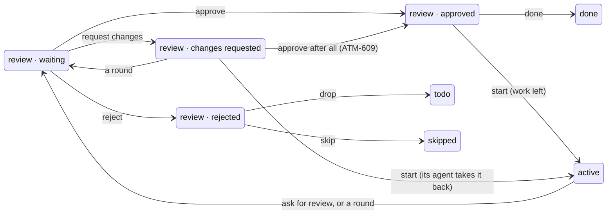
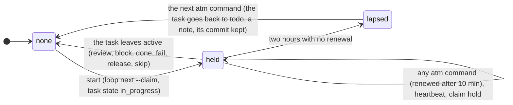
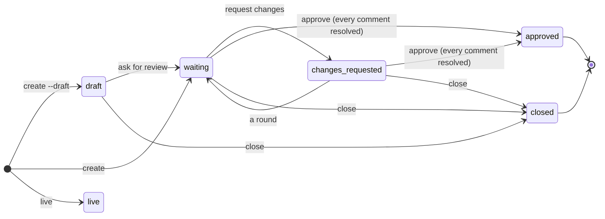
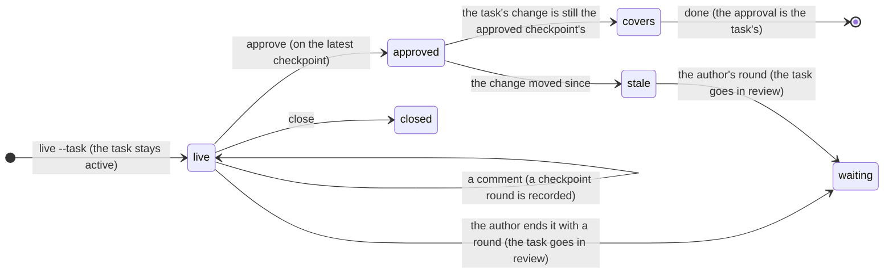
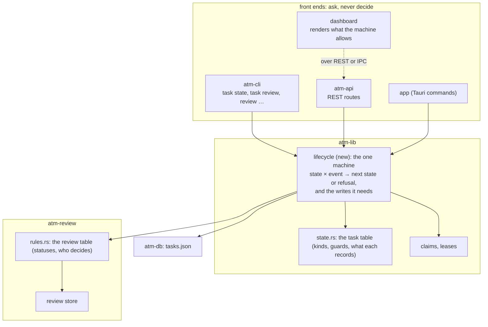

# One state machine for tasks and their reviews (ATM-633)

**Status:** proposal, for review with Hakan (CR). Once it is agreed, ATM-633's build half implements it.

**Replaces:**
- for tasks' statuses: [`docs/task-states.md`](task-states.md), written for the Python atm and still accurate on task
  statuses, but from before code reviews;
- for reviews' statuses: [`docs/code-review-design.md`](code-review-design.md) §3.2's diagram.

The rest of the review design stands.

## 1. Why

A task's status, its claim and its code reviews change together. The rules for how they do are spread over the
commands that change them. Each command checks what it thought of and skips what it didn't, and the bugs come from
the gaps:

- **ATM-630:** a review's approval was lost once the task's key changed. The review named the task by a string that
  no longer matched.
- **ATM-631:** `atm review create` on a task back in to do (its author's claim had lapsed) opened the review and left
  the task where it was.
- **ATM-632:** the same lapse, seen from the claim's side. It is closed as "no change", since ATM-631 takes the task
  back when the review opens. A new round or an added task on such a task still leaves the review waiting and the task
  in to do (§6.3, hole 1).

The fix is one explicit machine: one place says, for every state and every event, what comes next or why not.
Every front end (the CLI, the REST API, the app, the dashboard) asks it and none decides on its own.

## 2. What a task's state is made of

A task's state has three parts. Each has its own small diagram below (§3), and the machine is their product, with
the rules that tie them together (§4).

| Part | Values | Kept in |
|---|---|---|
| **Status** (its kind) | `todo`, `active`, `review`, `blocked`, `done`, `skipped` (a project names its own statuses; atm acts on the kind) | `tasks.json`: `status` |
| **Decision** (in review only) | `waiting`, `approved`, `changes_requested`, `rejected` | `tasks.json`: `review_state` |
| **Claim** | none, held (by an agent, until a time), lapsed | the clone's shared state: `claims` |
| **Code reviews** (zero or more) | each: `draft`, `waiting`, `live`, `changes_requested`, `approved`, `closed` | `.agentic-task-manager/reviews/CR-…/review.md`; the task links them in `code_reviews` |

A task with no code review can still be reviewed: `atm task state <id> in_review`, then a person's
`atm task review approve <id>`. The decision is then the task's alone. With a code review, the decision is the
review's, and the task carries it (§4.2).

## 3. The parts, one diagram each

### 3.1 A task's status (kinds)

- `start` is the only way into `active`, and it takes the claim (§3.3).
- Leaving `active` any other way drops the claim. A task in review, blocked or finished has no claim.

### 3.2 Inside `review`: the decision

A task in review waits for one decision. Its exits depend on which one it got:

- Only a decision opens an exit. Until then `done`, `start`, `drop` and `skip` are refused, for an agent and a person
  alike, each with the command that decides it.
- `atm loop next` hands back a decided task (approved or changes requested) to its agent before any new task.

### 3.3 The claim

- **A lapse is an event, not a state anyone keeps.** The next atm command that looks at claims applies it: the task
  goes back to `todo` with a "lease expired" note. The agent then hears so on its next command (exit 4), with how to
  take it back.
- **Taking it back** is `start` again, by the agent whose claim lapsed. `atm review create` does it on its own when
  the author opens a review on such a task (ATM-631).

### 3.4 A code review's status

- **Who:**
  - the author makes rounds and asks for review;
  - a reviewer decides (named reviewers, else anyone but the author; a person may override, saying why);
  - the author or a reviewer closes.
- **Open** means draft, waiting, live or changes requested: not decided yet. Approved and closed are ended, and take
  nothing more.

### 3.5 A live review

A live review runs beside a task that is still in progress. It has states of its own, and its approval reaches the
task only at the end:

`covers` and `stale` are not stored. They are what atm finds when the agent finishes the task: whether the working
tree's diff against the review's base is still the approved checkpoint's.

## 4. How the parts move together

### 4.1 The invariants

The machine keeps these true after every event. A refusal leaves everything as it was.

1. **A task in `active` has a held claim; any other task has none.** A lapsed claim is applied before anything else
   is decided.
2. **A task with an open static review (waiting or changes requested) is in `review`.** A live review is the
   exception: its task is `active` until the review ends.
3. **A task's decision is its latest code review's**, when it has one:
   - a waiting review means `waiting`;
   - changes requested means `changes_requested`;
   - approved means `approved`;
   - closed with its tasks rejected means `rejected`.

   A decision is never recorded on the task without its review, or the other way round.
4. **A task is in at most one open static review.** A second review waits until the first ends.
5. **A review names its tasks by whatever key they had** when it was written. The task it means is found as
   ATM-630's `review_keys::task_of` finds it, never by comparing strings.
6. **Only the people the review's rules name decide**, through any front end. No command decides a task's review
   around its code review.

### 4.2 Events and what they do

For each event: what it needs, what it changes in the review and in each task it names, and its refusals. The table
in the build (§7) has one row per state × event, each with its next state or its refusal message. This is that
table, grouped.

**On a task alone**

| Event | Needs | Task | Refused when |
|---|---|---|---|
| start | to do with dependencies done, or in review and decided for rework | → active; claim held | waiting on a dependency; in review undecided; claimed by another agent |
| ask for review (no CR) | active | → review, `waiting`; claim dropped | an agent's own claim lapsed (take it back first) |
| done | active (review mode none or batch, or a person), or review approved | → done; claim dropped | an agent's blocker or async task (ask for review); review not approved |
| fail, release | active | → todo, a note, commit kept | not active |
| block | to do or active, with a question or reason | → blocked; claim dropped | no `--on`, nothing asked |
| answer | blocked | → todo, the answers as a note | not blocked |
| skip | open; in review only once rejected | → skipped | review not rejected |
| reopen | done or skipped | → todo | not finished |
| claim lapses | active, no renewal for the lease | → todo, a note, commit kept | (an event, never refused) |

**On a code review and its tasks**

| Event | Who | Review | Each task it names | Refused when |
|---|---|---|---|---|
| create (static) | the author | → waiting (or draft) | active → review `waiting`; the author's own lapsed task taken back, then → review (ATM-631); already in review and in no other open review: linked | a task claimed by another agent; one the author never started; blocked or finished; in another open review |
| create (live) | the author, or a person (who becomes its reviewer) | → live | stays active, linked | as for static, except the task stays active |
| ask for review (draft) | the author | draft → waiting | as create | not a draft |
| round | the author | changes requested or live → waiting; waiting stays | active → review `waiting`; the author's lapsed task taken back first (hole 1) | an ended review; not the author |
| checkpoint | anyone on a live review | stays live | nothing | not live |
| comment, reply, resolve | anyone (resolve: a decider or the comment's author) | stays | nothing | an ended review |
| request changes | a decider | waiting → changes requested | review → `changes_requested`, a rejection note linking the CR | not waiting; not a decider |
| approve | a decider | waiting, live or changes requested → approved | review → `approved`; a live review's active task waits for done (§3.5) | an unresolved comment, drafts counted; not a decider |
| close | the author or a decider | → closed | with `--reject-tasks`: review → `rejected`; else unlinked, the task as it was | ended already |
| tasks added | the author or a decider | stays | as create, for the added | as create |
| tasks removed | the author or a decider | stays | unlinked, a note; review → active if it was in review only for this CR | — |
| done on a task with a live review | the task's agent | approved, covers: stays | → done, the approval recorded as the task's | stale (end it with a round); not approved |

**From outside atm**

| Event | Effect |
|---|---|
| commit | Nothing changes state. A task's commit is recorded on it (`commit`), and a range round reads it. |
| push, merge | The merge driver merges `tasks.json` task by task: a status by progress, the furthest along wins. It also merges a review's files, so its comments are kept and a clashing reference is renumbered. Neither is a status event; a merge that leaves a task and its review disagreeing is reconciled by the next command (§5.3). |
| a number moved at a merge (ADR-009) | The task's old key becomes an alias. Its reviews keep the old key, and the machine reads it as ATM-630 does (invariant 5). Nothing is rewritten. |

### 4.3 The three bugs as cases

| Case | State before | Event | Before | With the machine |
|---|---|---|---|---|
| ATM-630 | task `ATM-14` (was `ATM-12`) in review; CR-1 names `ATM-12` | approve CR-1 | CR approved, task left waiting | task found by `task_of`: → `approved` |
| ATM-631 | the author's task back in to do (claim lapsed); no CR | create CR-1 | CR waiting, task in to do | taken back (start), then → review `waiting` (fixed in 0.41.0; now one row of the table) |
| hole 1 (ATM-632's class) | the author's task back in to do; CR-1 changes requested | round | round written, then the task's move refused: CR waiting, task in to do | taken back first, or nothing written |

## 5. Where it lives

### 5.1 The layers

**Yes, atm-lib is the right layer** for the machine itself. It is the only layer that sees tasks, claims and reviews
together, and every front end already calls it (ADR-003 §4: front ends depend on atm-lib and atm-common only).

**The review table stays in atm-review.** atm-review is a crate that can stand alone (§3.1 of the review design: a
review tool on its own), so its own statuses and who decides belong to it.
- What moves out of it is nothing.
- What moves out of everything else is every copy of its rules: atm-lib's, the CLI's and the dashboard's.
- The machine composes the review table with the task table. Those two tables and the composition are the only
  places a transition is written.

**One module, `atm-lib::lifecycle`**, is what the front ends call:
- **`check(state, event, actor) → Outcome | Refusal`:** pure. It reads the task, its claim and its reviews, and returns
  the next state of each, or the refusal with its message and exit code. Nothing is written. The dashboard's "may I?"
  questions are answered by this (§5.2).
- **`apply(event, …)`:** loads the state, runs `check`, then writes what the outcome says, in a fixed order (§5.3).
- The existing entry points become thin callers of `apply`: `change_task_status`, `reviews::create`, `add_round`,
  `submit`, `close`, `set_tasks`, `apply_live_approval` and `drop_expired_claims`.

### 5.2 The dashboard asks; it doesn't decide

Today the dashboard decides no task moves (it has no drag and drop, no status buttons). But it does repeat review
rules to show or hide buttons:
- whether Approve is blocked by open comments (`ReviewPage.svelte`);
- whether Request changes shows on a live or sent-back review;
- `REWORK_STATES` in `waiting.ts`;
- which statuses count as open (`reviews/types.ts`, `page.ts`).

**Proposal:** the review page's data (`GET …/reviews/<CR>`) gains `can`, the machine's `check` for each action this
reader could take. For example: `{"approve": {"ok": false, "why": "c12 isn't resolved"}, "request_changes": {"ok":
true}, "close": {"ok": true}, "round": {"ok": false, "why": "only its author makes rounds"}}`.
- The task views gain the same where the dashboard shows actions: `derived.needs_you` is already the server's.
- The page shows a button when its action is `ok`, and disabled with its `why` when not.
- Drafts are the one thing only the page knows as they are being written. The server already counts them when the
  decision is sent (`submit_decision_with`). `can` counts the reader's saved drafts too, and the page asks again after
  it saves or sends one, so Approve is never enabled past an open draft.
- The dashboard's copies go: `approveBlocked`, `sentBack`'s button logic, `REWORK_STATES`, and the open-status lists
  (the status words for display stay, from the generated types).

### 5.3 One change, written in order

A review event writes the review store and `tasks.json`, two files. They can't be one atomic write, so the machine
makes the order safe:

1. **Check everything first:** every task the event names, every claim, the review's rules. A refusal writes nothing.
   Today `add_round` writes the round, then finds the task can't move.
2. **Write the review, then the tasks**, under the task file's lock.
3. **The review is the source of truth for its decision** (invariant 3). If the tasks' write fails after the review's
   (a crash, a full disk), the next atm command that opens the project reconciles each task from its latest review.
   `atm doctor` already detects this case ("CR-1 is approved but the task still waits for its review"). The machine
   applies it instead of only reporting it.

## 6. Today, mapped onto it

### 6.1 Where the rules are

| Rule | Where it is decided today |
|---|---|
| task kinds × commands, guards, what each records | `atm-lib/src/state.rs` (`Command`, `sources`, `check_guards`, `apply`): **the task table, kept** |
| "todo" means fail, release, drop, unblock or reopen by kind | `atm-lib/src/changes.rs::todo_command` |
| claims: take, renew, lapse | `changes.rs` (start), `claims.rs` (renew), `leases.rs::drop_expired_claims` (lapse: active tasks only) |
| review statuses, who decides | `atm-review/src/rules.rs`: **the review table, kept** |
| review events → tasks | `atm-lib/src/reviews.rs`: `create` (with `openings`), `add_round`, `submit`, `close`, `set_tasks`, `apply_live_approval` |
| a task's review decided by the task's command | `atm-cli/src/commands/task/review.rs` → `change_task_status`, with no review rule (§6.3, hole 2) |
| which review statuses are open or decided | `atm-review/model.rs` (`OPEN`, `ended`), and copies in `review_listen.rs` (twice), `reviews.rs::waiting_review`, dashboard `types.ts`, `page.ts`, `ReviewPage.svelte` |
| decided for rework | `state.rs`, `loop_rules.rs`, dashboard `waiting.ts` (three copies of `REWORK_STATES`) |
| who needs to act on a review | `rules.rs::decides`, and a variant in `review_pages.rs::needs` |
| a task's kind with fallbacks | `state.rs` (unknown → todo), `reviews.rs::kind_of`, `todo_command` (a claim elsewhere → active), `openings` |

The REST API and the app re-implement nothing: their review routes call `atm-lib::review_requests`. They change no
task status of their own.

### 6.2 What changes

- **`lifecycle` is new**, and `change_task_status` and the review functions call it. The task table (`state.rs`) and
  the review table (`rules.rs`) stay, as the machine's two halves, with their tests.
- **The copies go:**
  - `REWORK_STATES` lives once, in the task table;
  - the open and decided status sets live once, in atm-review's model (`review_listen`, `waiting_review` and the
    dashboard use them);
  - `needs` is derived from `decides`;
  - a task's kind is found in one place, with one fallback.
- **Review events check every task before writing anything.**
- **`atm task review approve|request-changes|reject` on a task with an open code review goes through that review's
  submit**, with its rules: who decides, every comment resolved. On a task with no code review, it stays as it is:
  the task's own decision, by a person.
- **A lapse is applied to a task in review too, where it matters**: its own claim can't be lapsed (it has none), but
  the author's round on a task the lapse sent back to to do takes it back first (hole 1).
- **The dashboard reads `can`** and drops its copies.
- **The agent docs** (`atm docs states`, `atm docs reviews`) are written from the same table, as the build's tests
  check every row.

### 6.3 Holes the table closes

1. **A round or an added task after a lapse** (ATM-632's class): the round is written, then the task can't go in
   review, so the review waits on a task in to do.
2. **`atm task review approve` around a code review:** today the review's author can approve their own task this way,
   with comments open, and the CR stays waiting. The two decisions then disagree.
3. **A failure part way through a review event** leaves half of it written (§5.3).
4. **Propagation that silently skips:** today a review event moves only tasks in the expected kind and skips the rest
   without a word. The machine says which tasks it didn't move and why, or refuses.
5. **`ask_for_review` (draft → waiting) has no caller:** a draft can't be sent for review except by closing it and
   opening another. The machine has the event, and `atm review round` on a draft (or a new `atm review ready`) runs it.

### 6.4 Existing projects

No data model changes: the same fields, the same review files. Two things are new:
- the next command reconciles a task whose decision disagrees with its latest code review (§5.3), saying so once,
  as `atm db migrate` says what a merge moved;
- `atm doctor` keeps reporting what it can't reconcile (a review naming a task the project doesn't have).

## 7. The build (once this is agreed)

1. **`atm-lib::lifecycle`:** `check` and `apply`, the composition of the two tables, and the write order of §5.3. The
   existing functions call it.
2. **The table test:** one row per state × event, built from the tables, each with its expected next state or
   refusal and message.
   - The three bugs and the holes of §6.3 are rows.
   - A test fails when a row has no expectation, so a new state or event can't go untested.
3. **The copies removed** (§6.2), each replaced by the one source, with the existing tests kept passing.
4. **`can` on the review page, and the dashboard reading it.** Component tests show the button for `ok` and the
   `why` otherwise; an e2e test plays approve blocked, then allowed.
5. **The agent docs** regenerated from the table, or checked against it by a test.

## 8. Open questions for the review

1. **Is atm-review keeping its own table right**, or should every rule move into `atm-lib::lifecycle`, leaving
   atm-review only the store? My pick is to keep it: the crate stays usable alone, and the review's rules are tested
   where they are.
2. **`atm task review approve` on a task with an open CR:** go through the CR (my pick), or refuse and point to
   `atm review submit`?
3. **A draft:** `atm review round` on a draft asks for review, or a separate `atm review ready`?
4. **Removing a task from a review it was in review for:** back to active (my pick, as §3.2 of the review design
   says), or left in review waiting for another review?
5. **Split ATM-633** into the design (this CR) and the build tasks of §7, so the build is reviewed in steps?
