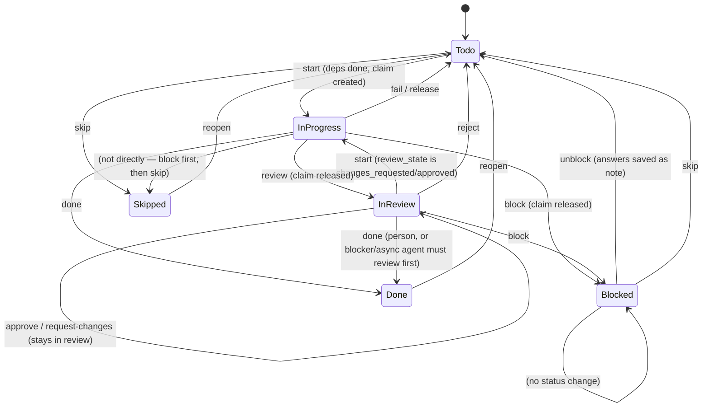
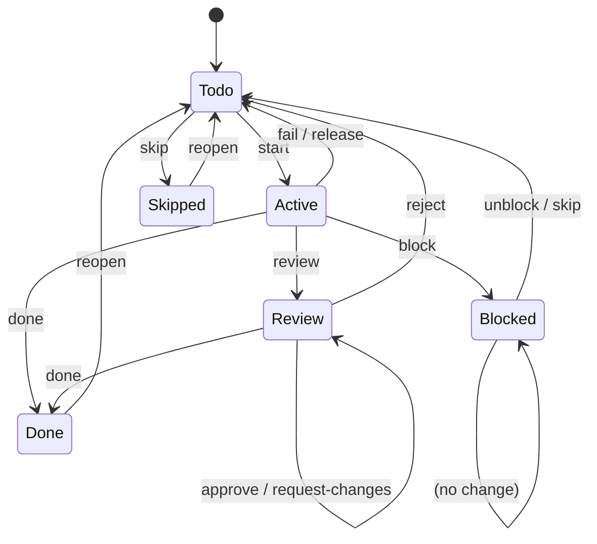

# Task states and status transitions

This document describes how a task moves through its lifecycle in the `atm` CLI (plugin `atm`). It is based on:

- `atm-cli/atm/cli/main.py` — argument parsing and command dispatch
- `atm-cli/atm/lib/status.py` — status-change orchestration (`change_task_status`)
- `atm-cli/atm/common/model.py` — the transition rules (`change_status`, `STATUS_CHANGES`)
- `atm-cli/atm/common/vocabularies.py` — the default statuses and kinds
- `atm-cli/atm/lib/loop.py` — claims, leases, and cross-worktree resolution

## 1. Status kinds

Every status belongs to one of six **kinds**. Rules are written against kinds, never status names, so a project may rename its statuses in `meta.statuses` as long as each kind is represented (`todo`, `active`, `done` are mandatory).

Default vocabularies (`atm/common/vocabularies.py`):

| kind | default status id | label |
|------|-------------------|-------|
| `todo` | `todo` | To Do |
| `active` | `in_progress` | In Progress |
| `review` | `in_review` | In Review |
| `blocked` | `blocked` | Blocked |
| `done` | `done` | Done |
| `skipped` | `skipped` | Skipped |

```json
[
  { "id": "todo",        "label": "To Do",        "kind": "todo" },
  { "id": "in_progress", "label": "In Progress",  "kind": "active" },
  { "id": "in_review",   "label": "In Review",    "kind": "review" },
  { "id": "blocked",     "label": "Blocked",      "kind": "blocked" },
  { "id": "done",        "label": "Done",         "kind": "done" },
  { "id": "skipped",     "label": "Skipped",      "kind": "skipped" }
]
```

A project can define additional statuses (e.g. `in_qa` of kind `review`) and pick among same-kind statuses with `--status`.

## 2. State diagram



Notes on the diagram:

- `start` is the only command that moves a task *into* `active` (`in_progress`). From `todo` it requires all dependencies done. From `review` it is allowed only when the review was decided (`review_state` is `changes_requested` or `approved`).
- `approve` and `request-changes` keep the task in `review` — they only change `review_state` (`approved` / `changes_requested`) and set `reviewed_at`. The task stays in review until its agent takes it back (`atm loop next` offers it to them first).
- `done` from `review` means the review passed. `done` from `active` means the work is finished (subject to review mode — see §4).
- `fail`, `release`, `reject`, `reopen`, and `unblock` all return a task to `todo`; `skip` sends it to `skipped`; `reopen` undoes `done` or `skipped`.

## 3. Transition table

The source of truth is `STATUS_CHANGES` in `atm/common/model.py` — each entry is `(allowed source kinds → target kind)`.

The names below are atm-lib's status functions. On the command line (T-425) each is `atm task state <id> <state>`:
`start` is `in_progress`, `review` is `in_review`, `done`, `block` is `blocked`, `skip` is `skipped`, and `todo` runs
the one for the kind the task is in (`todo_command` in `lib/status.py`): `fail` (in progress, with `--reason`),
`release` (in progress, otherwise), `reject` (in review), `unblock` (blocked) or `reopen` (done or skipped). `approve`
and `request-changes` are a review's decisions, `atm task review approve|request-changes <id>`.

| command | function | from (kinds) | to (kind) | meaning |
|---------|----------|--------------|-----------|---------|
| `start` | `start_task` | `todo`, `review` | `active` | claim the task; dependencies must be done |
| `review` | `review_task` | `active` | `review` | ask for a review; claim released |
| `done` | `done_task` | `active`, `review` | `done` | finish; record completion / commit / resolution |
| `fail` | `fail_task` | `active` | `todo` | back to todo, failure note |
| `release` | `release_task` | `active` | `todo` | back to todo, handoff note |
| `reject` | `reject_task` | `review` | `todo` | review rejected, back to todo |
| `approve` | `approve_task` | `review` | `review` | review approved; stays in review until agent takes it back |
| `request-changes` | `request_changes` | `review` | `review` | changes requested; agent gets it back first |
| `block` | `block_task` | `todo`, `active` | `blocked` | waiting on user/agent decision; claim released |
| `unblock` | `unblock_task` | `blocked` | `todo` | back to todo; Q&A saved as an answer note |
| `reopen` | `reopen_task` | `done`, `skipped` | `todo` | undo finished/skipped (reason kept as note) |
| `skip` | `skip_task` | `todo`, `blocked` | `skipped` | not needed (resolution `wont_do`/`obsolete`/`duplicate`) |



## 4. Command-by-command details

All status changes go through `change_task_status` → `change_status` (`atm/lib/status.py`, `atm/common/model.py:607`). Each runs as one atomic store change (`store.change`): status, claim, and the shared waiting/resolved records change together or not at all.

### `atm task state <id> in_progress`
- Moves `todo` (or a decided `review`) → `active`.
- Requires every dependency to be done-kind (`unfinished_dependencies`). A dependency only in the archive counts as done.
- Creates a claim: `{task, agent, branch, worktree, claimed_at, lease_expires_at}` (`lib/status.py:claim_record`).
- Clears any prior `completed` record for the task (`store["completed"].pop`).
- Sets `started_at`, `started_by`, clears `review_requested_at`, `completed_at`, `completed_by`, `agent`.
- Exit code 3 via `atm loop next --claim` when there is no task to start.

### `atm task state <id> in_review [--note TEXT]`
- Moves `active` → `review`; releases the claim.
- Sets `review_requested_at`, `review_state = "waiting"`.
- Adds a `review` note if `--note` is given.
- By review mode: an agent finishing an `active` task whose mode is `blocker` or `async` must `review` first (`check_review_mode`); a person may `done` directly.

### `atm task state <id> done [--note TEXT] [--commit SHA] [--resolution R]`
- Moves `active` or `review` → `done`; drops the claim.
- Records `completed_at`, `completed_by` (agent), optional `commit`.
- Default resolution `done`; allowed resolutions `done`, `wont_do`, `duplicate`, `obsolete`. `--duplicate-of` requires `--resolution duplicate` and cannot be self.
- Batch-review tasks (agent, mode `batch`, coming from `active`) get `sprint_review = "pending"`; the note kind is `review` for batch, else `outcome`.
- After done, tasks waiting on this one become newly ready; an archive hint may be emitted (at most once a day per clone).

### `atm task state <id> todo --reason TEXT`, in progress (fail)
- `active` → `todo`; adds a `failure` note with the reason.
- Wipes the attempt via `back_to_todo` but **keeps the commit** (work is in git, to be finished later).

### `atm task state <id> todo [--note TEXT]`, in progress (release)
- `active` → `todo`; adds a `handoff` note if `--note` given.
- Wipes the attempt but **keeps the commit**.

### `atm task state <id> todo --reason TEXT`, in review (reject)
- `review` → `todo`; adds a `rejection` note.
- Wipes the attempt (clears `commit` too).

### `atm task review approve <id> [--note TEXT]`
- Stays in `review`; sets `review_state = "approved"`, `reviewed_at`.
- Adds an `Approved: …` note if `--note` given.
- Task stays in review until its agent takes it back.

### `atm task review request-changes <id> --reason TEXT`
- Stays in `review`; sets `review_state = "changes_requested"`, `reviewed_at`.
- Adds a `rejection` note with the reason.

### `atm task state <id> blocked --on user|agent [--question TEXT]… [--reason TEXT]`
- `todo` or `active` → `blocked`; releases the claim.
- Requires `--on` (`user` or `agent`) and at least one of `--question` / `--reason`.
- Sets `waiting_on`, `questions`, `blocked_at`; adds a `note` if reason given.
- Records a `waiting` entry shared across worktrees (`store["waiting"]`).

### `atm task state <id> todo [--answer TEXT]…`, blocked (unblock)
- `blocked` → `todo`; clears `waiting_on`, `questions`, `blocked_at`.
- Turns questions + answers into one `answer` note (`q → a` pairs).

### `atm task state <id> todo --reason TEXT`, done or skipped (reopen)
- `done` or `skipped` → `todo`; drops claim and `completed` record.
- Adds a `Reopened: …` note; wipes the attempt.
- If reopened inside a closed sprint, reports `stranded` (the loop's default selection never looks there; use `atm sprint move`).

### `atm task state <id> skipped --reason TEXT [--resolution R] [--duplicate-of ID]`
- `todo` or `blocked` → `skipped`.
- Default resolution `wont_do`; allowed `wont_do`, `obsolete`, `duplicate`.
- Sets `skipped_at`, `resolution` (only when not default), optional `duplicate_of` (must exist, not self).
- Clears `waiting_on`, `questions`, `blocked_at`; adds a `Skipped: …` note.

### Notes command (not a status change)
- `atm task note <id> TEXT` — adds a note (max 500 chars) to a task of any status; does not change status.

## 5. Claims and leases

Claims live in `store["claims"]`, shared by all worktrees of a clone (`atm/lib/claims.py`, `lib/loop.py`).

```json
{
  "task": "T-001",
  "agent": "claude:session-1",
  "branch": "atm/T-001",
  "worktree": ".agentic-task-manager/worktrees/T-001",
  "claimed_at": "2026-11-04T10:00:00Z",
  "lease_expires_at": "2026-11-04T10:30:00Z"
}
```

- Default lease: **30 minutes** (`meta.lease_minutes` overrides).
- `start` creates the claim; `done`, `fail`, `release`, `review`, `block`, `reopen`, `skip`, `unblock`, `reject`, `approve`, `request-changes` drop it.
- Only the claiming agent may run status commands on the task; another agent's live claim → exit code **4** ("claimed by … until …").
- Expired claims are dropped and the task returns to `todo` with a `failure` note ("lease expired"), keeping the commit (`keep_commit=True`).
- `done`, `release`, `fail`, `review`, `block` give a special "your own lease expired" error (exit code 4) when the agent's own claim just expired — telling them to run `atm task state <id> in_progress` again.

## 6. Cross-worktree decisions (T-204)

A task that is `blocked` or `in_review` in another worktree is recorded in `store["waiting"]`. A decision made in this worktree about such a task (`unblock`, `skip`, `done`, `reject`) is applied here and propagated via `store["resolved"]` so the other worktree's copy stops waiting too (`apply_resolutions` in `lib/loop.py`).

Allowed remote decisions:

| command | waiting task must be kind |
|---------|---------------------------|
| `unblock` | `blocked` |
| `skip` | `blocked` |
| `done` | `review` |
| `reject` | `review` |

## 7. Side effects recorded on every change

`touch(task, actor, stamp)` (`common/model.py:554`) always sets `updated_at` and `updated_by`.

| field | set by |
|-------|--------|
| `started_at`, `started_by` | `start` |
| `completed_at`, `completed_by` | `done` |
| `review_requested_at`, `review_state`, `reviewed_at` | `review` / `approve` / `request-changes` |
| `waiting_on`, `questions`, `blocked_at` | `block` |
| `skipped_at`, `resolution`, `duplicate_of` | `skip` |
| `commit` | `done`, `commit` |
| `sprint_review = "pending"` | `done` on a batch-review task |

Attempt-clearing (`back_to_todo`) removes `started_at`, `completed_at`, `skipped_at`, `started_by`, `completed_by`, `agent`, `review_requested_at`, `waiting_on`, `questions`, `blocked_at`, `sprint_review`, `resolution`, `duplicate_of`; `commit` is removed unless `keep_commit` (`fail`, `release`, lease expiry).

Notes are capped at **500 characters** (`MAX_NOTE`).

## 8. Sprint moves

`atm sprint move <id>… --to <sprint\|next\|active\|backlog>` changes only the sprint assignment (or backlog), **not** the status. Claimed and finished tasks stay where they are. Moving into/out of a sprint starts/ends a `sprint_history` entry. Reopening a task in a closed sprint flags it as `stranded`.

## 9. CLI wiring and errors

`atm task state` (`task_state` in `atm/cli/main.py`) maps the state to a status function of `STATUS_FUNCTIONS`
(`atm/lib/status.py`; for `todo`, `todo_command` picks it by the task's kind, here or, for a task waiting in another
worktree, there), refuses options that aren't the function's (`--commit: not for in_progress (start) …`) and asks
for the ones it needs (`skipped (skip) needs --reason`). `atm task review approve|request-changes` run `approve` and
`request-changes`. Both go through `run_status`, which calls `change_task_status`: `--status` picks among same-kind
statuses; `--agent` names the actor.

Error handling (`main` in `atm/cli/main.py`):
- `AtmFailure` → `atm: <message>` on stderr, or `{"error": "...", "code": N}` with `--json`; exit `N` (claim
  conflicts / expired leases use code 4).
- Usage errors (Click's: a missing argument, an unknown option or command) → the same format, with the command's
  usage line, exit code 2.
- Unexpected errors → exit 1, message only (no traceback — skills and the merge driver read stderr).
