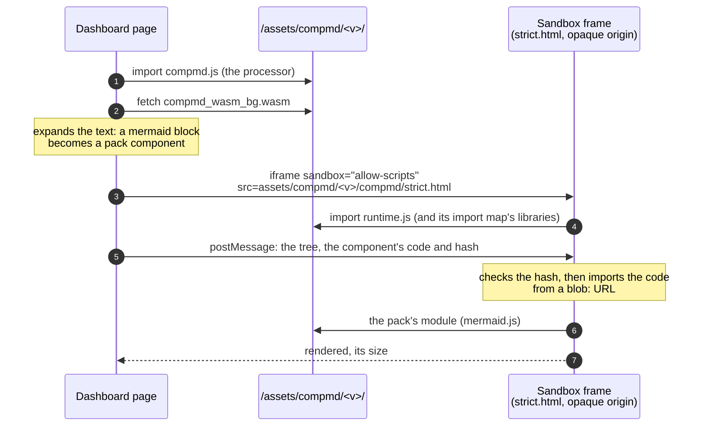
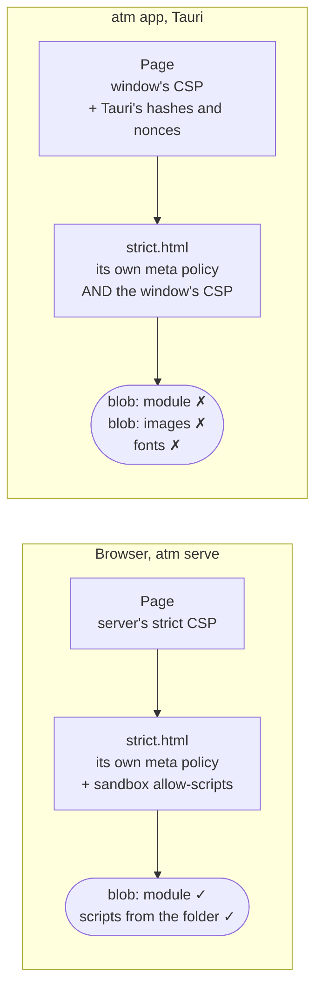
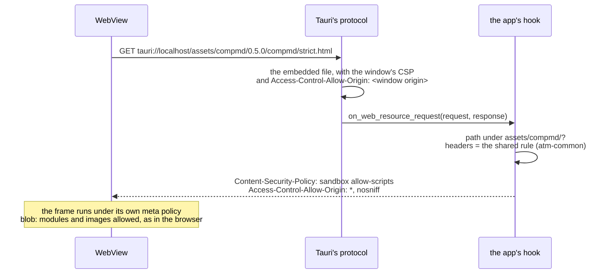

# CompMD in the atm app (Tauri)

Status: **proposal** (T-502), 2026-11-08. Builds on [compmd-rendering-design.md](compmd-rendering-design.md) (how the
dashboard renders with CompMD, §2 and §3c), the [Tauri guide](guides/tauri.md) and
[security-architecture.md](security-architecture.md) (I13, I26).

## 1. Problem

In the atm app, CompMD's output doesn't render: no Mermaid diagram draws. In debug builds (`cargo run -p atm-app`)
task text also showed as raw Markdown and the layout was off: the status bar wasn't pinned to the bottom. The same
dashboard, the same build of it, works in the browser under `atm serve`.

The cause is one assumption. CompMD's design (and `atm serve`'s) gives **each document its own policy**:

- the dashboard's page gets a strict CSP from the server;
- each sandbox frame (`strict.html`, `permissive.html`) gets only `sandbox allow-scripts` from the server and brings
  its own, different policy in a `<meta>` tag;
- CompMD's files are readable from anywhere (`Access-Control-Allow-Origin: *`), because the frames have an opaque
  origin.

Tauri gives **every HTML file the window's one policy**, edits that policy as it builds the app, and sends its own
headers for every file. Nothing in its config makes one file's policy differ from another's. So in the app, a frame
runs under the window's policy as well as its own, and the two together refuse what the frame needs.

Each fix so far was made from what a symptom suggested, and three of them changed the app's security policy. This
document sets out what the app has to do, and proposes one way to do it.

## 2. Background

### 2.1 How a diagram is drawn



The frame's own policy, in `strict.html`:

```
default-src 'none'; script-src 'self' blob: 'sha256-…'; style-src 'self' 'unsafe-inline'; object-src 'none';
base-uri 'none'; form-action 'none'; worker-src 'none'; img-src data: blob:; font-src 'self'; frame-src 'none'
```

Its runtime turns a component's code into a `Blob` and imports it from a `blob:` URL (`URL.createObjectURL` in
`runtime.js`), after checking its hash against the one `@compmd/vite` recorded. That is why its policy allows
`blob:` scripts, and a fallback (the block's code) is drawn by the same runtime: when the runtime itself can't run,
the frame shows **nothing**, not even the code.

### 2.2 What `atm serve` sends

| File | Headers (`crates/atm-api`) |
|---|---|
| the page (`/projects/…`, `/board`, …) | the strict CSP: own scripts by hash, CompMD's folder for scripts and frames, `'wasm-unsafe-eval'`, `connect-src 'self'`, `frame-ancestors 'none'` (I13); `nosniff`, CORP same-origin |
| CompMD's files (`/assets/…`, `assets.rs`) | `Access-Control-Allow-Origin: *`, `Cache-Control: no-cache`, `nosniff`, CORP same-origin |
| CompMD's frame documents (`.html` under `/assets/`) | as above, plus `Content-Security-Policy: sandbox allow-scripts` (sandboxed even if opened alone) |

A frame document under `atm serve` is under **its own** `<meta>` policy only; the header adds the sandbox, not script
rules.

### 2.3 What Tauri does

From Tauri's documentation, its source (2.12.5) and this project's tests:

1. **`csp` is "injected on all HTML files"** of the built app, sent as a `Content-Security-Policy` header by Tauri's
   protocol. There is no per-file policy in the config. *(Config reference; the app's test
   `compmds_frames_are_served_with_a_policy_the_page_can_frame` reads it from Tauri's asset resolver.)*
2. **Tauri edits that policy at compile time:** it adds the hashes of each file's inline scripts, and a nonce for
   styles and external scripts. `dangerousDisableAssetCspModification` turns that off, for all directives or the ones
   listed. *(CSP page; config reference.)*
3. **A nonce makes the browser ignore `'unsafe-inline'`** (CSP Level 3). With Tauri's nonce in `style-src`, every
   `style="…"` attribute the dashboard sets is refused, which is what broke the layout.
4. **`devCsp` is used "on development"**, and `csp` there too when there is no `devCsp`. In practice that means every
   debug build: `cargo run`, `cargo tauri dev`, the tests. *(Config reference; the test above saw `devCsp`.)*
5. **`cargo tauri dev` without a `devUrl` runs the CLI's own server**, on `http://127.0.0.1:1430`, and loads the page
   from there, with a live-reload script added to each HTML file. A built app loads it from `tauri://localhost`
   (`http://tauri.localhost` on Windows). *(Config reference `build.devUrl`; Hakan's console in `cargo tauri dev`.)*
6. **Tauri's own headers:** its protocol answers with `Access-Control-Allow-Origin: <the window's origin>`, not `*`.
   `security.headers` adds headers to every response, but only from a fixed list, which doesn't include
   `Access-Control-Allow-Origin`. *(Tauri's `protocol/tauri.rs`; HTTP headers page.)*
7. **Frames get no IPC.** Since CVE-2024-35222, Tauri injects its IPC script into no frame, and the invoke key stops
   frames it didn't set up from calling commands. CompMD's frames can't reach the app's commands
   (`the_main_windows_capability_lets_it_call_the_commands` checks a page from elsewhere is refused).
8. **One hook changes responses per request:** `WebviewWindowBuilder::on_web_resource_request` (Tauri issue #3533's
   `on_request`), called for each response of Tauri's protocol, with the response's headers to change. Tauri's own
   documentation shows it changing the CSP of an HTML response.



A browser enforces every policy a document has: a script runs only if each one allows it. The window's policy has
no `blob:`, so in the app the frame's component code is refused even when everything else is right.

### 2.4 What T-502 changed so far

| Change | Why | State |
|---|---|---|
| `frame-ancestors 'none'` out of the window's `csp` | the frames got it too (fact 1), so the page couldn't frame them | Hakan's console showed errors from inside `strict.html`: the frame now loads |
| `connect-src` allows CompMD's folder | CompMD fetches its WebAssembly; `atm serve` allows it with `'self'` | needed with any proposal below |
| `dangerousDisableAssetCspModification: ["style-src"]` | Tauri's nonce disabled `'unsafe-inline'` (facts 2, 3) | not yet checked in a window |
| `devCsp`: the `csp` plus the CLI's server and its live-reload socket | debug builds use it (facts 4, 5); a test keeps it in step with `csp` | not yet checked in a window |
| tests on what Tauri serves (its asset resolver), not on `tauri.conf.json` | the earlier test read the config, which is how the problem got through | in the suite |

None of these makes a diagram draw: the frame still runs under the window's policy.

## 3. Proposal: the app serves CompMD's folder as `atm serve` does

The app keeps the page under Tauri's policy, unchanged, and gives the files under `assets/compmd/` the headers
`atm serve` gives them, through Tauri's response hook (fact 8). Each document again has the policy it was built
for, as in the browser.



### 3.1 The change

1. **One rule for CompMD's files' headers,** in `atm-common` (a pure function from a path to its headers: CORS `*`,
   `nosniff`, and `sandbox allow-scripts` for an `.html` file), used by `atm-api`'s `assets.rs` and by the app. The
   front ends depend only on atm-lib and atm-common (ADR-003 §4), so the rule can't stay in `atm-api`.
2. **The main window is built in the app's `setup`** from its config entry (`WebviewWindowBuilder::from_config`),
   with the hook; the `windows` list in `tauri.conf.json` is left empty so Tauri doesn't make a second one.
3. **The hook** changes only responses whose path is under `/assets/compmd/`: it removes Tauri's
   `Content-Security-Policy` and `Access-Control-Allow-Origin` and sets the shared rule's headers. Every other
   response, the page's included, is left as Tauri made it.
4. **The page's policy goes back to I13's parity:** `frame-ancestors 'none'` returns (the frames no longer get the
   window's policy), and `connect-src` keeps CompMD's folder. `dangerousDisableAssetCspModification: ["style-src"]`
   stays: the server's policy allows inline styles too, and Tauri's nonce would refuse them.

### 3.2 What it doesn't change

- The page's scripts stay allowed by hash and from CompMD's folder only; no `blob:`, `data:` or `'self'` in its
  `script-src` (CVE-2026-95626).
- The frames still get no IPC (fact 7); the capability test stays as it is.
- The dashboard's code is unchanged: the same page in the browser and the app.

### 3.3 Development

The hook applies to Tauri's protocol. Under `cargo tauri dev` the page and its files come from the CLI's server
(fact 5), which the hook doesn't see, so its frames would still get `devCsp` and no diagram would draw. Two ways,
to settle in the first step (§3.5):

- **`cargo run -p atm-app` is the loop for anything CompMD draws:** it serves from `tauri://localhost`, through the
  hook, as the bundle does. `cargo tauri dev` stays for the rest (the Tauri guide says which to use when).
- **`build.devUrl` set to the dashboard's Vite dev server** (`pnpm run dev`), whose `build/dev-api.ts` already
  forwards `assets/` to `atm _serve`, which sends the headers above. Its own CSP (`build/security-headers.ts`) would
  then be the page's in development.

### 3.4 Tests

- **The hook's rule**, a unit test: a frame document under `assets/compmd/` comes out with `sandbox allow-scripts`
  and CORS `*`, without the window's CSP; any other file (the page) comes out as Tauri made it.
- **`atm serve` and the app agree**: both use the one function from `atm-common`, and each has a test on its own
  output.
- The existing tests on what Tauri serves stay, with the page's `frame-ancestors` back.
- **By hand, in a window, both builds**, with T-502's four test diagrams and Help: they draw, the broken one shows
  its code, Markdown is formatted, the layout is right. The [Tauri guide](guides/tauri.md) makes this check part of
  any task that changes the window.

### 3.5 Order

1. **A check first, before any code:** with the hook in a branch, does WebKit let the opaque-origin frame load its
   modules from `tauri://localhost` with `Access-Control-Allow-Origin: *`? It works for `http:` in every browser; a
   custom scheme in WKWebView has not been checked here.
2. If it does: the change above, its tests, the security doc (I26: the frames' headers in the app), the guide.
3. If it doesn't: back to this document, with what WebKit refused (the alternatives in §4 don't fix that either;
   it would need a frame origin WebKit treats as `http:`, such as `http://<scheme>.localhost`).

## 4. Discarded alternatives

### A. `blob:` (and the frame's other sources) in the window's policy

Config only. The window's policy would allow `blob:` scripts and images, and the frames would run.

**Discarded:** it loosens the **page's** policy, not only the frames'. CVE-2026-95626 is exactly this case: with
`blob:` or `data:` in `script-src`, Tauri's nonce protection does nothing, since those sources stay allowed when a
nonce is present. The page would allow more than under `atm serve`, and I26 would no longer be parity with I13.

### B. No `csp` in Tauri; each HTML file carries its own `<meta>` policy

With no `csp`, Tauri adds no policy anywhere ("CSP protection is enabled only if you set a CSP"). The frames already
carry theirs; the dashboard's build would write one into the page.

**Discarded:**
- One built page serves both the browser and the app, and a policy must name CompMD's folder by origin
  (`http://127.0.0.1:<port>` in one, `tauri://localhost` in the other). Either the page is built twice, or its
  `<meta>` policy allows `'self'`, which the server's policy refuses.
- Tauri's own protection (its hashes and nonces) goes; any HTML file without its own policy would get none.
- It doesn't set `Access-Control-Allow-Origin: *` on CompMD's files (fact 6), so the frame's module loads still
  depend on WebKit accepting Tauri's own value.

### C. `dangerousDisableAssetCspModification: true`

**Discarded:** it stops Tauri adding hashes and nonces; it doesn't stop it putting the policy on every HTML file.
The frames would still be under the window's policy, and the page's inline scripts would lose their hashes.

### D. A URI scheme of the app's own for CompMD (`atm-assets://`)

`register_uri_scheme_protocol` serves CompMD's files on a scheme of their own, with any headers.

**Discarded for now:** a new origin per platform (`atm-assets://localhost` on macOS and Linux,
`http://atm-assets.localhost` on Windows) that the page and both policies must name, and the page's code would need
to know it is in the app to use it, when the hook does the same on the files' current paths. It stays the fallback
if WebKit refuses the opaque frame's loads from `tauri://` (§3.5, step 3), since the Windows-style origin is `http:`.

### E. The app's window loads the dashboard from `atm serve`

The window would open `http://127.0.0.1:<port>/`, and every header would be the server's.

**Discarded:** that's the design T-457 moved away from (Hakan: one window, the app's own commands over IPC, no local
server). The app would depend on a running server, and a page from a local port would have the app's capabilities.

### F. Mermaid drawn in the page, outside the sandbox

**Discarded:** task text is untrusted, and Mermaid draws its labels as markup; the strict frame is what keeps it
from the page ([compmd-rendering-design.md](compmd-rendering-design.md) §3c). Drawing diagrams is also CompMD's
job, not atm's.

### G. Tauri's isolation pattern

**Discarded:** it puts a sandboxed frame between the page and the IPC, to check commands. It doesn't change which
policy CompMD's frames get.

## Appendix: research on existing software

What others do when a desktop shell's web view shows sandboxed content with its own policy. Most of what is
published is about Electron and VS Code; for Tauri there are framework issues and advisories rather than apps. The
community guides found were checked against Tauri's documentation and source before anything here relied on them.

### Tauri itself

- **Its isolation pattern** puts a frame with `sandbox="allow-scripts"` in the page (`scripts/isolation.js`), served
  by its own protocol (`protocol/isolation.rs`), which **sets that frame's CSP header itself**. Tauri solves its own
  frame-in-the-page problem the way §3 proposes: per-response headers, from code, not from config.
- **Issue #3533** asked to change the CSP at runtime (for user-provided URLs). The maintainers declined changing it
  from the frontend, made the CSP configurable as an object, and added `WindowBuilder::on_request`, today
  `on_web_resource_request`, as the Rust-side way to change responses.
- **CVE-2024-35222 / GHSA-57fm-592m-34r7:** frames could reach the app's IPC. Since 2.0.0-beta.20 Tauri injects its
  IPC script into no frame, and its advice for untrusted content is a frame without scripts, or a separate window or
  webview.
- **CVE-2026-95626 / GHSA-6vxm-x265-58qf:** `blob:` or `data:` in `script-src` cancel Tauri's nonce protection, which
  is why alternative A is out.

### VS Code webviews (Electron)

Each webview is a frame on an origin of its own (`vscode-webview://<id>`), with its own CSP, which the extension
writes, using a `cspSource` for its resources. Its resources are served by a service worker in the webview, and
messages go by `postMessage`. Published issues: CVE-2021-43908, where a webview's message check trusted a
`parentOrigin` query parameter; and the W3C ServiceWorker discussion (Matt Bierner, 2019) on serving resources to
sandboxed frames with a unique origin. Lesson for atm: an origin and a policy per kind of content, set where the
content is served; never trust what the frame says about its parent.

### Electron apps

Electron applies the CSP header and `<meta>` policies like a browser, and apps set headers per URL with
`session.webRequest.onHeadersReceived` (the Electron docs' example sets a CSP there; recent versions need a URL
filter on it). Pages loaded from `file://` get no headers that way and need a `<meta>` policy. This is the same shape
as Tauri's `on_web_resource_request`: one hook, per-response headers.

### Not found

No published Tauri app was found that runs CompMD-like sandboxed frames with their own policy; Obsidian's handling
of plugin frames isn't documented.

## References

- Tauri: [Content Security Policy](https://v2.tauri.app/security/csp/),
  [configuration reference](https://v2.tauri.app/reference/config/) (`csp`, `devCsp`,
  `dangerousDisableAssetCspModification`, `headers`, `build.devUrl`), [HTTP headers](https://v2.tauri.app/security/http-headers/),
  [issue #3533](https://github.com/tauri-apps/tauri/issues/3533),
  [GHSA-57fm-592m-34r7](https://github.com/advisories/GHSA-57fm-592m-34r7) (CVE-2024-35222),
  [CVE-2026-95626](https://app.opencve.io/cve/CVE-2026-95626) (GHSA-6vxm-x265-58qf),
  [isolation.js](https://docs.rs/crate/tauri/2.5.1/source/scripts/isolation.js),
  [isolation.rs](https://docs.rs/crate/tauri/2.9.2/source/src/protocol/isolation.rs)
- CSP: [MDN `script-src` (`'unsafe-inline'` with a nonce)](https://developer.mozilla.org/en-US/docs/Web/HTTP/Reference/Headers/Content-Security-Policy/script-src),
  [MDN `frame-ancestors`](https://developer.mozilla.org/en-US/docs/Web/HTTP/Reference/Headers/Content-Security-Policy/frame-ancestors)
- VS Code: [CVE-2021-43908 write-up](https://www.hacktron.ai/blog/posts/vscode-rce),
  [ServiceWorker issue (2019)](https://lists.w3.org/Archives/Public/public-webapps-github/2019Jun/0650.html)
- Electron: [webRequest](https://electronjs.org/docs/api/web-request)
- atm: [compmd-rendering-design.md](compmd-rendering-design.md), [security-architecture.md](security-architecture.md)
  (I13, I26), [guides/tauri.md](guides/tauri.md), `crates/atm-api/src/assets.rs`, `app/src-tauri/tauri.conf.json`
