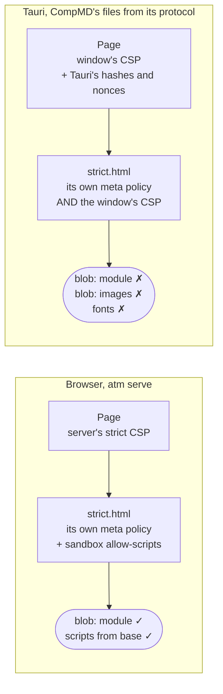
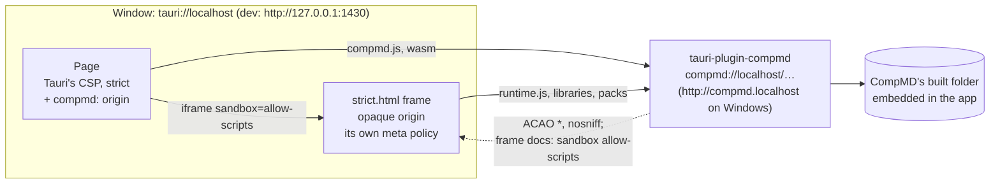
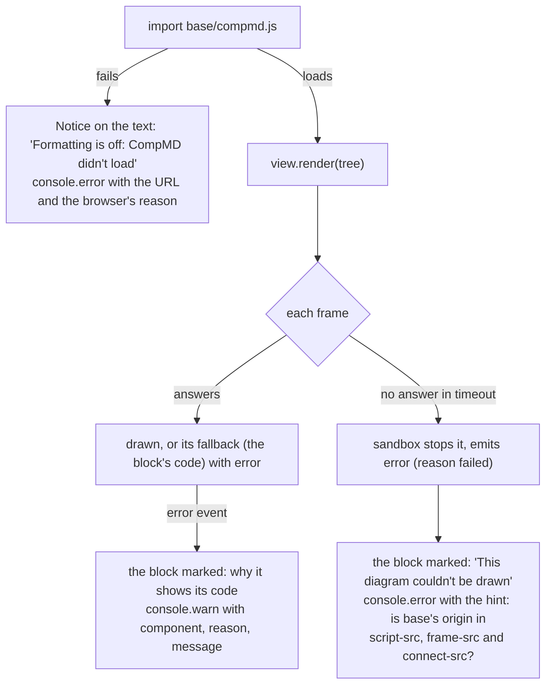

# CompMD in a Tauri app

Status: **accepted** (T-502, T-503), 2026-11-08, reviewed by Hakan; the decision is
[ADR-004](adr/ADR-004-compmd-in-tauri-through-its-own-protocol.md). How to show CompMD's output in a Tauri app, worked out for the atm
app, and written as the way to do it for any Tauri app that uses CompMD. Builds on
[compmd-rendering-design.md](compmd-rendering-design.md) (how the dashboard renders with CompMD, §2 and §3c), the
[Tauri guide](guides/tauri.md) and [security-architecture.md](security-architecture.md) (I13, I26).

What this aims for:

- **Straightforward for a Tauri developer:** add a plugin, add one origin to the CSP, give CompMD its base. No
  rewriting how windows are made, no other Tauri setting changed, `cargo tauri dev` working as it always does.
- **No hacks:** only Tauri's documented, stable APIs, used the way Tauri itself uses them.
- **Nothing fails silently:** every way this can go wrong shows on the page and in the console, with its cause.
- **The app's own security unchanged:** the page's policy stays as strict as without CompMD.

## 1. Problem

In the atm app, no Mermaid diagram drew. In debug builds (`cargo run -p atm-app`), task text also showed as raw
Markdown and the layout was off. The same dashboard works in the browser under `atm serve`. And none of it said why:
a diagram's place stayed empty, and text fell back to its source without a word on the page.

The cause is an assumption CompMD and `atm serve` share. **Each document has its own policy:**

- the dashboard's page gets a strict CSP from the server;
- each sandbox frame (`strict.html`, `permissive.html`) gets only `sandbox allow-scripts` from the server, and brings
  its own, different policy in a `<meta>` tag;
- CompMD's files are readable from anywhere (`Access-Control-Allow-Origin: *`), because the frames have an opaque
  origin.

Tauri gives **every HTML file it serves the window's one policy**, edits that policy as it builds the app, and sends
its own headers for every file it serves. Nothing in its configuration makes one file's policy differ from another's.
So in the app a frame runs under the window's policy as well as its own, and the two together refuse what it needs.

Each fix so far was made from a symptom. This document says what CompMD needs from any host (§3), and how a Tauri
app gives it that (§4).

## 2. Background

### 2.1 How a diagram is drawn

```mermaid
sequenceDiagram
    autonumber
    participant Page as Host page
    participant Files as CompMD's files (base)
    participant Frame as Sandbox frame<br/>(strict.html, opaque origin)
    Page->>Files: import compmd.js (the processor)
    Page->>Files: fetch compmd_wasm_bg.wasm
    Note over Page: expands the text: a mermaid block<br/>becomes a pack component
    Page->>Frame: iframe sandbox="allow-scripts"<br/>src = base + compmd/strict.html
    Frame->>Files: import runtime.js and its import map's libraries
    Page->>Frame: over its port: the part, the component's code and hash
    Note over Frame: checks the hash, imports the code<br/>(a blob: module), draws
    Frame-->>Page: drawn, its size; or an error, with why
    Note over Page: no answer within timeout (5 s):<br/>the frame is stopped, the view emits error
```

The frame's own policy, in `strict.html`:

```
default-src 'none'; script-src 'self' blob: 'sha256-…'; style-src 'self' 'unsafe-inline'; object-src 'none';
base-uri 'none'; form-action 'none'; worker-src 'none'; img-src data: blob:; font-src 'self'; frame-src 'none'
```

What matters from `@compmd/sandbox`'s API (`createSandbox`, its `HostRuntimeOptions`):

- **`base`**: where the host serves CompMD's frame documents, "a full URL, or one relative to the page". A host on
  another origin is supported as it is.
- **`timeout`**: how long a frame may not answer before it is stopped (5000 ms by default).
- **The `error` event**: "a component shows its fallback, why", with a reason (`missing`, `threw`, `failed`,
  `not-here`) and a message. The `rendered`, `loaded` and `settled` events say when the page is done.

The frame's runtime turns component code into a `Blob` and imports it from a `blob:` URL (`runtime.js`), after
checking its hash. When the runtime itself can't run, the frame can't draw a fallback either: its place stays empty,
and only the host can say why.

### 2.2 What `atm serve` sends

| File | Headers (`crates/atm-api`) |
|---|---|
| the page (`/projects/…`, `/board`, …) | the strict CSP: own scripts by hash, CompMD's folder for scripts and frames, `'wasm-unsafe-eval'`, `connect-src 'self'`, `frame-ancestors 'none'` (I13); `nosniff`, CORP same-origin |
| CompMD's files (`/assets/…`, `assets.rs`) | `Access-Control-Allow-Origin: *`, `Cache-Control: no-cache`, `nosniff`, CORP same-origin |
| CompMD's frame documents (`.html` under `/assets/`) | as above, plus `Content-Security-Policy: sandbox allow-scripts` (sandboxed even if opened alone) |

A frame document under `atm serve` has only its own `<meta>` policy. The header adds the sandbox, not script rules.

### 2.3 What Tauri does

From Tauri's documentation and source (2.12.5), and this project's tests. ✓ marks what a test or a run here showed.

1. **`csp` is "injected on all HTML files"** of the built app, as a header from Tauri's protocol. There is no
   per-file policy. ✓ (`compmds_frames_are_served_with_a_policy_the_page_can_frame`, from Tauri's asset resolver)
2. **Tauri edits the policy at compile time:** it adds each file's inline-script hashes, and a nonce for styles and
   external scripts. `dangerousDisableAssetCspModification` turns that off for all directives or the ones listed.
3. **A nonce makes the browser ignore `'unsafe-inline'`** (CSP Level 3). With Tauri's nonce in `style-src`, every
   `style="…"` attribute a page sets is refused. ✓ (atm's layout)
4. **`devCsp` is used "on development"**, and `csp` there too without one: in practice every debug build (`cargo run`,
   `cargo tauri dev`, tests). ✓
5. **`cargo tauri dev` without a `devUrl` runs the CLI's own server**, on `http://127.0.0.1:1430`, and loads the page
   from there. A built app loads it from `tauri://localhost` (`http://tauri.localhost` on Windows). ✓ (Hakan's
   console)
6. **Tauri's protocol answers with `Access-Control-Allow-Origin: <the window's origin>`**, not `*`. Its `headers`
   setting adds headers to every response, from a fixed list without `Access-Control-Allow-Origin`.
7. **Frames get no IPC.** Since CVE-2024-35222, Tauri injects its IPC script into no frame, and its invoke key stops
   frames it didn't set up from calling commands.
8. **Custom URI schemes are the app's own.** `register_uri_scheme_protocol` (also on a plugin's builder) serves a
   scheme from the app's code, with the headers it sets: on macOS and Linux as `<scheme>://localhost/…`, on Windows
   and Android as `http://<scheme>.localhost/…`. `convertFileSrc(path, scheme)` in `@tauri-apps/api` gives the right
   URL on each. Tauri builds its own features this way: the `asset:` protocol (whose CSP lines its documentation
   shows) and the isolation pattern's `isolation:` protocol, which sets its frame's CSP itself.
9. **One hook changes Tauri's own responses:** `WebviewWindowBuilder::on_web_resource_request`, on a window built in
   code, called for each response of Tauri's protocol (issue #3533).



A browser enforces every policy a document has: a script runs only if each allows it. The window's policy has no
`blob:`, so a frame served by Tauri's protocol has its component code refused, whatever else is right.

### 2.4 What T-502 changed so far

| Change | Why | With this proposal |
|---|---|---|
| `frame-ancestors 'none'` out of the window's `csp` | the frames got it too (fact 1) | **returns**: the frames no longer come from Tauri's protocol |
| `connect-src` allows CompMD's folder | CompMD fetches its WebAssembly | **becomes** CompMD's origin (§4.1) |
| `dangerousDisableAssetCspModification: ["style-src"]` | Tauri's nonce disabled `'unsafe-inline'` (facts 2, 3) | **stays**: atm's own page sets `style` attributes; not about CompMD |
| `devCsp`: `csp` plus the CLI's server and its live-reload socket | debug builds use it (facts 4, 5) | **shrinks** to `csp` plus the live-reload socket: CompMD's origin is the same in every build |
| tests on what Tauri serves, not on `tauri.conf.json` | the old test read the config, which is how this got through | **stay** |

### 2.5 Why nothing said what was wrong

| What failed | What the page showed | Where the cause went |
|---|---|---|
| `compmd.js` couldn't load or start (`connect-src`, or `script-src` naming the wrong origin) | the text as written, as if it were plain text | `console.error` in `CompMd.svelte`; nothing on the page |
| a frame's runtime refused (the window's policy) | an empty box, not even the block's code | the sandbox stopped the frame after 5 s and emitted `error`; **`CompMd.svelte` doesn't listen for `error`** |
| a refused `style` attribute | a broken layout | the console's CSP messages only |

The second is atm's: CompMD reports it, and atm drops it. §4.3 makes each of these show.

## 3. What CompMD needs from a host

Independent of Tauri: what any host page (a server, a desktop shell, an extension) gives CompMD.

| | The host… | Why |
|---|---|---|
| **H1** | serves CompMD's built folder at a **base** (`@compmd/vite`'s output), every file with `Access-Control-Allow-Origin: *` | the frames have an opaque origin and load their modules with CORS |
| **H2** | serves each frame document with **no policy but its own `<meta>`**, and `Content-Security-Policy: sandbox allow-scripts` | the frame's policy is what makes it strict; another policy on top refuses its `blob:` modules |
| **H3** | lets its page load from the base: `script-src <base> 'wasm-unsafe-eval'`, `frame-src <base>`, `connect-src <base>` | the processor, its WebAssembly, the frames |
| **H4** | passes the base to `createSandbox({ base })`, and the processor's URL from the same base | one place says where CompMD is |
| **H5** | listens for the view's `error` event, and for the load of `compmd.js` failing, and shows both | the frame can't report what stops it from running |

Under `atm serve` today, H1 to H4 hold, and H5 doesn't. In Tauri, H1 and H2 can't hold for files Tauri's own
protocol serves (facts 1 and 6), so CompMD's files come from a protocol the app controls (fact 8).

## 4. Proposal: CompMD's own protocol, from a Tauri plugin

A small Tauri plugin, `tauri-plugin-compmd`, serves CompMD's built folder on a `compmd:` scheme with H1 and H2's
headers. The page keeps Tauri's policy, made strict again, plus CompMD's origin (H3), and gives CompMD the base on
that origin (H4). This is how Tauri ships its own `asset:` and `isolation:` protocols.



### 4.1 What a Tauri developer does

1. **Add the plugin, with CompMD's built folder**, embedded when the app is built:

   ```rust
   tauri::Builder::default()
       .plugin(tauri_plugin_compmd::init(tauri_plugin_compmd::embed!("../dist/compmd")))
   ```

   The folder is what `@compmd/vite` built (H1). `embed!` fails the build, naming the folder, when it is missing or
   has no frame documents.
2. **Add CompMD's origin to the CSP** in `tauri.conf.json` (H3), both forms, as Tauri's documentation does for
   `asset:`:

   ```json
   "script-src": "'wasm-unsafe-eval' compmd://localhost http://compmd.localhost",
   "frame-src": "compmd://localhost http://compmd.localhost",
   "connect-src": "ipc: http://ipc.localhost compmd://localhost http://compmd.localhost"
   ```

   The same lines in `devCsp`, if the app has one: the origin is the same in every build.
3. **Give CompMD its base** in the page (H4), from Tauri's own helper:

   ```ts
   import { convertFileSrc, isTauri } from '@tauri-apps/api/core';
   // compmd://localhost/ on macOS and Linux, http://compmd.localhost/ on Windows and Android
   const origin = isTauri() ? convertFileSrc('', 'compmd') : '/';
   const base = `${origin}assets/compmd/${version}/`;
   const compmd = await import(/* @vite-ignore */ `${base}compmd.js`);
   const sandbox = compmd.createSandbox({ ...compmd.sandbox, base: `${base}compmd/` });
   ```

   `convertFileSrc` percent-encodes its path, `/` included, so it is called with an empty path and the rest added
   after it. The plugin serves the folder at the same paths as the browser's server (`/assets/compmd/<v>/…`), so the
   URLs `@compmd/vite` wrote, relative to `base`, resolve the same in both.
4. **Listen for errors** (H5): see §4.3.

Nothing else changes: windows are still declared in `tauri.conf.json`, Tauri still edits the policy as it does, and
`cargo tauri dev` works as usual.

### 4.2 The plugin

About a hundred lines, with no dependency but Tauri:

- `register_uri_scheme_protocol("compmd", …)` on the plugin's builder.
- **A request is served only if** its path is a file of the embedded folder: plain segments, no `..`, and a known
  type (`.js`, `.mjs`, `.wasm`, `.html`, `.json`, `.css`). Anything else is a `404` whose body names the path, and a
  line in the app's log.
- **Headers:** the content type by extension; `Access-Control-Allow-Origin: *`; `X-Content-Type-Options: nosniff`;
  `Cache-Control: no-cache`; for `.html`, `Content-Security-Policy: sandbox allow-scripts`. Nothing else: the frame's
  own `<meta>` policy is the one that rules it (H2).
- **Only `GET`**; any other method is a `405`.
- The scheme is not IPC: a page or frame on `compmd:` can't call the app's commands (fact 7). A test in atm checks
  it (§4.5).

In atm, `atm-api`'s `assets.rs` sends the same headers, so the browser and the app agree; each has a test on that
table (H1, H2).

### 4.3 Nothing fails silently



- **The host listens for `error`** on every view (H5), shows a short note at the block, and logs the event's
  component, reason and message. A frame that never answered is named as such, with the one cause it almost always
  is: the base's origin missing from the page's policy, or CompMD's files served with another policy on top.
- **CompMD failing to load shows on the page**, not only in the console: the text is shown as written, with a note
  that its formatting is off and why.
- **The plugin answers every refusal with a reason**, a `404` or `405` with a body, logged.
- **The build fails** when the folder is missing, instead of an app whose every frame is a `404`.

For CompMD (a request, not atm's to change): when a frame is stopped, the sandbox could show the block's fallback in
the host's page itself, as it does for a component that fails inside a working frame, so the reader sees the code
rather than an empty box.

### 4.4 Development

`cargo tauri dev` loads the page from the CLI's server (fact 5); CompMD's files still come from the plugin, which is
in the app in every build. So debug builds, `cargo tauri dev` and the bundle load CompMD the same way, from the same
origin. `devCsp` adds only what the CLI itself needs: its live-reload socket.

### 4.5 Tests

- **The plugin**, unit tests on its handler: a frame document comes with H2's headers; a module with H1's; `..`, an
  unknown file and an unknown type are a `404` with a reason; `POST` is a `405`.
- **The app's policy** (`the_windows_csp_is_strict`): CompMD's origin, both forms, in `script-src`, `frame-src` and
  `connect-src`; no `blob:`, `data:` or `'self'` in `script-src`; `frame-ancestors 'none'` back.
- **No IPC from `compmd:`:** the app's IPC test sends a command as `compmd://localhost`, which is refused.
- **atm serve and the plugin agree** on H1 and H2: each has a test on the same table.
- **The page reports failures:** unit tests on the dashboard's CompMD component, with a view that emits `error` and
  a `compmd.js` that fails to load: the note shows, and the console says why.
- **By hand, in a window, in both `cargo tauri dev` and `cargo run -p atm-app`:** T-502's four test diagrams and Help
  draw, the broken one shows its code, Markdown is formatted, the layout is right. The [Tauri guide](guides/tauri.md)
  makes this check part of any task that changes the window.

### 4.6 Who owns the plugin

The plugin is CompMD's integration with a Tauri host, not atm's logic: any Tauri app that uses CompMD needs the same
one. CompMD is the natural home (a `tauri-plugin-compmd` crate, and this document's §3 and §4.1 as its guide). Until
CompMD has it, atm builds it as a crate of its own in atm's workspace (`crates/tauri-plugin-compmd/`), with no
dependency on atm's crates, so it can move as it is (ADR-004, decision 5).

### 4.7 Order

1. **A check first, in a branch:** the plugin's smallest form, in `cargo run -p atm-app` and `cargo tauri dev`, to
   see three things nothing here has shown yet:
   - WebKit lets the opaque-origin frame load modules from `compmd://localhost` with `Access-Control-Allow-Origin: *`
     (it does over `http:` in every browser; a custom scheme in WKWebView is unchecked);
   - Tauri adds no policy of its own to a custom scheme's responses (fact 8 says they are the app's);
   - every URL CompMD's sandbox makes comes from `base` (§4.1, step 3), none from the page's origin.
2. If all three hold: the plugin, the page's changes, the error handling, their tests, the security doc (I26: the
   `compmd:` protocol as an entry point), the Tauri guide.
3. If WebKit refuses the opaque frame's loads from a custom scheme: no option here fixes that on macOS (the hook's
   files are on a custom scheme too). Back to this document with what WebKit said.

## 5. Discarded alternatives

### 5.1 The options compared

| | Option | For a Tauri developer | Pros | Cons | Who uses it |
|---|---|---|---|---|---|
| **§4** | **CompMD's own protocol, from a plugin** (proposed) | add the plugin, one origin in the CSP, pass `base` | each document gets the policy it was built for; the page stays strict; the same origin in every build, `cargo tauri dev` included; a separate origin for CompMD; no change to how windows are made | a new protocol (an entry point, in the security doc); the page passes a full `base`; WebKit's opaque-frame loads from a custom scheme to check | Tauri's `asset:` and `isolation:` protocols; VS Code (`vscode-webview://`, an origin per webview) |
| H | The response hook on Tauri's protocol | build the window in code instead of `tauri.conf.json`, write the hook | no page change; no new origin | changes how windows are made; a file's headers decided in two places (Tauri, then the hook), hard to trace; misses `cargo tauri dev`; CompMD shares the page's origin | Tauri's docs show it for changing a CSP; Electron apps (`webRequest.onHeadersReceived`) |
| A | `blob:` in the window's policy | one config line | smallest change | loosens the page too; cancels Tauri's nonce protection (CVE-2026-95626) | no app found; it is the case the CVE describes |
| B | No Tauri `csp`; a `<meta>` policy per file | the page's build writes its policy | each file's own policy | the page built per origin, or `'self'` in its policy; Tauri's hashes and nonces gone; a file without `<meta>` gets nothing; no control of CORS | VS Code webviews (the extension writes the CSP `<meta>`); Electron pages from `file://` |
| C | `dangerousDisableAssetCspModification: true` | one setting | one setting | the frames are still under the window's policy; the page's inline scripts lose their hashes | community guides' examples |
| E | The window loads the page from a local server | run and supervise a server | every header the server's | a local port's page gets the app's capabilities; reverses T-457 | `tauri-plugin-localhost`, which its docs flag as a risk; code-server (a browser app) |
| F | Mermaid in the page, no sandbox | none | no frames | untrusted labels as markup in the page; drawing is CompMD's job (§3c of the rendering design) | no app found for untrusted text |
| G | Tauri's isolation pattern | an isolation app | checks every command | doesn't change the frames' policy | Tauri's advice for apps that load untrusted content |

### H. The response hook on Tauri's protocol

`WebviewWindowBuilder::on_web_resource_request` rewrites the headers of CompMD's files after Tauri has made them.

**Discarded:**
- **A Tauri developer's setup changes:** the hook exists only on a window built in code, so the window leaves
  `tauri.conf.json`. Every app using CompMD would have to do this, and get it right.
- **Two places decide a file's headers:** Tauri's protocol makes a response, the hook takes some of it back. When a
  frame fails, finding which of the two sent what is the hard-to-debug case this document wants to avoid.
- **`cargo tauri dev` isn't covered:** the CLI's server serves the files there, and the hook never sees them. A
  developer would see diagrams in one build and not in the other.
- **CompMD shares the page's origin:** a frame document opened without its sandbox would be the page's origin. Only
  the `sandbox` header guards it, as under `atm serve`; the plugin's own origin adds a layer.

### A. `blob:` (and the frame's other sources) in the window's policy

**Discarded:** it loosens the **page's** policy, not only the frames'. CVE-2026-95626 is exactly this case: with
`blob:` or `data:` in `script-src`, Tauri's nonce protection does nothing, since those sources stay allowed when a
nonce is present.

### B. No `csp` in Tauri; each HTML file carries its own `<meta>` policy

**Discarded:**
- One built page serves the browser and the app, and a policy must name CompMD's files by origin. Either the page is
  built twice, or its `<meta>` policy allows `'self'`, which the server's policy refuses.
- Tauri's own protection (its hashes and nonces) goes, for every app that does it; a file without a policy gets none.
- It doesn't set `Access-Control-Allow-Origin: *` on CompMD's files (fact 6).

### C. `dangerousDisableAssetCspModification: true`

**Discarded:** it stops Tauri adding hashes and nonces; it doesn't stop it putting the policy on every HTML file.
(Disabling it for `style-src` alone stays, for atm's page: §2.4.)

### E. The window loads the page from a local server

**Discarded:** the design T-457 moved away from (one window, the app's own commands over IPC, no local server). The
app would depend on a running server, and a page from a local port would have the app's capabilities.

### F. Mermaid drawn in the page, outside the sandbox

**Discarded:** task text is untrusted, and Mermaid draws its labels as markup; the strict frame keeps it from the
page ([compmd-rendering-design.md](compmd-rendering-design.md) §3c). Drawing is CompMD's job, not the host's.

### G. Tauri's isolation pattern

**Discarded:** it puts a sandboxed frame between the page and the IPC, to check commands. It doesn't change which
policy CompMD's frames get.

## Appendix: research on existing software

What others do when a desktop shell's web view shows sandboxed content with its own policy. Most of what is
published is about Electron and VS Code; for Tauri there are framework features, issues and advisories rather than
apps. Community guides found were checked against Tauri's documentation and source before anything here relied on
them.

### Tauri itself

- **The `asset:` protocol** serves files from disk on its own scheme (`asset://localhost`, `http://asset.localhost`
  on Windows), and Tauri's CSP documentation shows the app adding that origin to its policy: the shape §4.1 follows.
- **The isolation pattern** puts a frame with `sandbox="allow-scripts"` in the page (`scripts/isolation.js`), served
  by its own protocol (`protocol/isolation.rs`), which **sets that frame's CSP header itself**. Tauri solves its own
  frame-in-the-page problem with a protocol of its own, from code, not with config.
- **Issue #3533** asked to change the CSP at runtime. The maintainers declined changing it from the frontend, made
  the CSP configurable as an object, and added `WindowBuilder::on_request`, today `on_web_resource_request`.
- **CVE-2024-35222 / GHSA-57fm-592m-34r7:** frames could reach the app's IPC. Since 2.0.0-beta.20 Tauri injects its
  IPC script into no frame; its advice for untrusted content is a frame without scripts, or a separate window or
  webview.
- **CVE-2026-95626 / GHSA-6vxm-x265-58qf:** `blob:` or `data:` in `script-src` cancel Tauri's nonce protection.

### VS Code webviews (Electron)

Each webview is a frame on an origin of its own (`vscode-webview://<id>`), with its own CSP, written by the
extension, which uses a `cspSource` for its resources; resources are served by a service worker in the webview, and
messages go by `postMessage`. Published issues: CVE-2021-43908, where a webview's message check trusted a
`parentOrigin` query parameter; and the W3C ServiceWorker discussion (Matt Bierner, 2019) on serving resources to
sandboxed frames with a unique origin. Lesson: an origin and a policy per kind of content, set where the content is
served; never trust what a frame says about its parent.

### Electron apps

Electron applies the CSP header and `<meta>` policies as a browser does, and apps set headers per URL with
`session.webRequest.onHeadersReceived` (recent versions need a URL filter on it). Pages from `file://` get no headers
that way and need a `<meta>` policy. Electron apps also register their own schemes (`protocol.handle`) for the same
reason Tauri apps do.

### Not found

No published Tauri app was found that runs CompMD-like sandboxed frames with their own policy; Obsidian's handling
of plugin frames isn't documented.

## References

- Tauri: [Content Security Policy](https://v2.tauri.app/security/csp/),
  [configuration reference](https://v2.tauri.app/reference/config/) (`csp`, `devCsp`,
  `dangerousDisableAssetCspModification`, `headers`, `build.devUrl`),
  [HTTP headers](https://v2.tauri.app/security/http-headers/),
  [`convertFileSrc`](https://v2.tauri.app/reference/javascript/api/namespacecore/#convertfilesrc),
  [`Builder::register_uri_scheme_protocol`](https://docs.rs/tauri/latest/tauri/struct.Builder.html#method.register_uri_scheme_protocol),
  [plugin `Builder`](https://docs.rs/tauri/latest/tauri/plugin/struct.Builder.html),
  [issue #3533](https://github.com/tauri-apps/tauri/issues/3533),
  [GHSA-57fm-592m-34r7](https://github.com/advisories/GHSA-57fm-592m-34r7) (CVE-2024-35222),
  [CVE-2026-95626](https://app.opencve.io/cve/CVE-2026-95626) (GHSA-6vxm-x265-58qf),
  [isolation.js](https://docs.rs/crate/tauri/2.5.1/source/scripts/isolation.js),
  [isolation.rs](https://docs.rs/crate/tauri/2.9.2/source/src/protocol/isolation.rs)
- CompMD: `@compmd/sandbox`'s `createSandbox` and `HostRuntimeOptions` (`base`, `timeout`, the `error` event), in
  `dashboard/node_modules/@compmd/sandbox/dist/`
- CSP: [MDN `script-src`](https://developer.mozilla.org/en-US/docs/Web/HTTP/Reference/Headers/Content-Security-Policy/script-src)
  (`'unsafe-inline'` with a nonce),
  [MDN `frame-ancestors`](https://developer.mozilla.org/en-US/docs/Web/HTTP/Reference/Headers/Content-Security-Policy/frame-ancestors)
- VS Code: [CVE-2021-43908 write-up](https://www.hacktron.ai/blog/posts/vscode-rce),
  [ServiceWorker issue (2019)](https://lists.w3.org/Archives/Public/public-webapps-github/2019Jun/0650.html)
- Electron: [webRequest](https://electronjs.org/docs/api/web-request)
- atm: [compmd-rendering-design.md](compmd-rendering-design.md), [security-architecture.md](security-architecture.md)
  (I13, I26), [guides/tauri.md](guides/tauri.md), `crates/atm-api/src/assets.rs`, `app/src-tauri/tauri.conf.json`,
  `dashboard/src/lib/documents/CompMd.svelte`
